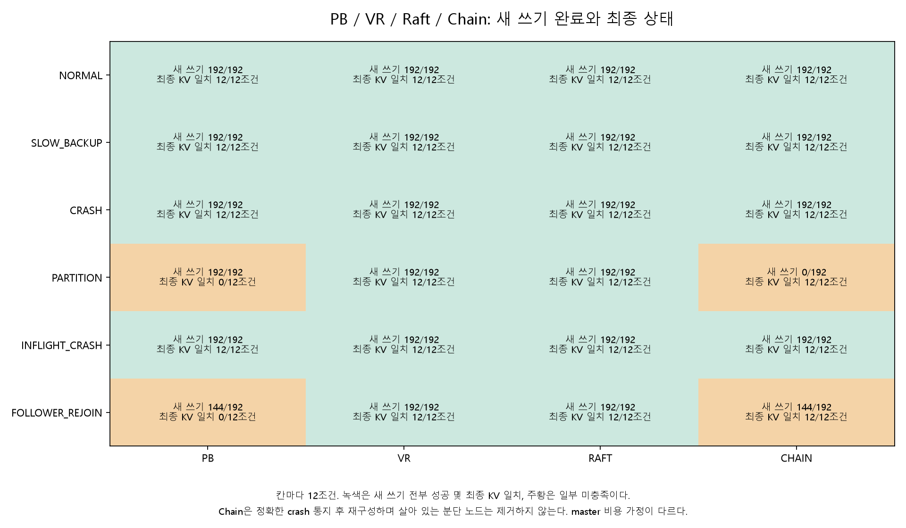
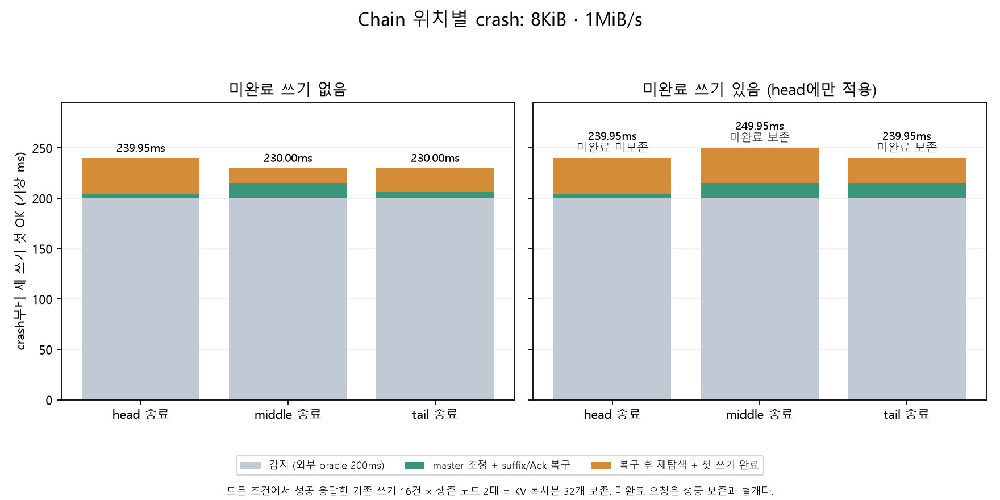

# Chain Replication 구현·비교 결과

2026-10-29 (Asia/Seoul). Chain 구현을 추가하고 **네 방식 공통 288조건 + Chain 위치별 crash 24조건 = 312조건**을 실행했다. 실제 서버가 아닌 가상 시간·방향별 FIFO 링크 모델이며, 공통 [설정·보장 전제](README.md)를 따른다.

- [공통 288조건 보고서](runs/run-2026-10-29T00-42-37.370281300Z-5b8d5890/repeat-001/results.md) · [CSV](runs/run-2026-10-29T00-42-37.370281300Z-5b8d5890/repeat-001/summary.csv)
- [위치별 24조건 보고서](runs/run-2026-10-29T00-42-37.370281300Z-5b8d5890/repeat-001/position-results.md) · [CSV](runs/run-2026-10-29T00-42-37.370281300Z-5b8d5890/repeat-001/position-summary.csv)

## 무엇을 구현했나

head에서 SET/DELETE를 받아 순서대로 적용·전달하고 **tail에서 확정·읽기**를 수행한다. tail Ack는 역방향으로 흘러 Sent를 해제한다. tail의 결과는 요청 future를 가진 head로 한 번 중계한다. 이 추가 peer 홉을 실제 측정에 포함했다.

외부 master는 생존 노드 전부를 freeze한 뒤, 적용 중이던 KV 작업을 끝내고 새 구성을 설치한다. Sent suffix는 peer 링크로 전달하고, 전 생존자의 적용·Ack·로그 일치 후 입장을 연다. 신뢰 master와 정확한 영구 crash 통지라는 전제이며 **분단된 노드를 임의로 제외하는 구현은 아니다**. CRAQ는 구현하지 않았다.

## 공통 비교

각 칸은 12조건(값 크기 2 × 링크 속도 2 × seed 3), 조건마다 새 쓰기 16건이다. Chain은 난수를 쓰지 않아 세 seed는 동일 조건 반복이다.

|시나리오|PB 성공|VR 성공|Raft 성공|Chain 성공|
|---|---:|---:|---:|---:|
|정상|192/192|192/192|192/192|192/192|
|느린 Backup 확인 +200ms|192/192|192/192|192/192|192/192|
|Primary/head crash|192/192|192/192|192/192|192/192|
|Primary/head 분단 후 repair|192/192|192/192|192/192|0/192|
|미완료 쓰기 중 Primary/head crash|192/192|192/192|192/192|192/192|
|Backup/middle 격리 후 repair|144/192|192/192|192/192|144/192|

공통 실험의 장애 전 성공 **18,432건**, 장애 후 성공 **4,320건**은 모두 생존 근거가 남았다. PB는 생존 KV, VR/Raft/Chain은 생존 로그에서 ID·명령·값을 확인했다. Chain은 72조건 모두 최종 생존 KV가 일치했다.

Chain은 head 분단 중 master가 강제 제외하지 않으므로 새 쓰기가 멈춘다. 각 논리 요청의 5초 예산 안에서 성공하지 못한 16건을 그대로 집계했다. repair 뒤에는 KV 일치만 관측하며, 새 probe를 추가하지 않았으므로 `0/192`를 repair 뒤 영구 쓰기 불능으로 해석하면 안 된다.

middle 격리 실험은 첫 4개 논리 쓰기를 격리 상태에서 시도한 뒤 repair한다. Chain은 그 4건을 완료하지 못했지만, repair 뒤 나머지 12건은 완료했다. PB도 완료 건수는 같았으나 최종 KV 일치가 0/12조건이고 Chain은 12/12조건이었다. PB에는 미완료 쓰기 복구와 분단 오판 처리가 없다는 범위 차이가 있다.

## 느린 노드와 정상 복제 비용

8KiB·1MiB/s·seed 1의 성공한 마지막 시도 RTT p99:

|방식|정상|느린 확인 +200ms|
|---|---:|---:|
|PB|9.947ms|209.947ms|
|VR|9.939ms|9.939ms|
|Raft|9.960ms|9.960ms|
|Chain|18.834ms|218.834ms|

Chain은 두 번의 순차 payload 전송과 tail→head 결과 중계가 필요하다. PB/VR/Raft는 Primary에서 두 노드로 동시에 전송하므로 현재 모델에서 순차 직렬화 비용이 다르다. Chain의 느린 조건은 tail Ack와 완료 중계를 모두 200ms 늦춘다. VR/Raft는 세 노드가 살아 있을 때 느린 Backup 하나를 기다리지 않고 과반수를 충족할 수 있다.

단일 in-flight인 Chain head는 tail의 직접 결과를 받더라도 역방향 Ack를 기다린다. 이 대표 조건에서 정상 새 쓰기 16건 사이에 BUSY 15회가 있었다. 따라서 위 RTT만으로 전체 처리량을 주장하지 않는다. 클라이언트 재시도 대기는 attempts·상태별 count와 첫 OK 지표를 함께 봐야 한다. pipeline 확장은 기존 멘토 질문으로 남겼다.

## head / middle / tail 각각의 crash

위치별 24조건 모두 새 쓰기를 재개했다. **성공 응답한 16건 × 생존 노드 2대 = KV 복사본 32개**가 모든 조건에서 보존됐다. 복구 완료 후 Sent는 0개였다.

8KiB·1MiB/s 대표 결과:

|종료 위치|미완료 없음: 첫 OK|head에만 미완료 쓰기 있음: 첫 OK|그 미완료 쓰기 보존|
|---|---:|---:|---|
|head|239.955ms|239.955ms|아직 전달하지 못해 미보존|
|middle|230.000ms|249.955ms|생존 head의 suffix를 새 tail로 전달해 보존|
|tail|230.000ms|239.955ms|새 tail까지 suffix를 전달해 보존|

감지는 전부 200ms이며, master 감지 후 입장 재개까지 4~15ms가 걸렸다. 첫 OK에는 이후 클라이언트 재탐색과 쓰기 완료가 추가된다. head가 생존하면 crash 직후 수락한 새 요청이 freeze 중 보존되어 복구 과정에서 확정될 수도 있다.

성공한 쓰기 보존과 미완료 쓰기 보존은 다르다. head에만 있던 쓰기는 head crash로 사라질 수 있고, middle/tail crash에서는 살아 있는 head에서 복구될 수 있다. 해당 요청은 어느 경우에도 이전 시도에서 OK를 받지 않았다. 두 번의 순차 crash 뒤 한 노드에서 계속 처리하는 경우는 별도 테스트로 검증했다.

## 해석의 한계

- Chain master는 정확한 영구 crash oracle을 가정한다. freeze/open 조정 각각 2ms는 시간에 포함하지만 master 네트워크 bytes·합의·오판 비용은 포함하지 않는다. PB/VR의 heartbeat timeout, Raft의 랜덤 election timeout과 전제가 다르다.
- Chain의 빠른 crash 결과만으로 일반적인 분단 환경에서 가장 가용성이 높다고 주장하지 않는다. 이 모델은 분단 시 새 사슬을 만들지 않는다.
- 공통 CacheEngine 때문에 tail 결과를 head로 중계했다. 실제 tail→client 직접 연결·서버 성능과 다르다.
- CPU·실제 SSD 지연·프로세스 재시작·신규 노드 합류·CRAQ·checkpoint는 범위 밖이다. 기존 세 멘토 질문은 유지한다.

## 검증·재현

- 전체 Gradle build 및 **489테스트 통과**, 실패·오류 0.
- tail 확정과 역방향 Ack 분리, tail 읽기의 미확정 값 비노출, 중복 재적용 방지, DELETE 중복 결과, 잘못된 이웃/epoch 거부, Progress의 확정 오인 방지를 검증했다.
- head/middle/tail crash·Sent suffix 재전송·두 번의 crash·분단 중 강제 제외 금지·KV 적용 완료 barrier·복구 전 open 거부를 검증했다.
- quick 주 비교 48조건을 두 번 실행하여 CSV가 동일했다. 위치별 24조건도 각 조건을 재실행해 동일한 관측값을 확인했다.
- 기존 PB/VR/Raft 216조건 회귀 CSV는 이전 hash와 정확히 일치한다: `4A74AECFE620442B7CFC088B41F1DDA52AF994E5A81852790C582EB79A6F2E3E`.
- 주 비교 CSV SHA256: `E3A84FEC1ED945571F2A2955A1D8C8E78C9404AD526512EE9919335DB00AB176`
- 위치별 CSV SHA256: `B68E01FB453E8C26A75BA5E9BA0B126CA09C455DD296AA2D0AF41479960B52D8`
- quick CSV SHA256: `441F3DE522A1F09608702FDBDB7EACC32114C78CFED23DE19FCE1C23FB6A5E44`
- source hash: `24a2590593ee2be4c77cf758256d541b8aa19bc82bf439bcc2291d70c9ed290f`
- backend hash: `83f34bd31c558090a3c85002e43e4f2951b008ae41833ee439d5562cdda35c3e`

기준 HEAD `df5716b5174f58093b7f6438520b1eecc3658ad9`의 미커밋 작업에서 실행했다. 입력 식별은 위 source/backend hash를 따른다. 남은 주 variant는 **Rosé**다.
