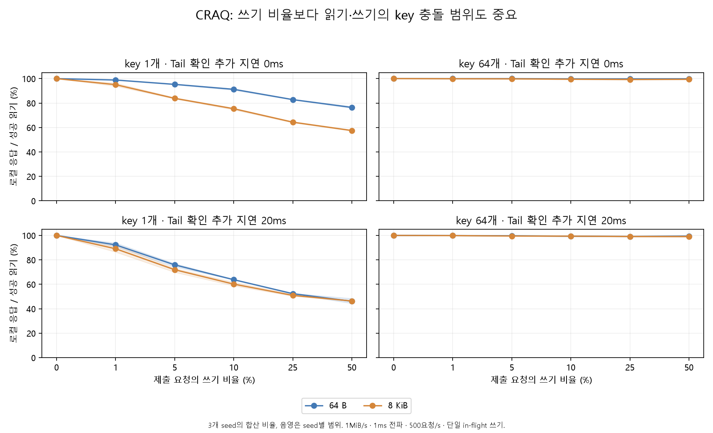
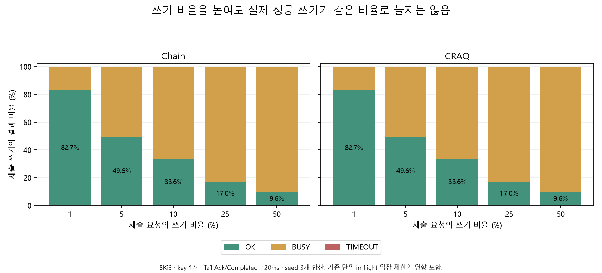
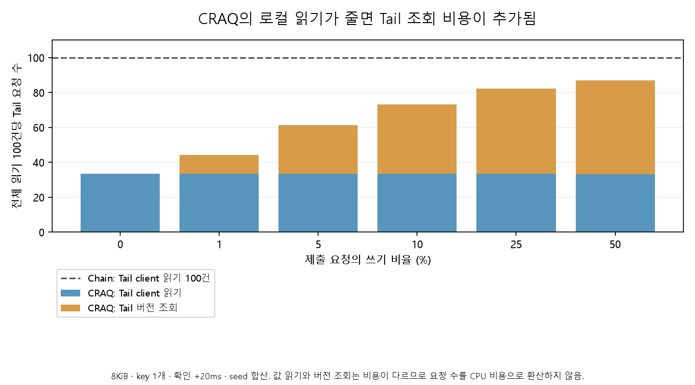

# CRAQ 혼합 부하 결과 — 2026-11-04

동일한 입력 쓰기 비율에서도 key 충돌 범위와 확인 지연에 따라 로컬 읽기 비율이 달라졌다. 기존 단일 in-flight 쓰기 엔진 때문에 높은 쓰기 제출 비율에서는 BUSY가 많았으며, 이 조건을 함께 보고한다.

## 실행 증거

- [반복 1 summary.csv](runs/run-2026-11-04T00-17-53.018686100Z-ea670367/repeat-001/summary.csv) · [반복 2](runs/run-2026-11-04T00-17-53.018686100Z-ea670367/repeat-002/summary.csv) · [실행별 자동 집계](runs/run-2026-11-04T00-17-53.018686100Z-ea670367/repeat-001/results.md)
- 288조건 × 2회, 총 864,000건 제출. 두 CSV SHA-256 동일: `4684781B76AB5766942EAAADDD66D07F3D49F9A913E3567957133CA492E8BAD6`.
- 반복당 읽기 성공 365,360건, 쓰기 성공 21,928건, 쓰기 BUSY 44,712건. 읽기 구간 검증 위반·최종 미완료 0. 최종 입장 로그/Tail 적용 및 prefix 일치 확인.
- 전체 프로젝트 `gradlew build :experiment-runner:installDist` 통과: 테스트 658개, 실패/오류 0. 신규 혼합 실험 테스트 3개는 24조건 재현/round-trip, 읽기 검사기의 오검출 방지, 결과 재생성·변조/누락 거절을 포함한다.
- 실행 HEAD `5d0176f6dfcfee50735f4b11ab54176a6d18318e`, 브랜치 `feat/craq-reads`. 변경은 미커밋이며 이 HEAD 자체에 CRAQ가 포함된 것은 아니다.
- 실행 sourceHash `e1df50211eb0051c9594464bb2dbb07c0b48965ed8dc97ea0282b900c9490fd9`, backendHash `b7ee8af20997d3f051b590ce85b26285600202b52c290c3074c0c21ae0c3dc6f`. manifest·원본 JSON은 해당 run에 보존한다.

## 1. 같은 쓰기 비율이어도 key 충돌 범위에 따라 다름

8KiB·Tail 확인 +20ms·seed 3개 합산에서:

|설정 쓰기 비율|key 1개: 로컬 읽기|key 64개: 로컬 읽기|
|---:|---:|---:|
|0%|100.00%|100.00%|
|1%|89.10%|99.87%|
|10%|60.16%|99.40%|
|50%|46.36%|99.11%|

확인: 단일 hot key는 미확정 버전이나 늦은 Ack와 읽기가 자주 겹쳤다. 여러 key에 균등하게 나누면 dirty인 key를 읽을 확률이 낮았다. 실험 범위를 넘어 모든 분포에서 같은 수치라고 일반화하지 않는다. 효과에는 쓰기 입장 제한·확인 지연·링크 큐가 함께 반영된다.

## 2. 성공 지연만 보여주면 쓰기 거절이 숨겨짐

같은 대표 조건에서 쓰기 비율 50%의 실제 제출 쓰기는 seed 합산 2,248건이고, 그중 성공 216건(9.61%), BUSY 2,032건이었다. Chain과 CRAQ 모두 기존 단일 in-flight 쓰기 경로를 공유한다. 이 결과를 CRAQ 자체의 근본적인 쓰기 한계나 논문 구현의 처리량으로 해석하지 않는다.

제출 비율만 고정해도 실효 부하는 입장 제한의 영향을 받는다. 따라서 비교할 때 offered/OK/BUSY/TIMEOUT과 성공 지연을 함께 제시한다. 해당 대표 조건의 두 모드 쓰기 결과는 동일했다.

## 3. Tail의 값 읽기 감소와 Tail 조회 비용을 구분

Chain은 읽기 100건 전부를 Tail에서 처리한다. CRAQ는 client 읽기 약 33건을 Tail에 배치하며, key 1개·8KiB·확인 +20ms에서 설정 쓰기 비율 50%이면 dirty 조회 약 54건이 추가되어 Tail 요청이 약 87건이 된다. 값 읽기와 버전 조회는 응답 크기와 처리 비용이 다르므로 요청 수만으로 CPU·처리량 개선 폭을 계산하지 않는다.

## 해석 범위

3노드, 1MiB/s, 전파 1ms, 입력 500건/s, 3초의 가상 시간 탐색 실험이다. 로컬 읽기 CPU·client 값 응답 비용을 두지 않았다. 특히 64개 key에서는 dirty 읽기가 1% 미만일 수 있어 p99가 0ns여도 조회가 전혀 없는 것이 아니다. 경로별 건수와 비율을 함께 봐야 한다.

다음 결정은 실제 목표 서비스의 읽기/쓰기 비율과 key 쏠림을 대표 조건으로 정하는 것이다. 그 조건을 정한 뒤 실제 서버에서 CPU와 값 응답 비용을 포함한 읽기 처리량을 확인한다. 새 합의 알고리즘·쓰기 pipeline을 이번 실험에서 추가하지 않았다.
