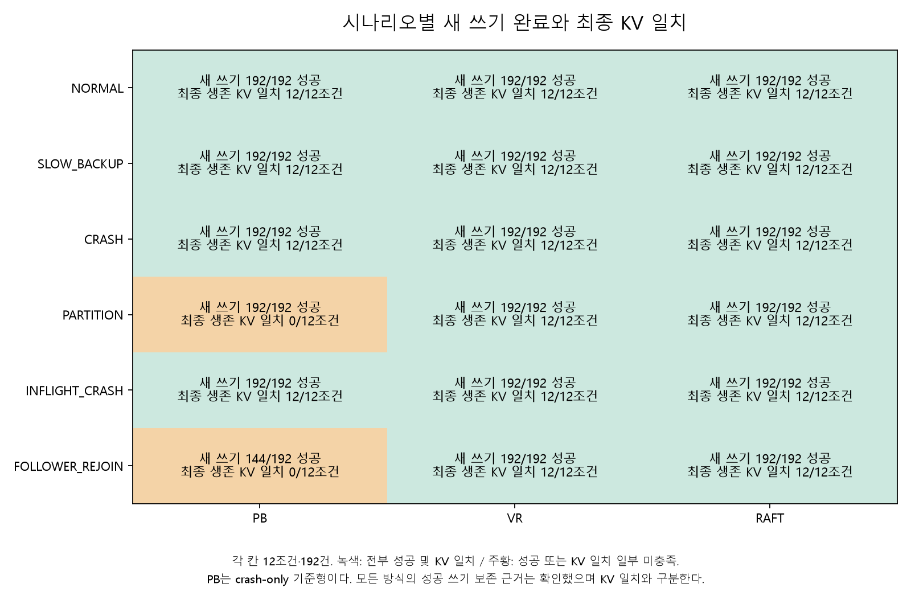
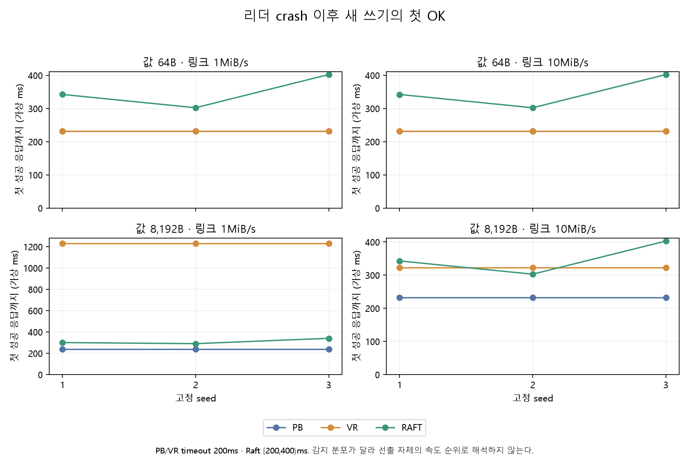

# PB / VR / Raft 비교 결과

2026-10-29 (Asia/Seoul). Raft를 별도 구현하고 기존 PB·VR과 **216조건**을 공통 Runner에서 실행했다. 이전 연속 부하 실험과 구분되는 closed-loop 비교다. 자세한 모델과 제한은 [README](README.md)를 따른다.

- [전체 216조건 보고서](runs/run-2026-10-29T00-25-33.998339700Z-530f1fcd/repeat-001/results.md)
- [원본에서 생성한 CSV](runs/run-2026-10-29T00-25-33.998339700Z-530f1fcd/repeat-001/summary.csv)

## 확인한 결과

각 방식은 6시나리오 × seed 3 × 값 크기 2 × 링크 속도 2 = 72조건이다. 조건마다 정상 SET 64건을 완료한 뒤 주입하고, 새 논리 SET 16건을 시도한다. 총 장애 전 성공 **13,824건 모두 생존 근거가 남았다.** PB는 생존 KV, VR/Raft는 생존 로그의 ID·명령·값을 검사했다. 죽은 노드는 제외한다.

|시나리오|PB 새 쓰기 성공|VR 새 쓰기 성공|Raft 새 쓰기 성공|
|---|---:|---:|---:|
|정상|192/192|192/192|192/192|
|느린 Backup ACK +200ms|192/192|192/192|192/192|
|리더 crash|192/192|192/192|192/192|
|리더 격리 후 repair|192/192|192/192|192/192|
|미완료 쓰기 도중 crash|192/192|192/192|192/192|
|Follower 격리 후 repair|144/192|192/192|192/192|

장애 후 성공 쓰기 **3,408건도 모두 생존 근거가 남았다.** 분단 시 옛 리더에 별도로 제출한 요청은 세 방식 모두 성공 응답하지 않았다. 이 주입 사례에서의 확인이며, PB의 일반적인 분단 안전성을 증명하지 않는다.

## 느린 Backup의 영향

8KiB·1MiB/s 대표 조건에서 성공한 시도 RTT p99:

|방식|정상|ACK +200ms|
|---|---:|---:|
|PB|9.947ms|209.947ms|
|VR|9.939ms|9.939ms|
|Raft|9.960ms|9.960ms|

PB는 두 Backup ACK가 모두 필요하다. VR/Raft는 자신과 빠른 Backup으로 과반수를 충족한다. **이 실험은 세 노드가 살아 있는 상태**다. 한 노드가 이미 죽은 뒤라면 남은 Backup 하나도 과반수에 필요하므로 같은 결론을 적용할 수 없다.

초기 교정 실행은 시도 deadline 100ms라 ACK +200ms 조건의 PB를 모두 TIMEOUT으로 만들었다. 최종 결과는 **시도 deadline 최대 1초**를 사용했다. deadline이 짧아서 실패한 결과와 복제 방식의 지연 차이를 분리하기 위해 보정했으며, 이 문서와 그림은 최종 실행만 사용한다.

## 리더 crash 후 첫 새 쓰기 성공

|값·링크|PB|VR|Raft (seed 1~3)|
|---|---:|---:|---:|
|64B·1MiB/s|232.161ms|232.226ms|302.209~402.209ms|
|8KiB·1MiB/s|239.913ms|1,229.939ms|289.960~339.960ms|

**PB/VR timeout은 200ms, Raft는 [200,400)ms**다. 따라서 이 숫자만으로 선출 자체의 우열을 주장하지 않는다. 첫 OK에는 감지·프로토콜 전환·로그 전달·클라이언트 재탐색·새 쓰기 복제가 모두 포함된다.

이 구현에서 VR은 view change 과정에 전체 로그를 전달한다. 64건의 8KiB 이력이 있는 1MiB/s 조건에서는 그 비용이 드러난다. Raft는 투표 시 마지막 term/index로 후보를 거르고 AppendEntries로 필요한 suffix를 보정한다. 이 차이는 **현재 구현 및 선택한 모델의 결과**이며, snapshot·전송 정책을 갖춘 실제 제품의 성능 순위가 아니다.

## 보존과 KV 일치는 별개

- Raft와 VR은 72조건 전부 최종 생존 KV가 대상 key별로 일치했다. Raft는 모든 조건의 새 쓰기 16건도 완료했다.
- PB는 PARTITION과 FOLLOWER_REJOIN 각각 12조건에서 최종 생존 KV가 달랐다. crash-only 범위를 벗어나는 분단·오판 및 복구 절차가 없기 때문이다. FOLLOWER_REJOIN의 첫 4건은 완료하지 못했고, repair 뒤 나머지 12건은 완료했다.
- PB에서 성공 응답한 쓰기는 보존됐어도, 응답하지 못한 쓰기가 일부 노드에만 남거나 옛 Primary가 뒤처질 수 있다. 성공 보존과 전체 상태 일치를 나눠서 본다.
- INFLIGHT_CRASH는 모든 방식의 12조건에서 성공 응답하지 못한 요청이 생존 노드에 남았다. 실패 응답은 취소가 아니다.

## 검증·재현 근거

- 전체 Gradle build 성공, **475테스트·실패 0·오류 0**.
- Raft 검증: 과반수 복제·읽기, 중복 ID/명령 재사용, 20개 seed crash, 분단된 리더의 미확정 suffix 교체, 오래된 후보 거부, term당 한 표, 지연·유실·중복 RPC, 현재 term no-op, 과거 term 직접 commit 금지, 과반수 없는 읽기 실패.
- 빠른 36조건을 공통 Runner에서 두 번 실행했고 CSV hash가 일치했다.
- schema 변경·보존 count 조작·소수 측 OK 조작·불완전 결과의 완료 표시 거부를 테스트했다.
- 최종 CSV SHA256: `4A74AECFE620442B7CFC088B41F1DDA52AF994E5A81852790C582EB79A6F2E3E`
- quick CSV SHA256: `132AC8B10A15EBFAA9B6BA10CFEE78785846697E5E30F4871150C0F6C25321E1`
- source hash: `19cdc5679dc2561b6d241d774a9103cec10f9be71db59416d903fcc5e466ac78`
- backend hash: `f60557f419e8b11aea88d31ae4257814ddf30183a80f3d480877193380164a1e`
- 기준 HEAD는 `df5716b5174f58093b7f6438520b1eecc3658ad9`이며 작업은 미커밋 상태에서 실행했다. 소스·실행 클래스 hash가 실제 입력 식별자다.

Raft의 term·vote·log는 메모리에만 있다. 이 결과는 재시작 recovery·실제 서버 성능·실제 SSD 비용을 보장하지 않는다. 기존 [세 멘토 질문](../sustained-load/mentoring-questions.md)은 유지하며, Chain Replication·Rosé는 다음 구현 후보로 남긴다.
