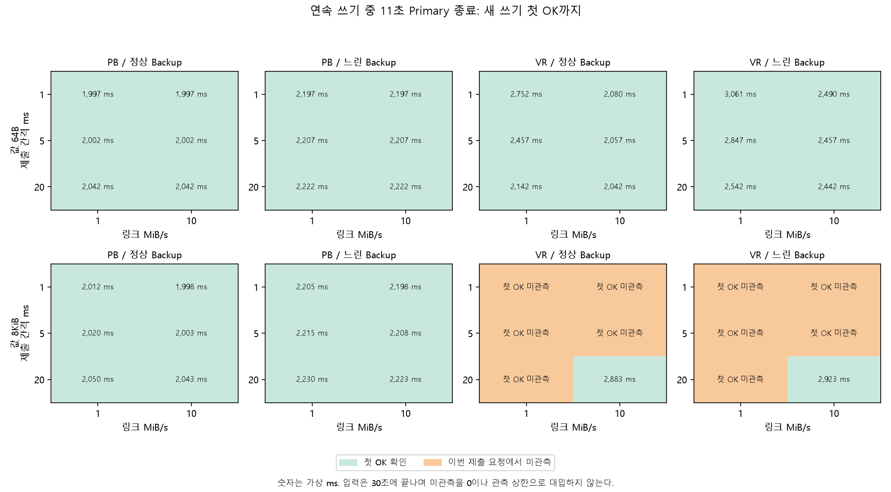
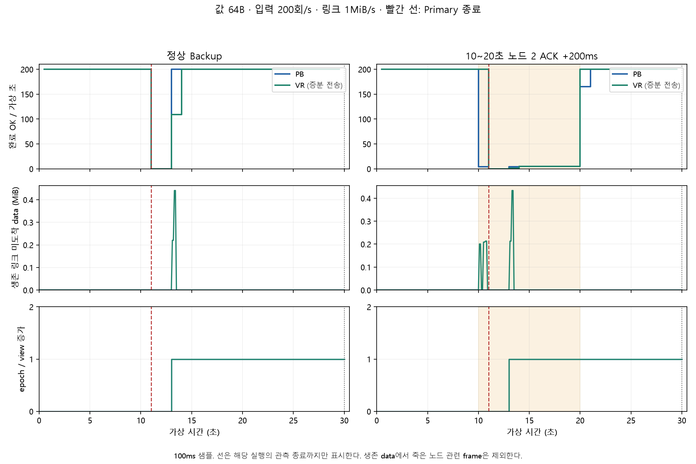
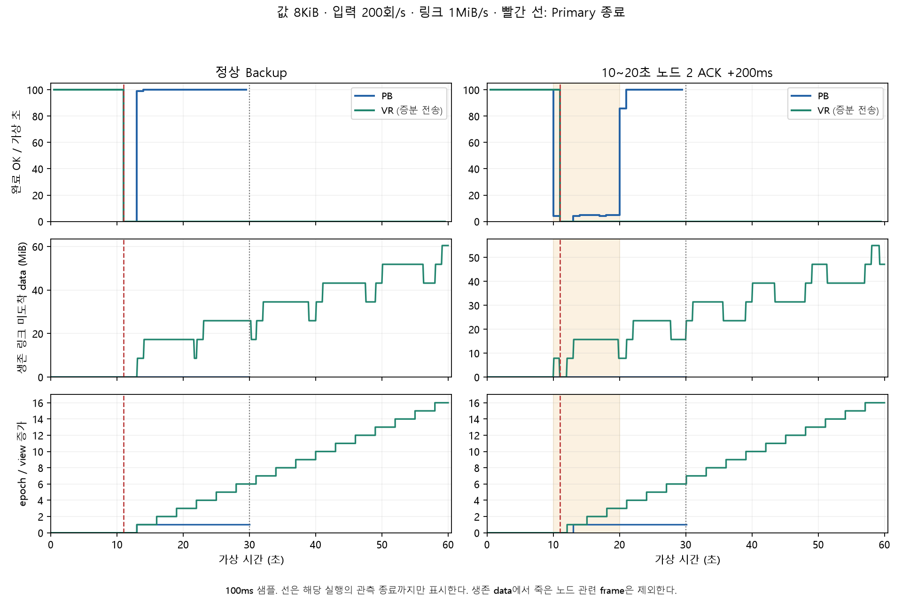

# 연속 부하 중 Primary crash 결과

2026-10-28 (Asia/Seoul). 가상 0~30초 연속 쓰기 중 11초에 실제 Primary 0을 종료했다.
48조건·60만 요청을 실행했고, 최초 성공 쓰기의 생존 보존과 새 쓰기의 재개를 별도로 확인했다.

- [48조건 전체 보고서](runs/run-2026-10-28T08-10-13.129127300Z-c4191cbd/repeat-001/results.md)
- [조건·구간·시계열 CSV](runs/run-2026-10-28T08-10-13.129127300Z-c4191cbd/repeat-001/summary.csv)
- [모델과 지표 정의](README.md) · [실행 설정](comparison.properties)
- [그대로 유지한 멘토 질문](../sustained-load/mentoring-questions.md)

## 결과 요약

| 방식·시나리오 | 조건 | 장애 후 새 쓰기의 첫 OK 확인 | 전체 수렴 확인 |
|---|---:|---:|---:|
| PB / 정상 Backup | 12 | 12 | 12 |
| PB / 느린 Backup | 12 | 12 | 12 |
| VR / 정상 Backup | 12 | 7 | 7 |
| VR / 느린 Backup | 12 | 7 | 7 |

전체 48조건의 실행·원본 검증을 완료했다. 관측 조건에서 첫 OK를 확인하지 못한 것은 Runner 프로세스 실행 실패와 구분한다.
새 입력은 30초에 끝나고, 그 뒤 최대 30초는 이미 제출한 요청과 복제본 상태를 관측했다. 추가 probe는 보내지 않았다.
따라서 미관측 10조건은 이번에 제출한 새 요청에서 재개를 확인하지 못했다는 뜻이며, 60초 모든 시점의 서비스 가능성이나 영구 복구 불능을 판정한 것이 아니다.

**그림 1.** 숫자는 crash → crash 이후 제출한 새 쓰기의 첫 OK callback까지의 가상 ms다. 주황색에 시간 상한을 대입하지 않았다.
같은 입력 간격이라도 값·링크에 따라 장애 전 성공 로그 길이가 달라지므로 입력률 하나의 효과만 분리한 실험은 아니다.

## 1. 장애 전 성공 쓰기는 생존 근거가 보존됐다

| 항목 | 결과 |
|---|---:|
| crash 전 OK 요청 | 86,041 |
| 관측 종료에도 생존 evidence에 남은 crash 전 OK | 86,041 / 86,041 |
| 장애 전후 모든 OK | 172,833 |
| 생존 evidence에 남은 모든 OK | 172,833 / 172,833 |
| 장애 시점 응답 미완료 | 21 |
| 그중 최종 생존 evidence에 남은 요청 | 21 / 21 |

죽은 노드 0의 메모리는 근거에서 제외했다.
PB는 생존 KV를, VR은 생존 로그를 request ID·key·value로 확인했다. 이 구분은 프로토콜의 확정·적용 순서 차이에 따른다.
미완료 요청이 남은 것은 취소나 롤백을 보장하지 않는다는 관측이며, 모든 미완료 요청이 항상 남는다는 보장은 아니다.

**로그 보존과 실제 KV 적용은 다르다.** crash 전 OK의 생존 KV 기대 복사본 172,082개 중 171,298개가 관측 종료에 적용돼 있었다. 나머지 784개 복사본은 아직 적용이 확인되지 않았지만, 해당 요청의 로그는 생존 evidence에 있었다.
이는 성공 쓰기의 로그가 모두 유실됐다는 판정과 다르다.

예를 들어 정상 Backup·8KiB·간격 5ms·1MiB/s 조건의 VR은 crash 전 OK 1,100건을 모두 로그에서 보존했지만, 실제 KV 적용 복사본은 2,198 / 2,200이었다.
마지막 요청은 두 생존 노드 모두 아직 적용하지 않은 상태일 수 있다. KV 존재 여부만 확인했다면 이 경우를 로그 유실과 혼동할 수 있다.

## 2. 작은 값에서는 복구 뒤 느린 ACK의 비용도 보인다

값 64B·제출 간격 5ms·1MiB/s:

| 방식 | 정상 Backup failover | 느린 Backup failover |
|---|---:|---:|
| PB | 2,002.161ms | 2,207.161ms |
| VR | 2,457.188ms | 2,847.188ms |

초기 감지 timeout 2초와 클라이언트 재탐색이 포함된 결과다. VR은 view change의 로그 교환·설치 확인 비용도 낸다.
PB는 정해진 승계와 생존 Backup 하나의 ACK로 재개한다. 보장 수준이 다르므로 이 숫자만으로 일반적인 프로토콜 우열을 정하지 않는다.

**그림 2.** 입력 200회/s·1MiB/s. 빨간 선은 crash 11초, 음영은 느린 ACK 10~20초, 회색 점선은 입력 종료다.
0~30초 내의 완료량을 누적 OK의 1초 차분으로 그렸고 선은 각 실행의 관측 종료까지만 표시한다.

기존에 Primary가 살아 있을 때는 VR이 느린 Backup을 과반수 밖에 둘 수 있었다. 한 대가 죽고 노드 1·2만 남으면 둘 다 과반수에 필요하므로 느린 노드 2의 ACK를 건너뛸 수 없다.
느린 Backup 조건의 장애 이후 성공 요청 p99는 PB 202.161ms, VR 202.188ms였다. 역할 변경·첫 OK·계속되는 요청의 지연이 서로 다른 지표임을 보여준다.

## 3. 큰 로그에서는 데이터 보존과 쓰기 재개가 분리됐다

VR의 첫 OK 미관측 10조건은 모두 8KiB였다. 다음 다섯 조합이 정상/느린 Backup 양쪽에서 해당됐다.

| 제출 간격 | 링크 |
|---:|---:|
| 1ms | 1MiB/s |
| 1ms | 10MiB/s |
| 5ms | 1MiB/s |
| 5ms | 10MiB/s |
| 20ms | 1MiB/s |

정상 경로는 증분 전송이지만 DOVIEWCHANGE/STARTVIEW는 전체 로그를 전달한다.
부하로 커진 로그의 전송과 재전송, view-change 대기 예산의 상호작용이 시계열에 나타났다. 각 원인의 효과를 분리하는 추가 실험은 아직 하지 않았다.

**그림 3.** 같은 입력 200회/s·1MiB/s다. global pending이 아니라 생존 링크의 data만 표시해 죽은 노드의 폐기 예정 frame과 구분했다.
해당 VR 대표 조건은 성공 로그가 보존돼도 view가 반복 증가하고 이번 입력에서 새 OK가 나오지 않았다.
현재 전체 상태 전달과 정책의 한계이며, 최적화된 VR 전반이나 실제 서버의 복구 성능을 일반화한 결과가 아니다.

## 4. 요청 결과도 함께 기록했다

| 전체 요청 결과 | 건수 |
|---|---:|
| 제출 | 600,000 |
| OK | 172,833 |
| BUSY | 301,486 |
| UNAVAILABLE | 106,582 |
| NOT_PRIMARY | 19,001 |
| STALE_EPOCH | 98 |
| TIMEOUT / 최종 응답 미완료 | 0 |

입력은 응답을 기다리지 않고 고유 요청을 한 번씩 제출했다. 첫 OK 이전의 실패·재탐색도 분모에 남겨 두었다.
위 합계는 선택한 조건 조합의 집계이며 실제 운영 성공률이 아니다. p50/p99는 성공한 요청만의 지연이므로 이 실패 수와 함께 읽는다.

## 검증과 재현

- 전체 Gradle build 및 Runner 배포본 생성 성공. 테스트 XML 기준 464 tests, failures/errors 0.
- 부하 중 실제 Primary 역할 확인, 새 요청의 첫 OK, crash 전 성공 evidence, 생존 로그 불변 사본, 응답 미완료 요청 보존 가능성, crash 뒤 두 노드의 ACK 조건을 검사했다.
- 죽은 노드 frame을 생존 복제 backlog에서 제외하고, 보존 증거에 죽은 노드 KV를 사용하지 않음을 검사했다.
- 예정 제출·응답 합·pre/post 경계·시계열 coverage·보존 evidence·바이트 수지를 원본 검증에서 대조한다.
- 원본 누락·중복·schema 변경·성공 로그 보존 위반은 완료 표식을 제거한다.
- quick `run-2026-10-28T08-10-05.554934300Z-1814418f`은 16조건을 두 번 실행했다. CSV SHA-256: `B81CCF80BEDA2D1F370AC0388FA13177F685075343D71BAA32E358A05121C4C2`로 일치했다.
- full JSON에서 CSV·Markdown을 재생성한 뒤 두 파일 모두 기존 hash와 같았다.
- full CSV SHA-256: `E010DF24EF20154CCD31E7249D98D3290942919402074CEF4BBB93C035FF1FAD`.
- full 보고서 SHA-256: `B75A2652DE484094AF78AD253CED5C0D0992D760DD5075D37B3A666B9A20F45A`.
- source SHA-256: `c9c2aa5f7e21008ab5c6586a86e077fd3555d549990c38820c8de1d4377a4746`.
- backend SHA-256: `9499b6faf995f549b4fc044271cf0e57759b762a72187aff58e39794032edcbf`.
- 기존 연속 부하 48조건도 [다시 실행](../sustained-load/runs/run-2026-10-28T08-10-19.275716200Z-f306a6c2/repeat-001/summary.csv)했다. CSV는 기존과 동일한 `AE58E31E837322B72D11D48B0E2454BBED826A5B0EF9A41329583A2DD2927DF4`다.
- 기준 commit df5716b 위 미커밋 구현을 포함한다. 실제 실행 코드는 source/class hash로 식별한다.

그림은 [plot_results.py](plot_results.py)가 보관된 CSV에서 생성한다. 입력·스크립트·그림 hash는 [figures/sources.json](figures/sources.json)에 있다.
Matplotlib·NumPy와 한글 폰트 환경은 이전 비용 실험을 재사용한다. JSON·manifest·로그는 run 폴더에 로컬 보관한다.

## 멘토링에 남긴 결정

동시 쓰기 pipeline, 느린 노드의 지연·전송 예산, checkpoint·부분 상태 전달은 이번 작업에서 확정하지 않았다.
같은 세 질문에 이번 crash 결과를 추가 근거로 붙였다. [멘토 질문](../sustained-load/mentoring-questions.md)을 따른다.
