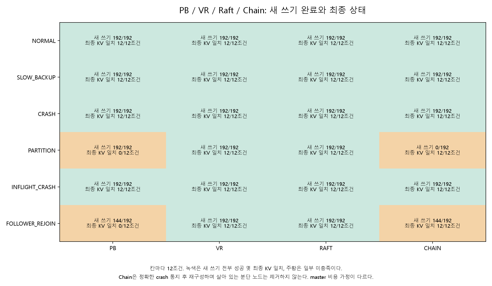
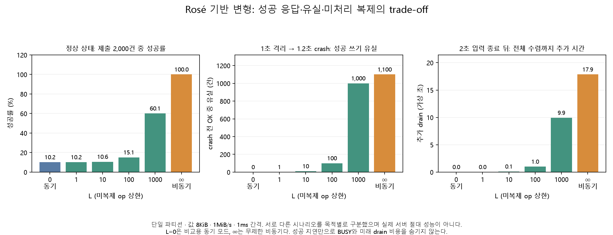
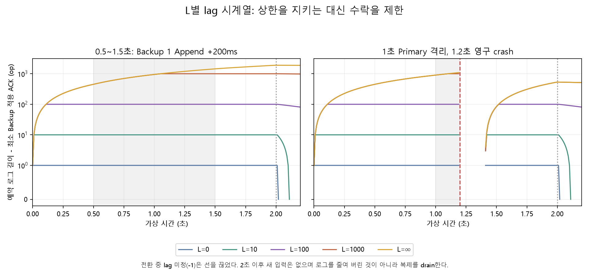

# A1 구현·실험 종합 — Rosé 기반 변형까지

**PB·VR·Raft·Chain과 Rosé 기반 bounded-lag 변형을 구현하고, 최신 핵심 비교 552조건을 실행했습니다.**

공통 KV Store 구현 완료 · 전체 프로젝트 테스트 **502개 통과** · 가상 시간 실험 · 실제 서버 검증은 후속입니다.

기준: 2026-10-29 · OpenKache A1 · 현재 작업 브랜치 `codex/a1-replication-experiments`

## 1. 현재 구현 범위

| 방식 | 쓰기 성공 조건 | 장애 후 전환 | 현재 범위 |
| --- | --- | --- | --- |
| Primary-Backup | 두 Backup의 ACK | heartbeat·고정 승계 | 동기 SET·단일 Primary crash. 분단·미완료 쓰기 복구 한계 확인 |
| Viewstamped Replication | 과반수 commit | view change | 고정 3노드·분단 복구·미완료 로그·중복 요청. 증분 전송 개선 |
| Raft | 과반수·현재 term commit | 투표·랜덤 timeout | 고정 3노드·로그 최신성 검사·충돌 suffix 정리·리더 no-op |
| Chain Replication | tail 적용 | 외부 master의 사슬 재구성 | head 쓰기·tail 읽기·역방향 Ack·Sent 재전송·위치별 crash |
| Rosé 기반 변형 | 로컬 적용 + 미복제 op 상한 L | 외부 master·최장 생존 prefix | 단일 파티션 bounded-lag 실험. 논문 전체 재현은 아님 |

**공통 KV Store:** 인메모리 GET/SET/DELETE/EXISTS/COUNT와 SCAN/RANGE를 구현했습니다. 복제 엔진별 KV를 분리해 사용합니다. 복제 peer의 실제 TCP 연결·NVMe 저장·재시작 영속성은 아직 검증하지 않았습니다.

**Rosé의 범위**

논문의 다중 파티션 coordinated apply·snapshot·지역 복제는 제외했습니다. 이번 구현은 한 파티션·명령 하나의 적용 경계에서 **L별 성공률·지연·유실량**을 검증하는 변형입니다. 다섯 원논문을 모두 완전 재현했다고 표현하지 않습니다.

## 2. 핵심 실험 구성

| 실험 | 조건 수 | 확인한 것 |
| --- | ---: | --- |
| PB·VR·Raft·Chain 공통 비교 | 288 | 정상·느린 확인·Primary/head crash·분단·미완료 쓰기·재합류 |
| Chain 위치별 crash | 24 | head/middle/tail 종료, 미완료 suffix 유무·크기·대역폭 |
| Rosé 기반 L별 비교 | 240 | L=0/1/10/100/1000/∞, 지연·분단·crash, 성공·lag·유실 |

공통 비교는 closed-loop이고 Rosé 비교는 0~2초 open-loop입니다. 서로 다른 실험 수치를 한 표의 속도 순위로 합치지 않습니다. Chain의 seed 3개는 동일 조건 반복이며 독립 난수 표본이 아닙니다.

## 3. PB·VR·Raft·Chain에서 확인한 차이

공통 288조건의 장애 전 성공 **18,432건**, 장애 후 성공 **4,320건**의 생존 근거를 확인했습니다. PB는 생존 KV, VR/Raft/Chain은 생존 로그의 ID·명령·값으로 검사했습니다. 로그 보존과 최종 KV 일치는 따로 봅니다.

- **느린 노드:** 8KiB·1MiB/s 대표 조건에서 PB p99는 9.947→209.947ms, Chain은 18.834→218.834ms였습니다. VR/Raft는 세 노드가 살아 있을 때 빠른 Backup으로 과반수를 채웠습니다.
- **분단:** PB는 새 쓰기를 완료했어도 복구 뒤 KV 불일치가 남았습니다. Chain은 살아 있는 분단 노드를 강제로 제외하지 않아 쓰기가 멈췄고, repair 뒤에는 KV가 일치했습니다.
- **사슬 재구성:** Chain 위치별 24조건 전부 새 쓰기를 재개했고, 기존 성공 16건 × 생존 노드 2대 = KV 복사본 32개를 매 조건 보존했습니다.
- **응답과 처리량:** 단일 in-flight Chain의 정상 대표 조건에서 새 쓰기 16건 사이에 BUSY 15회가 있었습니다. 성공한 마지막 시도 RTT만 보면 이 비용이 가려집니다.

PB/VR의 고정 감지 timeout, Raft의 랜덤 election timeout, Chain/Rosé master의 정확한 crash oracle은 전제가 다릅니다. 현재 숫자로 선출 방식 자체의 우열을 주장하지 않습니다.

## 4. Rosé 기반 변형: L로 무엇을 교환했나

**8KiB·1MiB/s·1ms 제출 간격**의 목적별 대표 조건입니다. 정상 성공 수와 격리 후 crash 유실은 서로 다른 시나리오입니다.

| L | 정상 성공 / 2,000건 | 격리 후 crash 전 OK 중 유실 | 정상 입력 종료 뒤 추가 drain |
| --- | ---: | ---: | ---: |
| 0: 동기 제어군 | 203 | 0 | 0.02초 |
| 1 | 203 | 1 | 0.02초 |
| 10 | 212 | 10 | 0.11초 |
| 100 | 302 | 100 | 1.00초 |
| 1000 | 1,202 | 1,000 | 9.93초 |
| ∞: 무제한 비동기 | 2,000 | 1,100 | 17.85초 |

**L을 키우면 더 많은 쓰기를 먼저 성공시킬 수 있지만, 유실 가능량과 뒤에 남는 복제 작업도 커집니다.** 240조건 모두 유한 L의 예약 lag·성공 쓰기 유실 상한을 만족했고 최종 수렴했습니다.

L=10 정상 대표 조건은 p99 약 9.90ms여도 **성공 212건·BUSY 1,788건**이었습니다. 무제한 모드의 모델상 0ns는 즉시 로컬 KV라는 가정의 결과이며 실제 시스템의 지연이 아닙니다.

### lag 시계열과 복구 해석

- Primary의 예약 로그 길이에서 두 Backup의 최소 적용 ACK를 뺀 값을 셉니다. L=0은 미응답 한 건 때문에 peak lag 1이 가능하지만 성공 쓰기 유실은 0입니다.
- 가득 찬 뒤 아직 수락하지 않은 요청은 deadline에 제거합니다. 이미 수락한 요청의 TIMEOUT은 취소가 아닙니다.
- 정확한 Primary crash 뒤 최장 생존 prefix의 Backup을 선택하고 나머지를 peer 경로로 복구합니다. PB의 NodeId 고정 승계와는 다른 정책입니다.
- 입력 종료 뒤에는 새 probe 없이 drain합니다. 성공 미관측을 영구 복구 불능으로 표현하지 않습니다.

## 5. 구현·검증 근거

- 전체 프로젝트 `gradlew build :experiment-runner:installDist` 성공, **502테스트·실패/오류 0**.
- quick 반복 CSV 동일. JSON 원본으로 조건별 CSV·시계열·보고서 재생성 가능.
- Rosé 추가 뒤 기존 네 방식 288조건 CSV가 이전과 정확히 일치했습니다.
- 작업은 **미커밋 상태**입니다. 원격 저장소에 아직 없는 코드 경로를 완료 MR 링크처럼 제시하지 않습니다.
- 원본 입력은 source hash `35ddbb409357aa1d7256a2ed37e16dc4be69e7f1815680ef8340170fe3498184`, backend hash `4391971ba07eddd3e9f6e9bec8b883749d7cb28185ec5714f0f0ffe37c1f139b`로 식별합니다.

### 비교 CSV 첨부

네 방식 공통 288조건:
[CSV 원본 요약](../chain-comparison/runs/run-2026-10-29T00-42-37.370281300Z-5b8d5890/repeat-001/summary.csv)

Chain 위치별 crash 24조건:
[CSV 원본 요약](../chain-comparison/runs/run-2026-10-29T00-42-37.370281300Z-5b8d5890/repeat-001/position-summary.csv)

Rosé 기반 변형 240조건:
[CSV 원본 요약](../rose-comparison/runs/run-2026-10-29T01-03-29.244815600Z-bee0648a/repeat-001/summary.csv)

### 저장소 내 위치

- 엔진: `cache-core/src/main/java/io/openkache/core/replication/{primarybackup,vr,raft,chain,rose}`
- 테스트·연구 backend: `cache-core/src/test/java/io/openkache/core/replication/experiment`
- 설계·실험·그래프·설정: `experiments/a1-active-passive-failover`

## 6. 멘토링에서 결정받을 사항

**10/23 피드백 반영:** crash 우선·partition 후순위·기본 Primary 1 + Backup 2·실험 조건 명시·결정론적 실험을 기준으로 진행합니다.

[지난 멘토링 후속 — Redis 설정과 Java 시뮬레이션 후보 조사](https://app.notion.com/p/408ec94529fd8180a388fd898b962147?pvs=204)

다음에 확인할 질문은 세 가지로 좁혔습니다.
1. 목표 환경의 대표 네트워크 지연·장애 감지·첫 쓰기 복구 시간 예산
2. 성공 응답한 캐시 쓰기 유실 허용 여부와 원본 저장소 전제
3. 후순위로 제안한 Rosé 다중 파티션 기여 검증이 이번 마일스톤의 필수 성과인지

[멘토링 질문 — 운영 기준과 쓰기 보존 요구사항](https://app.notion.com/p/408ec94529fd811aa25cd4b674305db2)

각 질문의 근거와 (답변) 자리를 남겼습니다. Java 도구는 문서 조사 단계이며 설치·연동 성공으로 표시하지 않았습니다.

## 7. 아직 하지 않은 것

실제 3서버 복제 연결·GC/CPU/SSD 실측, 재시작 영속화, 동적 membership, generic pipeline, checkpoint, CRAQ, Rosé 다중 파티션 coordinated apply는 후속입니다. 제한된 실험에서 위반이 없었던 결과를 일반적인 안전성 증명으로 확대하지 않습니다.

### 참고 논문

- [VR Revisited](https://pmg.csail.mit.edu/papers/vr-revisited.pdf)
- [Raft](https://raft.github.io/raft.pdf)
- [Chain Replication](https://www.cs.cornell.edu/home/rvr/papers/OSDI04.pdf)
- [Rosé](https://vldb.org/cidrdb/papers/2026/p8-zarkadas.pdf)

[이전 멘토링 요약](https://app.notion.com/p/401ec94529fd80dc8f56d325fa95b1c6) · [기존 학습 정리](https://app.notion.com/p/3feec94529fd80be8de5f3172ff12119)

