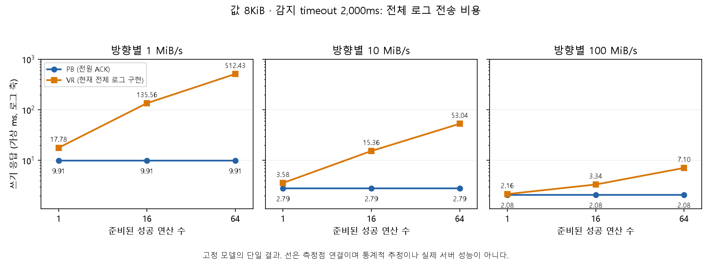
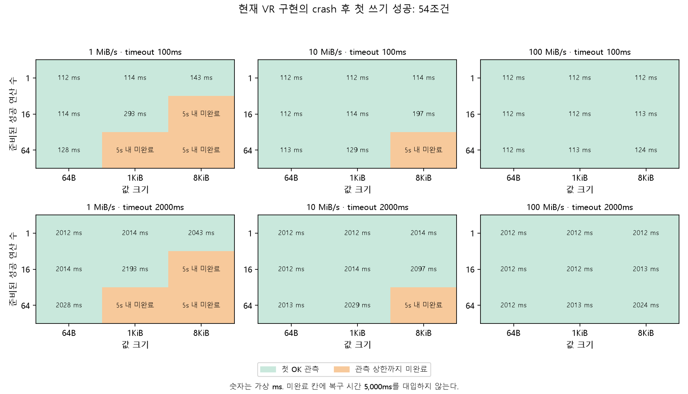

# 메시지 크기·대역폭을 반영한 PB / VR 결과

2026-10-28 (Asia/Seoul). 현재 전체 로그 VR 구현은 로그가 커질수록 통신 비용이 증가했고, 낮은 대역폭에서는 재전송 대기열 때문에 장애 오판과 복구 지연이 발생했다.
이 결과는 명시된 가상 네트워크 모델과 현재 구현에 한정된다.

- [216조건 상세 보고서](runs/run-2026-10-28T01-36-54.664991200Z-d71e8b8d/repeat-001/results.md)
- [조건별 CSV](runs/run-2026-10-28T01-36-54.664991200Z-d71e8b8d/repeat-001/summary.csv)
- [모델·바이트 계산·실행 방법](README.md) · [전체 설정](comparison.properties)

## 무엇을 측정했나

PB/VR × NORMAL/CRASH × 준비 이력 1·16·64 × 값 64·1,024·8,192B × 링크 1·10·100MiB/s × 감지 timeout 100·2,000ms = 216조건이다.
방향별 FIFO 직렬화 큐와 편도 전파 1ms를 적용했다. 준비 이력은 빈 네트워크에서 시작하며 측정 구간만 대역폭 제한을 적용했다.
난수가 없는 모델이므로 반복은 재현 확인이다.

## 실행 결과

| 방식·단계 | 조건 | OK | UNAVAILABLE | 5초 내 복구 미완료 |
|---|---:|---:|---:|---:|
| PB NORMAL | 54 | 54 | 0 | 0 |
| PB CRASH | 54 | 54 | 0 | 0 |
| VR NORMAL | 54 | 52 | 2 | 0 |
| VR CRASH | 54 | 46 | 0 | 8 |

216조건 모두 backend 실행과 결과 검증을 완료했다. 위 미완료 8조건은 프로토콜의 첫 OK를 관측하지 못한 실험 결과이며 Runner의 실행 실패가 아니다.
5초에 복구됐다고 계산하거나 영구 복구 불능으로 판정하지 않는다.
모든 조건의 기존 성공 이력은 생존 KV에서 14,580 / 14,580 복사본이 일치했다. 이는 고유 키 보존 검사이며 임의 이력 전체의 안전성 증명은 아니다.

## 1. 큰 로그는 정상 쓰기에도 비용을 만든다

값 8KiB, 링크 1MiB/s, 감지 timeout 2,000ms에서 한 건의 새 SET 응답을 비교했다.

| 준비된 성공 연산 수 | PB 응답 (가상 ms) | VR 응답 (가상 ms) |
|---|---:|---:|
| 1 | 9.913 | 17.783 |
| 16 | 9.913 | 135.557 |
| 64 | 9.913 | 512.434 |

PB는 새 연산 하나를 보내므로 이전 이력 길이에 따른 변화가 없다. VR은 새 연산을 포함한 전체 로그를 보내므로 이력 크기가 응답에 반영됐다.
PB의 지연은 `2ms + serialize(65+valueBytes) + serialize(40)`과 모든 NORMAL 조건에서 정확히 일치했다.
key/value bytes를 수량으로만 세고 시간을 고정하던 이전 비교와 달리 큰 메시지의 직렬화 시간이 드러났다.

**그림 1.** 세 패널은 방향별 링크 1·10·100MiB/s다. 세로축은 가상 ms의 로그 축이다. 각 점은 결정적인 단일 조건이며 신뢰구간·분산 표본이 없다. 선은 측정점 연결이다.
링크가 100MiB/s이면 이력 64개에서 PB 2.079ms, VR 7.104ms였다. 네트워크가 빠르면 현재 구현의 추가 전송 시간이 줄지만 전체 로그를 보낸다는 사실은 같다.

## 2. heartbeat까지 전체 로그를 보내면 큐가 커진다

이력 64개, 값 8KiB의 VR heartbeat PREPARE는 약 0.503MiB다. 이를 10ms마다 보낼 때 한 방향 링크에 생성되는 데이터는 초당 약 50MiB가 된다.
관측 중 새 SET이 들어가면 로그가 65개가 되어 frame이 더 커진다.

링크 1MiB/s·timeout 2,000ms의 VR NORMAL은 약 512ms에 성공했지만, 수집 시 아직 대기·전송·전파 중인 데이터는 56,730,034B(약 54MiB)였다.
이 결과는 첫 요청의 성공과 backlog 해소가 다른 문제임을 보여준다. 기록된 최대 queue wait는 예약된 프레임의 값이며 실제로 그 시간까지 전송을 기다린 프레임을 모두 관측한 것은 아니다.

현재 구현은 로그 전송량을 제한하거나 같은 snapshot 재전송을 합치지 않는다. 코드의 주기와 바이트 계산, 실제 pendingBytes 증가를 함께 보면 낮은 대역폭에서 이 재전송 정책이 병목을 만든 것으로 해석할 수 있다.

## 3. 실제 장애 없이도 view change가 발생했다

VR NORMAL에서 다음 두 조건은 실제 crash 없이 약 93.031ms에 UNAVAILABLE로 끝났고 view가 증가했다.

- 값 8KiB, 링크 1MiB/s, timeout 100ms, 준비 이력 16개
- 값 8KiB, 링크 1MiB/s, timeout 100ms, 준비 이력 64개

큰 PREPARE가 도착하기 전에 heartbeat timeout이 발생했다. timeout은 대역폭 활성화 시각부터가 아니라 마지막 정상 메시지 수신부터 센다.
timeout을 2,000ms로 바꾸면 이 두 NORMAL 조건은 성공했지만, 이것만으로 crash 중 재전송 backlog까지 해소되지는 않았다.

## 4. crash 복구에서도 로그 전송과 재전송 정책이 드러난다

**그림 2.** 각 칸은 한 조건이다. 초록색 숫자는 가상 ms, 주황색은 5초 관측 상한까지 첫 OK를 못 본 경우다. 상단은 감지 timeout 100ms, 하단은 2,000ms다.

아래 네 조합은 감지 timeout 100ms·2,000ms 모두에서 5초 내 복구가 완료되지 않았다(총 8조건).

| 준비 이력 | 값 크기 | 방향별 링크 |
|---:|---:|---:|
| 16 | 8KiB | 1MiB/s |
| 64 | 1KiB | 1MiB/s |
| 64 | 8KiB | 1MiB/s |
| 64 | 8KiB | 10MiB/s |

view change의 전체 로그 전송과 재전송도 같은 방향 큐를 사용한다. 프레임이 반복 예약되면 후속 확인 메시지도 뒤에서 기다린다.
timeout을 키워도 같은 네 조합이 관측 상한을 넘었다. 감지 시간뿐 아니라 재전송 주기와 전송 중인 상태를 고려하는 제어가 필요한 결과다.

PB는 이력 전체를 전달하지 않기 때문에 이번 고유 키 crash 실험에서 모두 성공했다. 그러나 PB에는 이전 비교에서 확인한 분단·미완료 쓰기 로그 복구 보장이 없다.
두 방식의 보장이 다르므로 이 표만으로 PB가 일반적으로 더 좋은 복제 프로토콜이라고 결론 내리지 않는다.

## 검증·재현 근거

- 전체 Gradle build 및 Runner 배포본 생성 성공. 테스트 XML 기준 427 tests, failures/errors 0.
- frame 크기, 동일 방향 큐잉·역방향 병렬 전송, 직렬화 ceil 계산, drop/pending 바이트 수지, 독립 PB RTT 기대식을 검사했다.
- 준비 이력을 제외하고 동일한 committed 상태·빈 링크에서 측정을 시작함을 확인했다.
- 원본 누락·중복·schema 변경·바이트 불변식 위반은 완료 표식을 제거하고 실패한다.
- quick `run-2026-10-28T01-36-52.427655900Z-d804c3e3`은 64조건을 두 번 실행했다. 두 CSV SHA-256이 `0FCDFA1DA415CB34B9BCD5CE231028613A1C36547A14D2C7CD5CDFD2B3C1B3EE`로 일치했다.
- full CSV·Markdown을 JSON 원본에서 재생성한 뒤 두 파일 모두 기존 hash와 일치했다.
- full CSV SHA-256: `B99DE6DA4C1F43A9B2262C266EF44F87B5515DBBF61B504D220E67A01F56A3EB`.
- full 보고서 SHA-256: `E568E42348467269D976E6DFD1EFF7EAF3E930328986E22588F23B9D6A00238C`.
- source SHA-256: `43941ade9ea8ab873f28553fcd1b237260801ad66391ba2299a1f1fb06b29164`.
- backend SHA-256: `f4e5fb6a1927a3a6d4ec0a3b82d68c645e1d18a4c898eef4f97fac4e5c9165d9`.
- 기준 commit df5716b 위 미커밋 구현을 포함한다. 실제 소스는 source/class hash로 식별한다.

그래프는 [plot_results.py](plot_results.py)로 CSV에서 생성했다. 입력·스크립트·그림 hash는 [figures/sources.json](figures/sources.json)에 기록했다.
원본 JSON·실행 manifest·로그는 해당 run 폴더에 로컬 보관하며 CSV·보고서·그림은 Git 보관 대상이다.

## 해석 범위와 개선 지점

전송량은 실제 wire bytes가 아니라 선언된 논리 인코딩이다. 각 방향 링크는 독립이며 TCP·NIC 공유·압축·패킷 분할·CPU·SSD 비용을 반영하지 않았다.
준비 단계는 무제한 대역폭이고 각 단계에 새 요청 한 건만 보낸다. 지속 부하의 처리량·정상 상태 p99를 측정한 결과가 아니다.

이 실험에서 확인한 개선 지점은 현재 VR의 전체 로그 반복 전송과 flow control이다. 증분 PREPARE, 작은 COMMIT heartbeat, 재전송 간격/전송 중 snapshot 제어를 적용한 뒤 같은 조건을 재실행하면 개선 효과를 비교할 수 있다.
이는 다음 구현의 방향이며 이번 결과에는 적용하지 않았다.
