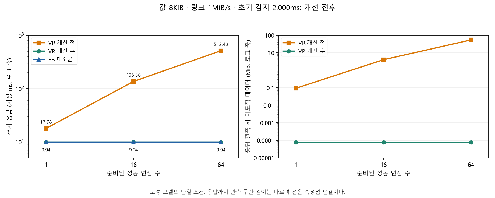
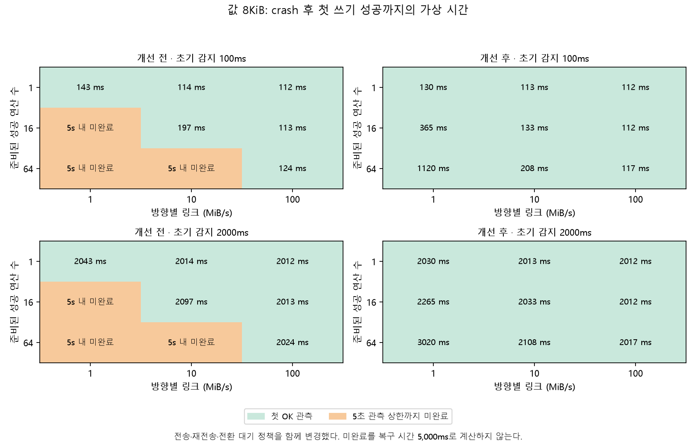

# VR 전송 개선 전후 결과

2026-10-28 (Asia/Seoul). 증분 PREPARE·작은 COMMIT heartbeat·확인 기반 재전송을 적용하고 같은 216조건을 실행했다.
관측 범위에서 정상 쓰기의 전체 이력 전송 비용과 불필요한 backlog가 줄었고, 기존 8개 복구 미완료 조건도 모두 5초 안에 완료됐다.

## 실행 근거

- [개선 후 216조건 보고서](runs/run-2026-10-28T05-25-57.952704Z-1243c82b/repeat-001/results.md) · [CSV](runs/run-2026-10-28T05-25-57.952704Z-1243c82b/repeat-001/summary.csv)
- [개선 전 참조 결과](../network-cost-comparison/results.md) · [원래 CSV](../network-cost-comparison/runs/run-2026-10-28T01-36-54.664991200Z-d71e8b8d/repeat-001/summary.csv)
- [동일 빌드에서 다시 실행한 개선 전 CSV](../network-cost-comparison/runs/run-2026-10-28T05-26-00.402149Z-e8188df6/repeat-001/summary.csv)
- [변경 내용·정책·실행 방법](README.md) · [실행 설정](comparison.properties)

원래 FULL_LOG 비용 실험을 같은 최종 빌드에서 다시 실행했고 CSV가 원래 파일과 바이트 단위로 같았다.
개선 전후 CSV의 PB 108조건도 모든 열이 같음을 확인했다. 네트워크 대역폭·전파·큐·관측 상한과 준비 이력을 유지했다.

## 1. 정상 쓰기는 기존 로그 길이의 영향을 줄였다

값 8KiB, 링크 1MiB/s, 초기 감지 timeout 2,000ms:

| 준비된 연산 수 | VR 개선 전 응답 (가상 ms) | VR 개선 후 응답 (가상 ms) | PB 대조군 (가상 ms) |
|---|---:|---:|---:|
| 1 | 17.783 | 9.939 | 9.913 |
| 16 | 135.557 | 9.939 | 9.913 |
| 64 | 512.434 | 9.939 | 9.913 |

준비 이력 64개에서는 약 51.6배 짧아졌다. 새 연산만 전송하므로 이 조건의 개선 후 응답은 이력 길이에 따라 늘지 않았다.
PB와의 작은 차이는 논리 frame 구성 차이가 반영된 것이다. 이 수치는 동일 대역폭·즉시 KV 처리 모델의 한 건 SET이며 실제 서버 처리량이나 p99가 아니다.

**그림 1.** 값 8KiB·1MiB/s·초기 감지 2,000ms. 두 세로축 모두 로그 축이다. 오른쪽은 응답을 관측한 시점에 아직 도착하지 않은 bytes의 합이다.
이력 64개에서 미도착 데이터는 56,730,034B에서 80B로 줄었다. 남은 80B는 작은 COMMIT 통지 두 개다.
관측 종료까지 걸린 시간도 줄었으므로 이를 동일 시간당 트래픽 비교로 해석하지 않는다. 각 점은 고정 모델의 단일 결과이며 선은 측정점 연결이다.

## 2. 기존 미완료 8조건이 모두 완료됐다

| VR 관측 항목 | 개선 전 | 개선 후 |
|---|---:|---:|
| NORMAL 첫 요청 OK | 52 / 54 | 54 / 54 |
| NORMAL의 장애 없는 view 증가·UNAVAILABLE | 2조건 | 0조건 |
| CRASH 후 5초 내 첫 OK | 46 / 54 | 54 / 54 |
| CRASH 관측 상한까지 미완료 | 8조건 | 0조건 |

PB 대조군은 NORMAL/CRASH 각각 54조건 모두 성공했고 이전 결과와 같았다.
전체 216조건 모두 실행·검증을 완료했으며 기존 성공 이력 14,580 / 14,580 복사본이 생존 노드에서 일치했다.
새 OK 직후 Backup의 KV 적용은 COMMIT 도착 뒤일 수 있어, 첫 callback 시점에 모든 새 복사본이 적용됐다고 주장하지 않는다.

**그림 2.** 각 칸은 한 조건이며 숫자는 가상 ms다. 주황색은 개선 전 5초까지 첫 OK를 못 본 경우이고, 5,000ms에 복구됐다는 뜻이 아니다.
이력 64개·값 8KiB·1MiB/s에서 개선 후 첫 OK는 초기 감지 100ms일 때 1,119.939ms, 감지 2,000ms일 때 3,019.939ms였다.
상태를 이어받는 데 전체 로그가 필요하므로 큰 이력의 crash 비용까지 일정해진 것은 아니다.

## 3. 변경한 정책과 비교 범위

개선 모드는 다음을 함께 변경했다.

- 정상 요청은 peer별 ACK 이후 suffix만 보내고, 주기 확정 통지는 40B COMMIT으로 보낸다.
- 전체 상태·증분 전송은 원격 확인을 기다리며 재전송 간격을 1초 → 2초 → 최대 4초로 늘린다.
- 상태 요청이 오면 snapshot 전송을 우선하고, 설치 확인 전에 증분 재전송으로 되돌리지 않는다.
- 초기 장애 감지 timeout은 100/2,000ms 그대로지만, view-change 대기 예산은 최소 3초로 분리했다.

따라서 crash 개선은 전송·재전송·전환 대기 정책의 묶음 결과다. 개별 요소의 효과를 분리한 ablation 실험은 아니다.
재전송 대기를 늘린 만큼 유실 시 개별 요청은 TIMEOUT이 날 수 있으며, client는 같은 요청 식별자로 재시도해야 한다.
전환 대기 예산이 길어지면 새 후보까지 실패한 경우 다음 view로 넘어가는 시점도 늦어질 수 있다. 이번 216조건의 crash는 최초 Primary 한 대의 영구 종료다.

## 검증과 재현

- 전체 `gradlew build :experiment-runner:installDist` 성공. 테스트 XML 기준 451 tests, failures/errors 0.
- 기존 VR 안전성 검사를 FULL_LOG/INCREMENTAL 모두에 적용했다. 분단, COMMIT 통지 유실, 로그 없는 후보, 미완료 suffix, primary-only suffix 폐기, client 중복, 과반수 읽기, 비동기 KV callback을 검사했다.
- 개선 모드의 반복 분단·치유 검사에서도 유실·중복·순서 역전을 계속 주입했다. 재전송 정책에 맞는 제한 시간과 동일 요청 재시도로 수렴을 확인했다.
- 누락 prefix의 순서 외 적용 거절, idle heartbeat의 로그 payload 0, ACK 없는 send 완료의 슬롯 유지, 재전송 backoff, 상태 전달 우선순위를 검증했다.
- 이전 미완료 8조건을 별도 회귀 테스트로 유지했다. 작은 단일 키 읽기·쓰기 이력 검사도 두 모드에 적용했다.
- quick `run-2026-10-28T05-25-55.552245900Z-ae646ea7`은 64조건을 두 번 실행했고 CSV SHA-256이 `B944541FCEEA2BD0309FE7D9C14D4097655BB20BA2C0D2D4365C01853697FAB4`로 일치했다.
- full JSON에서 CSV·Markdown을 재생성한 뒤 두 파일 모두 기존 hash와 같았다. 모드가 섞인 원본은 coverage 검증에서 거절한다.
- full CSV SHA-256: `B6332A594308D28A1D3F139CF406E676C716B34DC4D17FDE8F5E05E3A46AFEE9`.
- full 보고서 SHA-256: `BBF1CD99299E39EA93FFA61BFC277CD3A7D430EA4188F8FAC0A6299C6F704B0F`.
- 개선 전 재실행 CSV SHA-256: `B99DE6DA4C1F43A9B2262C266EF44F87B5515DBBF61B504D220E67A01F56A3EB` (기존 파일과 동일).
- source SHA-256: `861354b089fda74ab562d0c16502498e6586708e450cdcbc2875f17d395f040b`.
- backend SHA-256: `decaf57317ce2bcb7e04d006da3bb591d03032c145ffa2a49832c8ff779a17b6`.
- 기준 commit df5716b 위 미커밋 구현을 포함한다. 실제 코드 식별은 source/class hash를 따른다.

그림은 [plot_comparison.py](plot_comparison.py)가 두 CSV를 읽어 만든다. 조건 coverage와 PB 대조군의 동일성도 검사한다.
입력·스크립트·그림 hash는 [figures/sources.json](figures/sources.json)에 있다.
Python 의존성은 이전 비용 실험의 `requirements-plot.txt`를 재사용하며, 로컬 설치를 쓸 경우 `PYTHONPATH=cache-core/build/a1-plot-deps`로 실행한다.

## 해석의 한계

이 모델의 bytes는 실제 TCP frame이 아닌 선언된 논리 인코딩이며 CPU·SSD·NIC 공유·TCP 혼잡제어는 없다.
현재 이력 길이·값 크기·대역폭 범위에 대한 가상 결과이며 실제 서버 성능이나 모든 네트워크에서의 복구 상한이 아니다.
정상 단계는 새 요청 한 건이고, 준비 단계는 무제한 대역폭을 사용한다. 장시간 지속 부하·checkpoint·프로세스 재시작·동적 membership은 별도 범위다.
