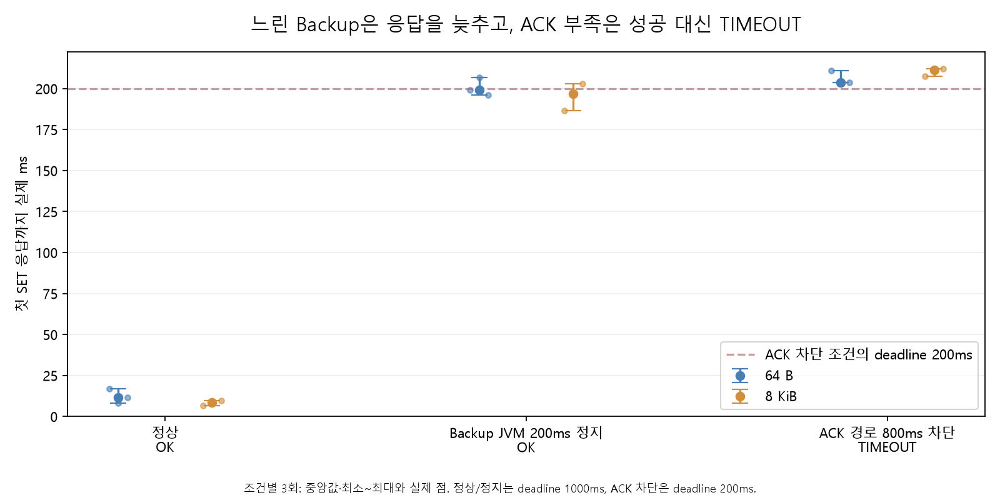
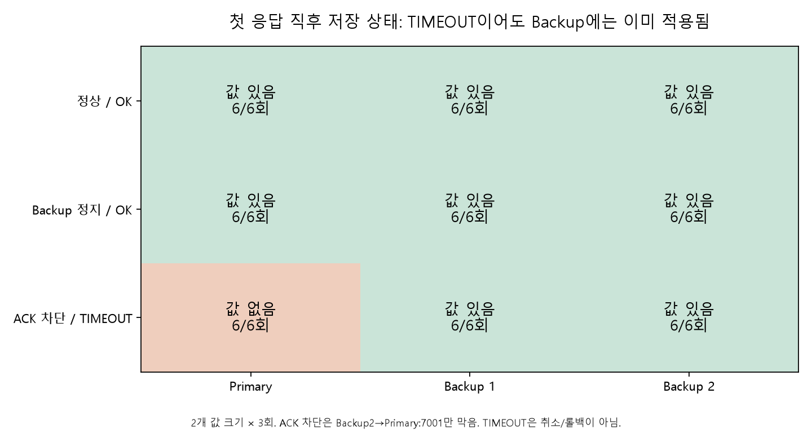

# PB 느린 Backup·ACK 경로 단절 — 2026-11-04

전체 진행의 4단계. 이전 유휴/연속 crash와 별도로 정상·Backup 정지·ACK 경로 차단을 18회 확인했다. Java 엔진과 프로토콜은 변경하지 않았다.

|조건|값|첫 응답|응답 시간 중앙값 [최소~최대] ms|복구 후 동일 SET 재시도|최종 값 복사본|
|---|---:|---|---:|---|---:|
|BASELINE|64B|OK|11.535 [8.071~16.779]|불필요|18/18|
|BASELINE|8192B|OK|8.593 [6.387~9.761]|불필요|18/18|
|SLOW_BACKUP|64B|OK|199.209 [196.012~206.783]|불필요|18/18|
|SLOW_BACKUP|8192B|OK|196.662 [186.678~202.879]|불필요|18/18|
|ACK_BLOCK|64B|TIMEOUT|203.830 [203.815~210.863]|3/3 OK|18/18|
|ACK_BLOCK|8192B|TIMEOUT|211.137 [207.339~211.959]|3/3 OK|18/18|

## 무엇을 확인했나

- BASELINE 6회는 전원 ACK와 로컬 적용 후 OK. Backup2 JVM을 SIGSTOP으로 200ms 정지한 6회도 SIGCONT 후 ACK를 받고 OK.
- ACK_BLOCK 6회는 Backup2→Primary의 TCP 목적지7001만 800ms DROP. 실제 임시 규칙 packet counter를 확인했으며 SSH·다른 peer 방향·다른 사람 서버는 건드리지 않았다.
- ACK 차단 6회 모두 200ms deadline에서 TIMEOUT. 해당 시점 Primary는 MISS, 두 Backup은 같은 값을 보유했다. ACK가 부족한데 OK를 반환한 경우는 없었다.
- 차단 해제 뒤 2초 대기와 같은 client 연결의 두 PING으로 추가/잘못 매칭된 응답이 없는지 확인하고, 동일 SET 재시도 및 후속 SET이 모두 성공했다. 관측 창 밖의 모든 가능한 늦은 응답을 증명한 것은 아니다.
- 매회 최종 key 2개 × 노드 3개, 총108개 값 복사본이 일치. epoch는 전원1 유지, 의도하지 않은 승격 없음.
- 임시 OUTPUT 규칙 제거와 세 전용 JVM 종료를 확인했다. EC2 인스턴스 자체는 유지했다.

## 발견한 한계

TIMEOUT은 롤백이 아니다. 같은 SET 재시도 후 값은 세 노드에서 같았지만, ACK 차단 조건의 fault-key 로컬 KV 버전은 Primary=1, Backup1/2=2였다. 처음 요청이 Backup에 한 번, 재시도로 다시 한 번 적용됐기 때문이다.
따라서 이 PB 기준형은 값 기준 멱등 SET을 확인한 것이며 exactly-once·전 노드의 valueVersion 일치·미완료 로그 복구를 보장하지 않는다. 이 결과를 숨기지 않고 값 일치와 버전 일치를 구분한다.

## 조건·시계

- 3노드 m6gd.medium, 같은 AZ·프라이빗 TCP·인메모리 KV, 원래 Primary 호스트에 Python client/controller 공존.
- 값64B/8KiB × 3조건 × 3회. heartbeat50ms·감지500ms·tick10ms, 조건별 warmup30건.
- 정상/정지 요청 deadline1000ms, ACK 차단 deadline200ms. 따라서 ACK 차단 응답 시간과 정상 조건을 성능 순위로 비교하지 않는다.
- JVM 정지와 네트워크 DROP은 서로 다른 fault다. 전자는 KV 적용/메시지 처리까지 정지, 후자는 ACK 경로만 차단하며 TCP 재전송도 포함한다.
- 실제 정지/차단 duration은 Backup2의 동일 시계, SET 응답 duration은 Primary 호스트 client의 동일 시계다. PC 조정 이벤트도 남겼지만 교차 호스트 시각을 직접 차감하지 않는다.

## 재현·범위

- [실행 안내](README.md#느린-backup과-ack-경로-단절), [18행 CSV](backup-fault-results/summary.csv), [원본·artifact 해시](backup-fault-results/sources.json).
- 원본 JSON/제어 이벤트/환경/로그/실제 tar·스크립트는 Git 제외 로컬 폴더에 보관한다. 개인 키·IP·발표 질문은 Git에 넣지 않는다.
- Python 검증 테스트 총6개 통과(기존 load3+추가 fault3). Java 코드를 변경하지 않아 기존 전체 build645개 통과 상태를 유지한다.
- 이번 단계는 여기서 완료. 다음 VR 실서버 연결·비교는 사용자의 ‘다음 단계’ 요청 전 시작하지 않는다.
