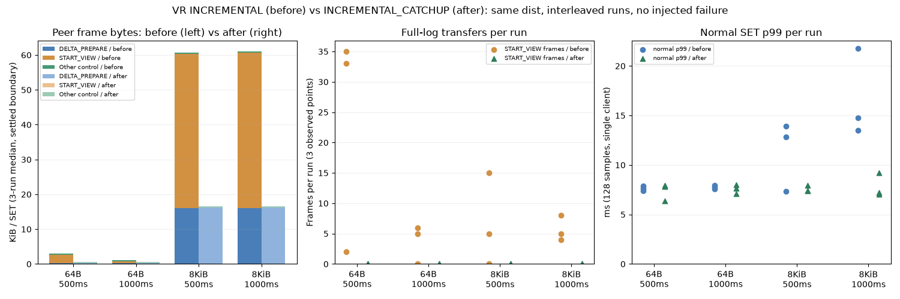

# VR 전송 경로 개선 전후 비교 (INCREMENTAL → INCREMENTAL_CATCHUP)

관련 이슈: S15P31D111-187 후속. 7단계에서 확인한 COMMIT gap→GET_STATE→전체 START_VIEW 경로를 줄이는 `INCREMENTAL_CATCHUP` 모드를 추가하고, 기존 `INCREMENTAL`과 같은 배포본·부하·계측으로 번갈아 측정했다. 기존 모드와 이전 결과는 그대로 보존한다.

## 바꾼 동작

- Primary는 Backup별로 이미 보낸 로그 길이(확인된 길이와 확인 대기 중 전송의 상한)를 넘지 않는 COMMIT만 통지한다. 통지 값은 항상 실제 commit 이하이므로 Backup이 미확정 위치를 적용하지 않는다. 나머지 확정은 다음 DeltaPrepare나 확인 이후 heartbeat가 전달한다.
- 같은 view에서 PREPARE_OK를 보낸 적 있는 정상 Backup의 GET_STATE는 전체 로그 대신 확인된 위치 이후의 DeltaPrepare로 처리한다. 그 Backup의 로그는 이 view 로그의 prefix이기 때문이다. view가 다르거나 확인 prefix가 없거나 전체 로그 설치가 진행 중이면 기존 전체 로그 경로를 유지한다.
- 전송 창·재전송 backoff(1→4초)·과반수 확정·view change·로그 선택은 바꾸지 않았다. 유실된 DeltaPrepare의 복구는 재전송 timer를 따르므로 기존 모드의 즉시 전체 로그 전달보다 늦을 수 있다. 이 trade-off는 결정론적 테스트로 확인했고 실서버에서는 유실을 주입하지 않았다.

## 실험 조건

- 전용 EC2 세 대, 같은 AZ·m6gd.medium·Ubuntu24.04 arm64·Java21·인메모리 KV·private TCP. 장애·인위적 지연·손실 주입 없음.
- 모드2 × 값64B/8KiB × 감지500/1000ms × 3회 = 24회. 조건마다 INCREMENTAL → INCREMENTAL_CATCHUP 순서로 번갈아 실행했다. HB50ms·tick10ms.
- Primary 호스트의 단일 closed-loop client. warm30건을 세 노드가 적용하고 데이터 전송이 안정된 뒤 측정128건. 서버 상태의 vrMode가 요청 모드와 같은지 매 snapshot에서 확인한다.
- byte는 성공한 로컬 TCP write의 length+header+body이며 before→settledAfter 경계의 합계다. 원격 수신·TCP/IP overhead·OS 재전송은 측정하지 않는다.

## 조건별 결과 (3회 중앙값, 합계는 3회 합)

|값 B|감지 ms|모드|peer B/SET 중앙값(최소~최대)|전체 로그 frame|전체 로그 byte|GET_STATE|COMMIT gap|COMMIT 제한 통지|증분 catch-up|정상 p99 ms 중앙값(최소~최대)|
|---|---:|---|---:|---:|---:|---:|---:|---:|---:|---:|
|64|500|INCREMENTAL|3017 (894~3198)|70|665,867|192|192|0|0|7.66 (7.41~7.85)|
|64|500|INCREMENTAL_CATCHUP|664 (654~689)|0|0|0|0|126|0|7.81 (6.40~7.96)|
|64|1000|INCREMENTAL|1094 (689~1184)|11|116,616|20|20|0|0|7.75 (7.56~7.97)|
|64|1000|INCREMENTAL_CATCHUP|689 (689~689)|0|0|0|0|6|0|7.66 (7.08~7.98)|
|8192|500|INCREMENTAL|62091 (16947~135640)|20|21,060,661|77|77|0|0|12.84 (7.35~13.93)|
|8192|500|INCREMENTAL_CATCHUP|16947 (16945~16949)|0|0|0|0|6|0|7.39 (7.39~7.92)|
|8192|1000|INCREMENTAL|62477 (54965~86951)|17|19,711,943|91|91|0|0|14.76 (13.48~21.77)|
|8192|1000|INCREMENTAL_CATCHUP|16947 (16945~16947)|0|0|0|0|7|0|7.25 (7.03~9.19)|

모든 24회에서 정상128건 OK, warmup 포함 값 복사본 474개가 세 노드에서 일치했다(총 11,376개). view change·transport 실패·전송 제어 재전송은 없었다(TRANSFER_RESEND before 0 / after 0).

INCREMENTAL 12회: 전체 로그 START_VIEW 118frame / 41,555,087B, GET_STATE 380, COMMIT gap 380, 전체 로그가 발생한 실행 10회. 전체 peer byte 54,930,865B 중 전체 로그 비중 75.6%.

INCREMENTAL_CATCHUP 12회: 전체 로그 START_VIEW 0frame / 0B, GET_STATE 0, COMMIT gap 0, 범위 제한 COMMIT 통지 145회, 증분 catch-up 요청 0회(창 대기 0회). 전체 peer byte 13,536,680B.

12회 합계 기준 전체 peer byte는 54,930,865B → 13,536,680B(75.4% 감소)다. 이는 번갈아 실행한 같은 조건 합계의 비교이며, 전체 로그 발생이 실행마다 0 또는 여러 번으로 갈리므로 조건별 중앙값과 최소~최대를 함께 본다.

## 안전성 회귀 검증

- 결정론적 테스트: INCREMENTAL과 같은 안전성·분단·유실·중복·순서 역전 검사 전체를 INCREMENTAL_CATCHUP에도 적용했다(`CatchupVrEngineTest`). 단일 키 이력의 선형화 검사(`RegisterHistoryTest`)와 8시나리오×2지연×5seed 프로토콜 행렬(`VrCatchupTest`)도 통과했다.
- 7단계와 같은 재현 조건(유실·순서 변경 없이 Backup2 ACK만 40ms 지연)에서 INCREMENTAL은 COMMIT gap과 전체 로그가 발생하고 INCREMENTAL_CATCHUP은 둘 다 0이며 12개 값과 view 0을 보존한다.
- 전달 시점마다 통지 commit ≤ Primary commit, Backup applied ≤ Primary commit을 검사했다. DeltaPrepare 한 번 유실 시 전체 로그 없이 재전송 timer로 복구되고, 다른 view·확인 prefix 없는 요청은 전체 로그를 받는다.
- 실제 TCP: `vr.mode` 설정 로드·거절, 상태 JSON의 vrMode, catch-up 모드에서 두 Backup 복제 확인 후 Primary crash→view change→committed 값 보존을 로컬 3노드에서 확인했다(`VrServerTest`).

## 해석 범위

- 단일 client·128표본·조건별 3회이며 최대 처리량·운영 p99·SSD 측정이 아니다. p99 차이는 같은 host의 Python controller와 JVM 경합을 포함하므로 전송량 감소만큼 일관된 지연 개선을 주장하지 않는다.
- COMMIT 범위 제한은 뒤처진 Backup이 확정을 알게 되는 시점을 그 Backup의 ACK 왕복 이후로 늦출 수 있다. 과반수 확정·client 응답 시점은 바뀌지 않는다.
- 유실 환경의 복구 지연(재전송 timer 의존)은 실서버에서 측정하지 않았다. 2MiB frame 한도·checkpoint·프로세스 재시작·membership 변경은 범위 밖이다.
- 이전 traffic 12회(7단계)는 계측 목적의 별도 cohort이며 이번 before 12회와 합산하지 않는다.

[실행별 CSV](catchup-results/runs.csv) · [조건별 요약 CSV](catchup-results/summary.csv) · [opcode별 CSV](catchup-results/opcodes.csv) · [원인별 CSV](catchup-results/reasons.csv) · [SHA 근거](catchup-results/sources.json)
