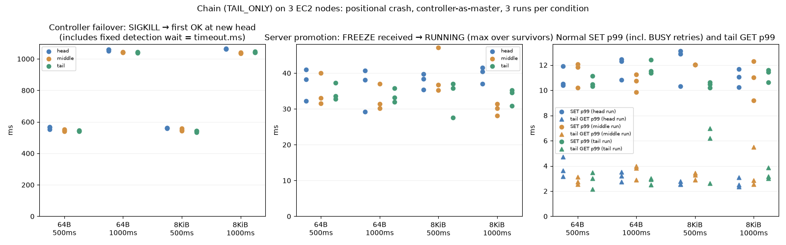

# Chain 실서버: 정상 쓰기·tail 읽기·위치별 crash

관련 이슈: S15P31D111-187 후속(9단계). 기존 `ChainEngine`(head 쓰기·tail 확정·역방향 Ack)을 실제 TCP에 연결하고, 정확한 영구 crash를 아는 **외부 master 역할을 실험 controller가 수행**했다. 이 결과는 master 합의·실제 failure detector·분단 fencing을 포함하지 않는다.

## 실험 조건

- 전용 EC2 세 대, 같은 AZ·m6gd.medium·Ubuntu24.04 arm64·Java21·인메모리 KV·private TCP. 초기 사슬 0(head)→1→2(tail), epoch1, 재전송·제어 간격 retry.ms=200.
- crash 위치 head/middle/tail × 값64B/8KiB × 감지 대기500/1000ms × 3회 = 36회. controller는 crash 대상 호스트에서 실행해 그 JVM에 SIGKILL을 보낸다.
- 정상 구간: warm30 + 측정128건 SET을 head에 보낸다. head는 직전 쓰기의 역방향 Ack가 오기 전 새 쓰기에 BUSY를 돌려주므로 client가 같은 요청을 재시도하며, 지연은 재시도를 포함한 값이다. tail GET 128건과 head GET의 redirect를 확인한다.
- failover: SIGKILL → controller가 timeout.ms만큼 **고정 대기**(실제 failure detector가 아님) → 생존자에 FREEZE(epoch2, 생존 사슬) → REPAIR → 생존자 전부 REPAIRING·길이/적용/Ack 일치·로그 SHA-256 digest 일치 확인 → OPEN → 새 head 첫 SET OK. 모든 시각은 같은 controller의 perf_counter다. digest의 JCA 초기화·JIT 비용이 failover에 섞이지 않도록 crash 전에 세 노드 digest를 한 번 계산해 일치를 확인한다(첫 cohort에서는 이 warm-up이 없어 repair에 70~330ms의 콜드 digest 비용이 포함됐고, 그 결과는 별도 원본으로만 보존한다).
- 서버 promotion은 FREEZE 수신(detectedNs)→RUNNING(readyNs)을 같은 JVM에서 뺀 값으로, 생존자 중 최대다. 호스트 간 nanoTime은 차감하지 않는다.

## 결과 (3회 중앙값; failover는 최소~최대 병기)

|위치|값 B|대기 ms|SET p50/p99 ms|BUSY 재시도 합|tail GET p50/p99 ms|failover ms|대기/freeze/repair(제어+확인+digest)/open/첫쓰기 ms|promotion ms|peer B/SET|
|---|---:|---:|---:|---:|---:|---:|---|---:|---:|
|head|64|500|5.50/10.51|90|0.61/3.62|564.3 (552.8~568.6)|500/11.9/23.7 (8.2+2.1+13.4)/5.2/23.3|38.3|641|
|head|64|1000|5.30/12.28|95|0.69/3.22|1058.8 (1049.8~1061.2)|1000/13.5/23.3 (6.3+3.3+13.2)/4.0/17.5|38.1|642|
|head|8192|500|5.50/12.86|84|0.65/2.56|561.7 (560.0~562.6)|500/14.0/24.1 (4.7+1.7+15.3)/4.1/20.2|38.4|16901|
|head|8192|1000|5.43/11.04|82|0.68/2.49|1063.8 (1062.7~1066.4)|1000/13.2/26.4 (4.8+2.9+17.4)/5.4/20.3|40.5|16903|
|middle|64|500|5.00/11.82|93|0.57/2.75|545.6 (541.0~552.7)|500/12.5/18.9 (5.7+2.0+11.2)/5.9/7.7|33.1|641|
|middle|64|1000|4.98/10.75|97|0.55/3.81|1042.3 (1040.4~1043.9)|1000/10.6/19.1 (4.3+2.2+12.8)/6.2/5.5|31.4|640|
|middle|8192|500|5.55/12.02|107|0.65/3.29|549.5 (544.1~559.0)|500/13.6/23.3 (6.6+2.9+13.8)/6.5/5.9|36.7|16902|
|middle|8192|1000|5.29/11.01|92|0.61/2.84|1039.0 (1034.8~1039.8)|1000/8.7/20.4 (2.7+1.7+16.0)/4.0/4.6|30.2|16901|
|tail|64|500|5.25/10.48|89|0.55/3.02|542.3 (540.8~546.3)|500/12.2/19.0 (5.8+1.3+13.1)/5.8/4.7|33.6|641|
|tail|64|1000|4.96/11.51|93|0.52/2.94|1042.6 (1039.1~1042.8)|1000/11.4/19.3 (5.2+2.0+12.9)/6.5/3.7|33.2|641|
|tail|8192|500|5.35/10.46|104|0.64/6.18|543.6 (534.9~543.7)|500/12.6/17.9 (4.2+1.2+12.0)/3.9/3.6|35.8|16901|
|tail|8192|1000|5.31/11.46|87|0.63/3.16|1041.5 (1040.3~1046.1)|1000/14.0/18.8 (5.0+1.8+11.5)/6.9/3.3|34.5|16901|

36회 모두 정상128건 OK·tail GET128건 OK, crash 전 값 복사본 17,064개(158키×3노드×36)와 crash 후 생존자 복사본 11,448개가 일치했다. 모든 실행에서 FREEZE 응답 applied=158, 복구 길이158, 생존자 로그 digest 일치, epoch1 쓰기 STALE_EPOCH, 비head 쓰기 redirect를 확인했다. BUSY 재시도 합계 1113회.

## 해석

- failover의 대부분은 controller의 고정 감지 대기(timeout.ms)다. freeze/repair/open은 controller↔노드 제어 왕복·상태 polling·digest 비교를 포함한 master 절차 비용이며, 이 값은 PB/VR/Raft의 heartbeat 기반 감지·자체 선출과 직접 비교할 수 없다. 같은 timeout.ms 조건에서 "감지 이후" 비용만 비교할 때 참고한다.
- head crash는 새 head(1)의 client 연결 변경, middle crash는 head→tail 직결, tail crash는 새 tail(1)의 확정 책임 이동이 각각 필요하지만, 세 경우 모두 master 절차가 같아 위치에 따른 복구 비용 차이는 작다.
- SET 지연에는 BUSY 재시도가 포함된다. 이 연구 구현의 head는 tail 결과 중계로 client에 응답한 뒤 역방향 Ack가 도착해야 다음 쓰기를 받으므로, 단일 client가 연속 쓰기를 보내면 짧은 BUSY 구간이 생긴다. 파이프라인 쓰기는 구현하지 않았다.
- 단일 client·128표본·조건별 3회이며 최대 처리량·운영 p99·SSD 측정이 아니다. peer byte는 warm+정상158건 구간의 세 노드 송신 합이다.

[실행별 CSV](chain-results/runs.csv) · [조건별 요약 CSV](chain-results/summary.csv) · [SHA 근거](chain-results/sources.json)
