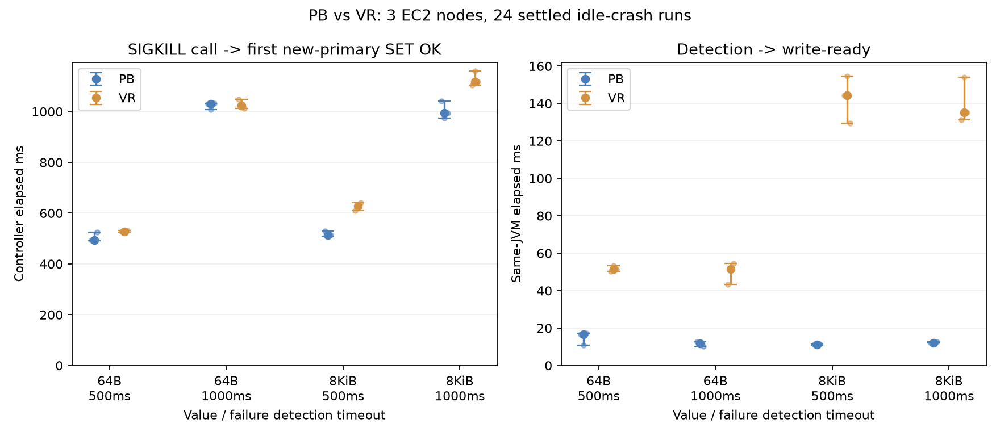
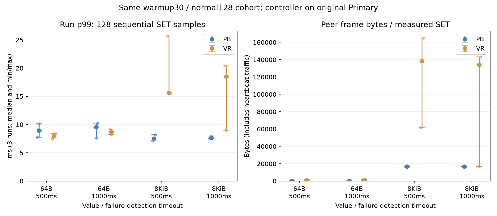

# PB·VR 동일 조건 실제 서버 비교

관련 이슈: S15P31D111-185. 기존 PB 결과와 분리해 같은 배포본·요청 수로 다시 실행했다.

## 조건

- 같은 AZ의 m6gd.medium 3대, Ubuntu 24.04 arm64, Java21, 노드별 인메모리 KV·private TCP.
- PB 전원 적용 ACK / VR INCREMENTAL 과반수 commit + view change. PB epoch1→2, VR view0→1.
- 2방식 × 값64B/8KiB × 감지500/1000ms × 3회 = **24회**. HB50ms·tick10ms.
- warmup30건 후 고유 key SET128건. 원래 Primary 호스트의 Python client, closed-loop 동시성1.
- 양쪽 Backup의 측정 key 값 검증 후 Primary JVM SIGKILL. 진행 중 쓰기·인위적 네트워크 장애 없음.
- 같은 요청 재시도, 간격10ms·deadline1초·socket1.5초. EC2 자체는 종료하지 않음.

## 결과

각 수치는 실행 3회의 중앙값이다. failover 범위는 최소~최대다. p99는 실행당 128개 표본의 nearest-rank이며 운영 p99 추정은 아니다.

|방식|값|감지 ms|SET p50 ms|SET p99 ms|failover ms (범위)|전환 ms|peer B/SET|
|---|---:|---:|---:|---:|---:|---:|---:|
|PB|64|500|3.46|8.97|492.52 (490.35~525.88)|16.62|404|
|PB|64|1000|3.32|9.53|1030.33 (1008.13~1031.59)|11.64|403|
|PB|8192|500|3.40|7.51|513.97 (509.21~529.47)|11.12|16660|
|PB|8192|1000|3.42|7.66|994.28 (974.99~1040.46)|12.16|16659|
|VR|64|500|3.94|7.98|527.19 (524.67~531.76)|51.42|809|
|VR|64|1000|4.01|8.71|1023.98 (1012.29~1047.32)|51.60|1535|
|VR|8192|500|4.66|15.64|627.55 (610.49~640.17)|144.28|138446|
|VR|8192|1000|4.31|18.52|1117.56 (1103.14~1160.53)|135.14|134110|

## 검증과 해석 범위

- 정상 SET **3072건** 전부 OK. 장애 후 생존 두 노드에서 기존128건+첫 새 쓰기 총 **6192개 값 복사본** 일치. stale epoch·Backup 직접 쓰기 거절을 24회 확인.
- 전환 시간은 새 Primary 자신의 readyNs−detectedNs만 사용한다. 전체 failover는 controller의 같은 perf_counter 기준이다. 서로 다른 호스트 시각을 빼지 않는다.
- VR 1회에서 OK 직후 진단 snapshot의 applied가158, commit/logLength가159였다. core의 OK future 완료 다음에 observation을 publish하는 순서로 생길 수 있는 관측 지연이다. 원본은 보존했고, 후속 로컬 KV 읽기에서는 마지막 SET을 포함한 모든 값이 일치했다. 즉시 snapshot의 applied를 쓰기 보존 판정으로 사용하지 않는다.
- 실제 TCP·JVM 스케줄링 비용을 포함한다. 표본3회·동시성1·PB 다음 VR 순서 실행이므로 순위 일반화나 최대 처리량 결론을 내리지 않는다.
- 정상 peer bytes는 노드3개의 비동기 누적 counter 차이이며 heartbeat와 관측 경계 오차를 포함한다. 순수 payload 비용이나 crash 중 상태 전달량은 아니다.
- 현재 관측에서는 VR의 정상 peer bytes도 더 크다. INCREMENTAL 모드도 뒤처진 노드의 GET_STATE에는 전체 START_VIEW를 보낼 수 있다. 이번 실행은 opcode별 횟수를 수집하지 않아 증가분을 특정 메시지 원인별로 분해하지 못했다.
- VR의 view change는 전체 로그를 보낸다. frame 한도2MiB에 맞춰 두 방식 모두 측정128건으로 제한했다. 체크포인트·분할 전송은 없으므로 장기 실행/큰 로그 적용성은 미검증이다.
- 두 Backup의 값을 확인한 뒤 종료한 settled idle crash다. VR 과반수만 반영된 순간의 crash, 미완료 쓰기, partition·재시작 안전성을 이 결과로 보장하지 않는다.
- PB는 crash-only 고정 승계, VR은 정족수·view change·중복 제거가 있어 보장 범위가 다르다. 원 논문/제품 전체 구현 성능 비교가 아니다.
- PB/VR 차이는 이 구현·환경·조건에서 해석한다. 느린 Backup/ACK 단절 PB 실험은 별도 결과에 있고, 같은 장애를 VR에 주입한 실측은 이번 cohort에 없다.

## 재현과 근거

`run_compare_ec2.py`로 새 원본 폴더에 실행한 후 `analyze_compare.py <원본폴더>`를 실행한다. 본 실험은 --quick 없이 수행했다. 실행 tar·스크립트·환경·원본 JSON은 Git 제외 로컬 폴더에 보존한다.
[실행별 CSV](compare-results/runs.csv) · [조건별 CSV](compare-results/summary.csv) · [SHA-256 근거](compare-results/sources.json)
