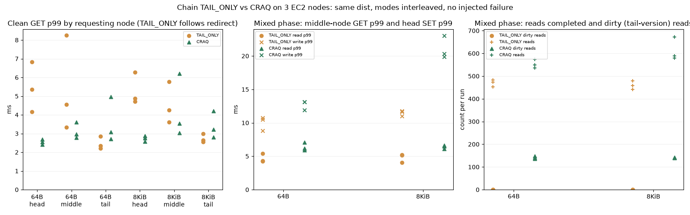

# Chain TAIL_ONLY vs CRAQ 실서버 읽기 경로 비교

관련 이슈: S15P31D111-181 후속(10단계). `feat/craq-reads`의 CRAQ 구현(`ReadMode.CRAQ`, key별 다중 버전, tail 버전 조회)을 실서버 worktree에 통합하고 같은 배포본·부하로 두 읽기 모드를 조건마다 번갈아 측정했다. 가상 실험의 0ns 로컬 읽기를 실서버 성능으로 해석하지 않기 위한 실측이다.

## 실험 조건

- 전용 EC2 세 대, 같은 AZ·m6gd.medium·Ubuntu24.04 arm64·Java21·인메모리 KV·private TCP. 사슬 0(head)→1→2(tail), retry.ms=200, 장애 없음. client는 head 호스트.
- 모드2 × 값64B/8KiB × 3회 = 12회. warm30 SET 후 세 노드 Ack 안정화.
- clean 읽기: 노드0/1/2 각각에 128건 GET. TAIL_ONLY에서 head/middle GET은 NOT_PRIMARY redirect를 받고 client가 tail에 다시 요청하므로 지연은 두 요청 합이다. CRAQ는 clean이면 로컬에서 응답한다.
- 혼합 구간: head에 hot key SET 128건(값 앞 4byte가 순번, BUSY 재시도 포함)을 보내는 동안 별도 reader가 middle 노드에 같은 key GET을 연속 요청한다. CRAQ에서 middle의 dirty 읽기는 tail에 버전을 조회해 확정 버전을 로컬에서 돌려준다. 읽기 순번이 뒤로 가지 않는지(단조) 검사한다.
- 서버 카운터(localReads/queryAttempts/dirtyReads)와 peer opcode byte(84/85 버전 조회, 80/83 데이터·결과 중계)를 구간별로 뺀다.

## 결과 (3회 중앙값, 횟수는 3회 합)

|값 B|모드|clean GET p50/p99 ms head|middle|tail|clean redirect|혼합 SET p99 ms|혼합 GET 수|혼합 GET p50/p99 ms|로컬/dirty/조회시도|redirect|버전조회 B 중앙값|
|---:|---|---:|---:|---:|---:|---:|---:|---:|---:|---:|---:|
|64|TAIL_ONLY|1.82/5.35|1.32/4.56|0.43/2.34|768|10.49|1407|1.02/4.34|0/0/0|1407|0|
|64|CRAQ|0.90/2.55|0.91/2.97|0.99/3.09|0|13.13|1658|0.75/6.17|1234/424/424|0|19320|
|8192|TAIL_ONLY|1.89/4.87|1.55/4.25|0.45/2.65|768|11.66|1378|1.20/5.15|0/0/0|1378|0|
|8192|CRAQ|0.97/2.77|0.97/3.54|1.00/3.21|0|20.34|1841|0.77/6.53|1417/424/424|0|19458|

12회 모두 clean GET 4,608건·혼합 SET 1,536건 성공, 혼합 GET 6,284건에서 순번 역행 0, 값 복사본 1080개 일치. TAIL_ONLY의 head/middle GET은 전부 redirect(각 128건), CRAQ는 redirect 0·clean 로컬 384건/실행이다.

## 해석

- CRAQ의 clean 읽기는 요청 노드에서 바로 응답하므로 head/middle GET이 TAIL_ONLY의 redirect+재요청(두 왕복)보다 짧다. tail GET은 두 모드가 같은 경로다.
- 직접 tail에 보낸 TAIL_ONLY의 clean p50 조건별 중앙값 범위는0.43~0.45ms, CRAQ head/middle은0.90~0.97ms다. CRAQ의 일반적인 지연 우위라고 해석하지 않는다. redirect 경로 제거와 실제 읽기 분산·처리량 효과를 구분해야 한다.
- 혼합 구간에서 CRAQ의 head SET p99가 TAIL_ONLY보다 높다. 버전 조회와 같은 호스트 reader 경합이 함께 포함된 관측이며, 각 원인의 비용을 분리해 계측한 결과는 아니다.
- 혼합 구간의 dirty 읽기는 tail 버전 조회 왕복이 추가되지만 값은 로컬에서 돌려준다. dirty 비율은 reader가 쓰기 진행 중 middle에 도착한 시점에 따라 달라지며 고정 비율이 아니다. TAIL_ONLY는 모든 읽기가 tail로 가므로 dirty 구분 자체가 없다.
- 단일 reader·단일 writer이며 읽기 처리량 상한·다중 reader 분산 효과·GC 대기·장애 중 읽기 가용성은 측정하지 않았다. 가상 실험의 288조건 혼합 부하(`craq-mixed`)는 원래 브랜치에 있으며 이번 실측과 합산하지 않는다.
- 순번 역행0은 단조 읽기 검사다. 호출/완료 시각의 전체 history를 기록하지 않아 선형화 가능성 전체 검증은 아니다. 복사본1080개 검사는 warm key30개×3노드×12회이며, 혼합 hot key의 마지막128은 tail에서만 확인했다. head/middle의 최종 hot 값과 전체 실시간 일관성은 후속 검증 대상이다.
- CRAQ는 빈 KV에서 모든 쓰기가 엔진을 경유해야 하며 COUNT는 tail 전용이다. master 합의·신규 노드 추가는 범위 밖이다.

[실행별 CSV](craq-results/runs.csv) · [조건별 요약 CSV](craq-results/summary.csv) · [SHA 근거](craq-results/sources.json)
