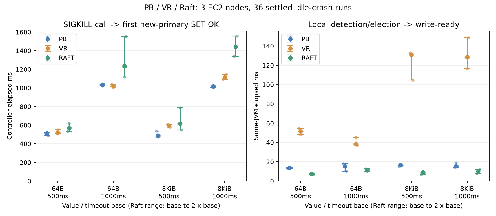
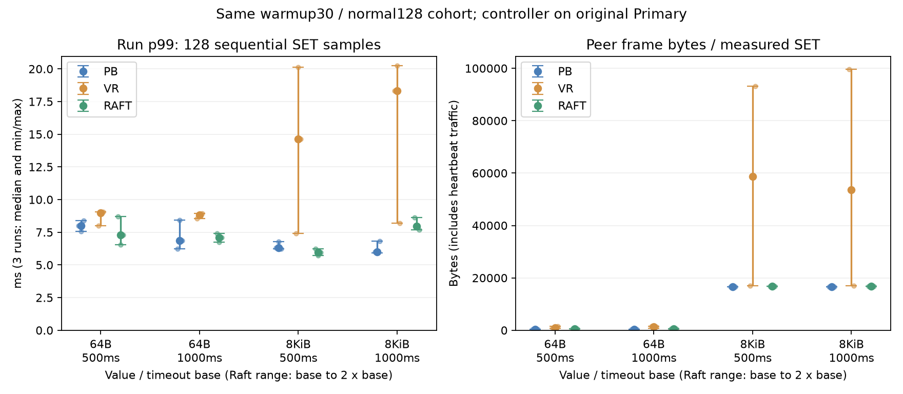

# PB·VR·Raft 동일 배포본 실서버 비교

관련 이슈: S15P31D111-186. 기존 결과와 분리한 새 36회 cohort다.

## 실험 조건

- 같은 AZ의 m6gd.medium 3대, Ubuntu24.04 arm64, Java21, 노드별 인메모리 KV·private TCP.
- PB 전원 적용 ACK·고정 승계 / VR INCREMENTAL 과반수·view change / Raft 과반수·투표 선출.
- 방식3 × 값64B/8KiB × timeout 기준500/1000ms × 반복3 =36회. warmup30건·정상 SET128건, HB50ms·tick10ms.
- PB/VR은 고정 감지 timeout. Raft는 선거 timeout을 [기준,2×기준)에서 뽑는다. 동일한 실제 감지 지연을 강제한 비교가 아니며 난수 범위도 프로토콜 조건으로 보고한다.
- Raft 노드별 난수 seed=반복번호+104729×노드ID. 값 payload는 세 방식 모두 같은 생성식이다. 실제 네트워크·스케줄 순서는 결정론적이지 않다.
- 초기 리더 선출·현재 로그 적용 완료를 기다린다. 실제 선출된 리더 EC2에서 Python controller를 실행하므로 controller는 항상 장애 전 리더와 같은 호스트다. Raft 리더 ID를0으로 고정하지 않는다.
- 양쪽 Backup 값 검증 후 원래 리더 JVM만 SIGKILL. 진행 중 쓰기 없음. 같은 논리 SET 재시도, 간격10ms·deadline1초·socket timeout1.5초.
- closed-loop 동시성1. 측정128건은 현재2MiB frame 한도에 맞춘 것으로 checkpoint·분할 전송은 없다.

## 결과

각 셀은 실행3회 중앙값, failover 괄호는 최소~최대다. p99는128표본 nearest-rank로 운영 환경의 p99 추정이 아니다.

|방식|값 B|timeout 기준 ms|SET p50 ms|SET p99 ms|failover ms (범위)|감지/선거 후 준비 ms|peer B/SET|
|---|---:|---:|---:|---:|---:|---:|---:|
|PB|64|500|3.09|7.99|511.93 (488.66~519.67)|13.57|402|
|PB|64|1000|2.93|6.86|1035.77 (1020.00~1040.14)|15.46|403|
|PB|8192|500|3.18|6.32|489.31 (472.96~537.37)|16.44|16659|
|PB|8192|1000|3.15|5.99|1017.48 (1005.65~1022.53)|15.46|16659|
|VR|64|500|4.31|8.97|518.00 (513.00~553.01)|51.67|930|
|VR|64|1000|4.32|8.84|1016.66 (1015.87~1036.80)|38.41|1350|
|VR|8192|500|4.06|14.63|595.18 (577.77~608.38)|131.18|58720|
|VR|8192|1000|4.47|18.34|1114.48 (1091.31~1144.96)|128.39|53528|
|RAFT|64|500|3.01|7.29|570.35 (532.95~621.97)|7.47|514|
|RAFT|64|1000|4.00|7.10|1233.05 (1116.19~1552.36)|11.32|519|
|RAFT|8192|500|2.98|5.96|616.47 (549.59~786.13)|8.88|16772|
|RAFT|8192|1000|4.31|7.94|1442.78 (1339.64~1558.26)|10.26|16775|

## 검증·해석 범위

- 정상4608건 OK, 기존 성공 쓰기4608건 보존. 장애 후 생존 두 노드의 기존128개+첫 새 쓰기 총9288개 값 복사본 일치. stale epoch·Backup 직접 쓰기 거절36회 확인.
- 실제 Raft 리더 이동(실행 순서의 이전→이후): 1→0, 0→2, 2→0, 1→2, 2→0, 1→0, 1→2, 0→1, 2→1, 1→2, 2→1, 1→0.
- 전체 failover는 controller의 SIGKILL 호출 직전→새 리더 첫 OK까지다. 전환은 승격 노드 내부 시계만 차감한다. 서로 다른 호스트의 nanoTime을 직접 빼지 않는다.
- Raft 전환 지표는 **승리한 최근 로컬 선거의 후보 시작→현재 term no-op 포함 적용 준비 완료**다. 초기 선거 누적값을 쓰지 않도록 선거별 진단을 추가했다. 선행 실패 선거/다른 노드 감지 대기는 전체 failover에만 포함되므로 전환 지표를 프로토콜 전체 선거 비용으로 해석하지 않는다.
- timeout 범위·리더 배치·정상 전송 패턴이 다르므로 이 구현과 조건의 결과다. 장애 감지 후 전환만으로 가용성/안전성 우열을 판단하지 않는다.
- 정상 peer bytes는 누적 전송 frame counter의 차이로 heartbeat·재전송·상태 전달 fallback과 관측 경계 오차를 포함한다. opcode별 원인 분해는 없다.
- 실제 KV 값 검증을 보존 판정으로 사용한다. OK 완료 후 observation publish 순서 때문에 즉시 진단 snapshot은 적용 위치가 잠시 뒤처질 수 있다.
- 각 조건3회·짧은 warmup·동시성1·PB→VR→Raft 순서 실행이다. 최대 처리량·SSD·논문 전체 시스템 성능·partition·재시작 보장을 주장하지 않는다. Raft term/vote/log는 메모리이며 crash/restart durability는 미구현이다.
- 이번 실험은 양쪽 Backup 반영 후 idle crash다. 정족수만 반영된 순간의 crash나 미완료 쓰기 검증은 아니다. 기존 PB42회·PB/VR24회 결과와 섞지 않았다.

## 재현·근거

`run_election_ec2.py` 본 실행 후 `analyze_election.py <원본폴더>`. --quick은64B/500ms 각 방식1회로 본집계에서 제외한다. 실행tar·script·환경·원본은 로컬 Git제외 폴더에 보존한다.
[실행별 CSV](election-results/runs.csv) · [조건별 CSV](election-results/summary.csv) · [SHA-256 근거](election-results/sources.json)
