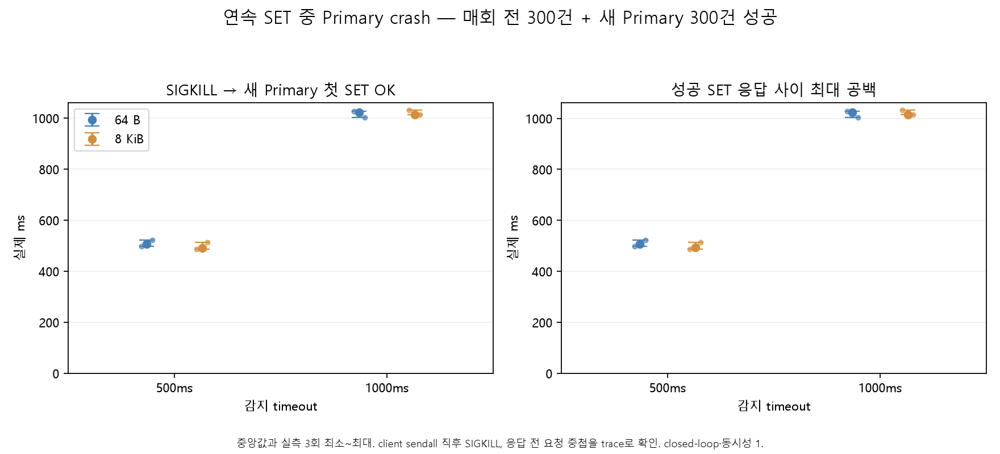
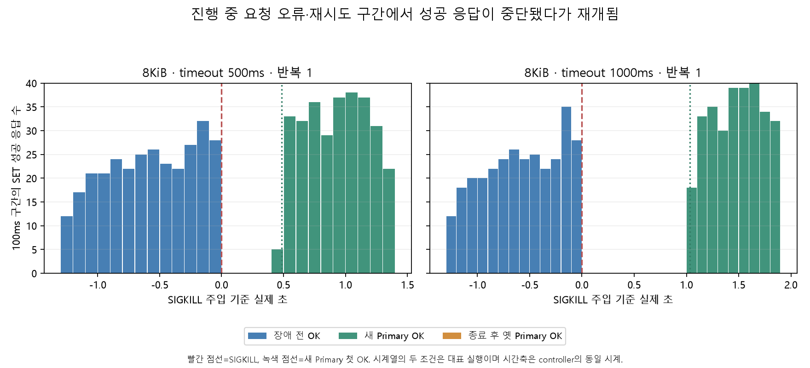

# PB 연속 쓰기 중 Primary crash — 2026-11-04

실제 EC2 세 대에서 client 요청 전송 직후, 응답을 읽기 전에 Primary JVM을 종료했다. 기존 유휴 시점 crash 12회와 별도 집계한다.

|값|감지 timeout|첫 새 Primary OK 중앙값 [최소~최대] ms|최대 성공 공백 중앙값 ms|진행 중 요청 재시도 횟수 범위|성공 쓰기 보존|
|---|---:|---:|---:|---:|---:|
|64B|500|507.375 [498.143~523.251]|507.420|44~46|1800/1800|
|64B|1000|1023.362 [1002.527~1027.554]|1023.420|92~94|1800/1800|
|8192B|500|491.193 [485.889~512.959]|493.206|42~44|1800/1800|
|8192B|1000|1013.113 [1013.110~1032.381]|1014.682|92~94|1800/1800|

## 확인한 것

- 12회 모두 장애 전 300건과 새 Primary 300건 성공. 총 성공 쓰기 7,200건, 생존 두 KV의 값 복사본 14,400개 확인. 유실·값 불일치·미해결 논리 요청 0.
- 진행 중 요청의 첫 결과 집계: {'CLIENT_FAILURE': 12}. 같은 operation/key/value 재시도로 최종 성공. 옛 Primary의 늦은 OK는 새 Primary 복구로 세지 않았다.
- 종료 뒤 재시도 전 관측한 후보 key의 생존 복사본 수: {0: 7, 2: 5}. 관측 시각과 상태를 원본에 기록하며 원자적 snapshot으로 간주하지 않는다.
- 각 요청의 start/send/end와 SIGKILL 호출 전후 시각을 기록해 장애와 client 요청 구간이 겹쳤는지 확인했다.
- 정상 client write는 중단 없이 closed-loop로 제출하고, 장애 후에는 같은 논리 SET을 최대 15초 예산·10ms 간격으로 재시도했다. 동시성은 1이다.
- 상태 코드와 연결 오류를 모두 원본에 남겼다. STALE_EPOCH/Backup NOT_PRIMARY·Redirect도 매회 확인했다.

## 보장 범위

**실제로 검증한 장애 시점은 client-inflight다. 서버가 이미 쓰기를 받아 Backup에 전달한 특정 내부 단계까지 강제한 실험은 아니다.** 복사본이 없던 후보를 재시도로 새로 적용한 경우를 미완료 로그 복구의 증거라고 부르지 않는다.
PB 자체에 client table이나 미완료 쓰기 복구를 추가하지 않았다. 동일 SET 재전송은 값 기준으로 멱등이며 exactly-once·valueVersion 중복 방지를 보장하지 않는다.
타이밍은 같은 controller perf_counter로 측정했다. JVM 내부 전환 duration만 해당 JVM의 nanoTime 차이를 사용한다. EC2 자체·Backup을 종료하지 않았고 인위적 ACK 지연/partition도 주입하지 않았다.
결과는 동일 AZ, m6gd.medium 세 대·인메모리 KV·원래 Primary 호스트에 공존한 client/controller 조건이다. 최대 처리량·SSD 성능 결과가 아니다.

## 재현·보관

- [실행 안내](README.md#연속-쓰기-중-crash), [12행 CSV](load-results/summary.csv), [원본 및 artifact SHA-256](load-results/sources.json).
- 원본 JSON에는 요청별 attempt, 논리 완료, 후보 key 관측, 서버 상태가 있다. 개인 IP/키·서버 로그·원본은 Git 제외 로컬 폴더로 수집했다.
- Python 집계 테스트 3개 통과. 이번 단계는 Python 실험/분석 추가이며 Java 프로토콜은 변경하지 않았다. 기존 Java 전체 build 645개 테스트 통과 상태를 유지한다.
- 다음 알고리즘이나 느린 Backup 실험은 이 단계에서 시작하지 않았다.
