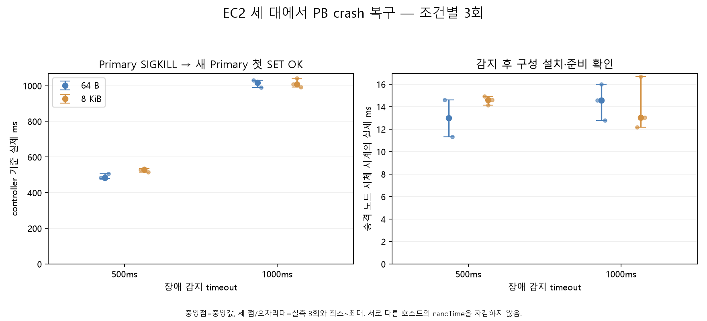
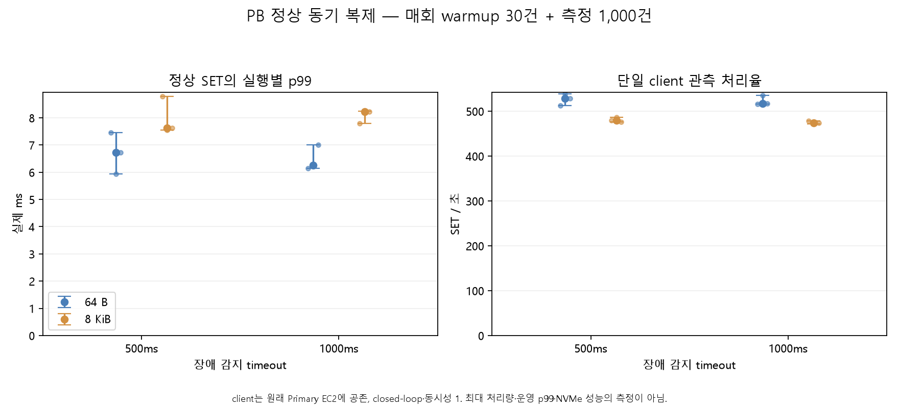

# PB EC2 실측 결과 — 2026-11-04

m6gd.medium 세 대 · Ubuntu 24.04 arm64 · OpenJDK21 · 같은 AZ · 실제 프라이빗 TCP.
값 2 × 감지 timeout 2 × 반복 3 = 12회. 정상 SET 성공 12,000건, 첫 post-crash SET 12건. 모든 실행 성공.

|값|timeout|SET p99 중앙값 (ms)|단일 client SET/s 중앙값|첫 쓰기 복구 중앙값 [최소~최대] (ms)|감지 후 전환 중앙값 (ms)|성공 쓰기 보존|
|---|---:|---:|---:|---:|---:|---:|
|64B|500|6.729|528.3|484.063 [480.208~505.903]|12.979|3000/3000|
|64B|1000|6.254|517.6|1016.921 [989.225~1031.042]|14.574|3000/3000|
|8192B|500|7.632|479.9|529.623 [514.687~535.942]|14.594|3000/3000|
|8192B|1000|8.216|474.3|1008.782 [992.656~1040.694]|13.040|3000/3000|

## 보존과 응답 검증

- 매회 장애 전 OK 1,000건을 두 Backup에서 확인(총 24,000개 복사본).
- 장애 후 같은 1,000건과 첫 새 쓰기를 생존 두 노드에서 확인(총 24,024개 복사본). 유실/값 불일치 0.
- 12회 모두 epoch1 쓰기를 새 Primary가 STALE_EPOCH로 거절했고, Backup 직접 쓰기는 NOT_PRIMARY + Redirect(1)였다.
- 정상 부하 종료 후 crash를 주입했으므로 진행 중 쓰기 복구나 중복 요청 보장까지 검증한 것은 아니다.

## 해석

이번 조건에서는 timeout 500ms에서 약 480~536ms, timeout 1000ms에서 약 989~1041ms에 첫 새 쓰기가 성공했다. 감지 후 전환은 약 11~17ms였다. 감지 timeout이 전체 복구 시간에 큰 비중을 차지한다는 관측이며 다른 프로토콜과의 실측 순위는 아니다.
첫 쓰기 복구는 같은 controller의 SIGKILL 호출 직전~새 Primary OK 수신 구간이다. 서버 전환 시간은 승격 노드 내부 duration이며, 서로 다른 호스트의 monotonic 시각을 직접 비교하지 않았다.

정상 p99는 매회 1,000개 sample의 p99를 구한 뒤 실행별 중앙값으로 요약했다. client와 Primary의 CPU 공존, 30건 warmup, 3회 반복, 단일 in-flight·동시성 1을 명시한다. CPU·실제 TCP가 포함된 측정이지만 최대 처리량이나 SSD 성능 결과는 아니다.

현재 PB만 실서버에 연결했다. 연속 SET 중 client 요청과 crash가 겹치는 조건은 [별도 12회 결과](load-results.md)에 있다. VR/Raft/Chain/CRAQ/Rosé 실서버 비교, 서버 내부 처리 단계 고정 crash·ACK 유실/지연·partition·재시작은 후속이다.

## 재현과 보관

- [조건·실행 방법](README.md), [12행 CSV](results/summary.csv), [원본별 SHA-256 및 실행 artifact hash](figures/sources.json).
- 원본 JSON·서버 로그·환경·실제 배포 tar는 로컬 Git 제외 실행 폴더에 보관한다. 개인 키·IP·멘토링 자료는 저장소 문서에 넣지 않는다.
- 이 브랜치 변경은 미커밋이다. 기준 develop commit과 배포 artifact hash를 함께 기록하며 기준 commit만으로 새 구현이 포함됐다고 해석하지 않는다.
