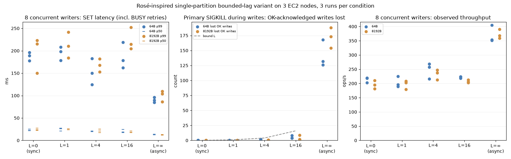

# Rosé 단일 파티션 변형 실서버: L별 쓰기 지연·backpressure·crash 유실 상한

관련 이슈: S15P31D111-187 후속(11단계). `RoseEngine`(bounded-lag Primary-Backup 단일 파티션·op 상한 변형)을 실제 TCP에 연결했다. 원 논문의 다중 파티션 coordinated apply·snapshot·지역 복제·영속 WAL은 재현하지 않았다. 외부 master 역할은 정확한 Primary crash를 아는 controller가 맡는다.

## 실험 조건

- 전용 EC2 세 대, 같은 AZ·m6gd.medium·Ubuntu24.04 arm64·Java21·인메모리 KV·private TCP. Primary 0, Backup 1/2, retry.ms=200. controller/client는 Primary 호스트.
- L ∈ {0(전원 적용 ACK 동기), 1, 4, 16, -1(무제한 비동기)} × 값64B/8KiB × 3회 = 30회.
- 정상: warm30 후 closed-loop client 8개가 각각 64건(총512건) SET. 지연은 BUSY 재시도를 포함한 client 관측값이며 peakLag/backpressureCount는 Primary 상태값이다.
- crash: client 8개가 계속 쓰는 중 각 client가 32건 이상 OK를 받은 시점에 Primary JVM SIGKILL → controller가 timeout.ms(500) 고정 대기 → 두 Backup FREEZE → 적용 prefix가 긴 쪽을 새 Primary로 REPAIR → 로그 digest 일치·minAck 확인 → OPEN → 새 Primary 첫 SET OK. OK를 받았는데 새 Primary에 없는 key를 유실로 센다. 응답 없이 끊긴 요청은 unknown으로 따로 센다.

## 결과 (3회 중앙값, 합·최대는 3회 기준)

|값 B|L|SET p50/p99 ms|ops/s|BUSY 재시도|peakLag 최대|backpressure 합|crash 전 OK 합|unknown 합|유실 최대/합 (상한 L)|failover ms|repair ms|promotion ms|
|---:|---:|---:|---:|---:|---:|---:|---:|---:|---:|---:|---:|---:|
|64|0|22.18/189.37|218|12814|1|1511|975|24|0/0 (0)|595.9 (593.9~598.3)|49.0|64.9|
|64|1|25.80/198.59|196|14012|1|1620|1013|24|0/0 (1)|593.8 (590.6~600.7)|48.3|63.5|
|64|4|20.80/149.83|257|9723|4|1398|1060|24|2/5 (4)|596.9 (595.8~597.2)|53.4|68.3|
|64|16|18.67/178.14|222|9592|16|1335|1053|24|8/16 (16)|613.9 (607.3~620.5)|70.8|85.3|
|64|∞|13.08/89.89|353|4559|282|0|1006|23|168/426 (∞)|602.2 (594.2~610.4)|65.4|78.6|
|8192|0|23.62/215.58|195|12926|1|1524|973|24|0/0 (0)|614.9 (603.5~617.6)|66.1|83.4|
|8192|1|24.08/210.26|203|13816|1|1618|889|24|0/0 (1)|602.8 (593.7~607.2)|59.2|73.9|
|8192|4|20.74/167.96|237|9495|4|1417|1037|24|1/2 (4)|609.4 (608.5~618.5)|72.2|82.8|
|8192|16|18.17/214.79|206|9287|16|1348|1173|24|9/12 (16)|632.2 (607.9~642.2)|94.4|108.7|
|8192|∞|12.41/104.27|368|3501|352|0|1072|24|188/515 (∞)|604.7 (590.1~615.5)|62.1|72.3|

30회 모두 정상512건 OK·복사본1,536개 일치, crash 전 OK 10,251건 중 유실 976건이며 L≥0 조건에서 유실이 L을 넘은 실행은 없었다. L=0은 유실 0이다. 모든 실행에서 생존자 로그 digest 일치, epoch1 쓰기 STALE_EPOCH, Backup 직접 쓰기 redirect를 확인했다.

## 해석

- L=0은 모든 Backup 적용 ACK 뒤 응답하므로 유실이 없고 지연이 가장 길다. L>0은 로컬 적용 뒤 바로 응답하며 Backup 최소 ACK와의 거리가 L에 닿으면 backpressure로 새 쓰기를 미룬다. 유실 수는 crash 순간의 실제 lag이며 상한 L 안에 있다.
- 동시 client 8개에서는 L=1~16 모두 lag가 L에 닿아 backpressure가 자주 발생했고(3회 합 약1,300~1,600회), peakLag 최대는 정확히 L이다. L=∞는 lag가 수백 op까지 커져 crash 한 번에 OK 쓰기 수백 건이 사라졌다. 느린 Backup·원거리 복제 조건은 이번 실측에 없다.
- 정상 p50/p99(약20ms/150~215ms)는 client 8개가 한 Primary를 공유하며 적용 중(BUSY) 재시도를 반복한 결과다(3회 합 BUSY 재시도 약3,500~14,000회). 단일 client 조건의 PB/VR/Raft 지연과 직접 비교하지 않는다. L=∞가 가장 짧은 이유는 Backup ACK를 기다리지 않아 BUSY 구간이 줄기 때문이다.
- failover는 controller의 고정 감지 대기(500ms)를 포함하며 실제 failure detector가 아니다. 새 Primary 선택은 적용 prefix 길이 비교이고 두 Backup 길이가 다르면 짧은 쪽을 peer 경로로 복구한다.
- 단일 파티션·op 상한 변형이므로 Rosé 원 논문의 보장·성능 수치와 직접 비교하지 않는다. PB(전원 ACK)와 L=0이 같은 보장 수준이고 L>0·무제한은 성공 쓰기 유실을 허용하는 다른 보장 수준이다.

[실행별 CSV](rose-results/runs.csv) · [조건별 요약 CSV](rose-results/summary.csv) · [SHA 근거](rose-results/sources.json)
