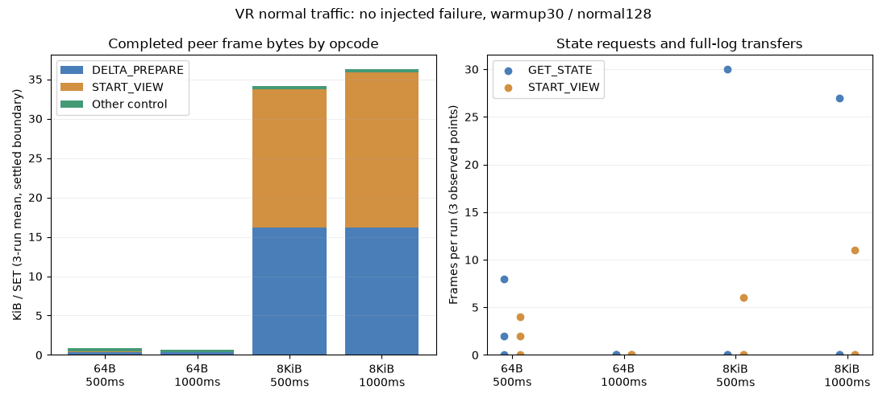

# VR 정상 전송량 증가 원인 분석

관련 이슈: S15P31D111-187. 알고리즘을 바꾸지 않고 원인 카운터와 opcode별 송신 완료량을 추가했다.

## 실험 조건

- 전용 EC2 세 대, 같은 AZ·m6gd.medium·Ubuntu24.04 arm64·Java21·인메모리 KV·private TCP.
- VR INCREMENTAL, 값64B/8KiB × 감지500/1000ms ×3회 =12회. HB50ms·tick10ms. 장애·인위적 지연·손실 주입 없음.
- Primary 호스트의 단일 closed-loop client. warm30건을 세 노드가 적용하고 데이터 전송량이 안정된 뒤 측정128건 시작.
- before / 즉시 immediateAfter / 모든 값 검증 및 데이터 전송량 안정 후 settledAfter를 각각 기록한다. 정상 구간과 잔여 전송(tail)을 CSV에서 구분한다.
- byte는 성공한 로컬 TCP write의 length+header+body다. 원격 수신·TCP/IP overhead가 아니다. 안정화 중 heartbeat 비용도 combined에 포함한다.

## 관측 결과

|값 B|감지 ms|peer B/SET 평균|START_VIEW byte 비중 최소~최대|전체 로그 frame 합계|GET_STATE 합계|COMMIT gap 합계|
|---|---:|---:|---:|---:|---:|---:|
|64|500|865|0.0%~30.1%|6|10|10|
|64|1000|689|0.0%~0.0%|0|0|0|
|8192|500|34950|0.0%~76.1%|6|30|30|
|8192|1000|37139|0.0%~78.3%|11|27|27|

정상1536건 모두 OK. warmup 포함 총5688개 값 복사본이 일치했다. 측정+tail에서 GET_STATE 67개, COMMIT gap 요청 67개, START_VIEW 23개, 전송 제어 재전송 0회를 기록했다.

전체 로그 전송은12회 중 4회에서 발생했고, 나머지 8회에서는0이었다. 전체 로그 byte 합계 14,755,488 B는 전체 peer frame 28,278,879 B의 52.2%다. 중복 전체 로그 요청 44회는 억제됐다. 이는12회 합계의 비중으로, 모든 실행/값 크기에 같은 비중이 발생한다는 뜻은 아니다.

## 원인 검증

1. 정상 경로의 뒤처진 Backup은 자신의 로그 끝보다 앞선 COMMIT을 받으면 GET_STATE를 보낸다. Primary는 전체 로그를 담은 START_VIEW로 응답한다.
2. Primary는 Backup별 확인을 기다리는 전송 창이 하나다. 다른 Backup과 과반수를 충족해 다음 쓰기가 성공해도, ACK가 늦은 Backup에는 다음 DELTA가 아직 전달되지 않을 수 있다. 이때 COMMIT이 해당 로그보다 앞설 수 있다.
3. 결정론적 테스트에서 메시지를 버리거나 순서를 바꾸지 않고 Backup2 ACK만40ms 늦춰 같은 COMMIT gap→GET_STATE→START_VIEW 경로를 재현했다. view change 없이 모든 값은 최종 보존됐다. 순차·빠른 ACK 대조군은 전체 로그 전달이0이었다.
4. 실제 서버에서도 원인 카운터와 opcode frame/byte를 대조한다. GET_STATE 이유 합계 및 송신 성공 횟수가 일치하는지 검증했다. 요청 이유 카운터는 요청 횟수이며, 중복 요청이 throttle될 수 있어 전체 로그 송신 횟수와 같다고 가정하지 않는다.

## 해석 범위와 후속

- 이번 결과는 상태 전달 fallback 경로와 비용을 확인한 것이다. ACK40ms는 재현용 조건이며 실제 서버의 ACK 지연이40ms였다는 뜻은 아니다.
- core 카운터는 항목별 원자적 관측, wire opcode/합계는 노드별 lock 안에서 일관된 snapshot이다. 노드 간 동시 snapshot은 아니므로 안정된 데이터/요청 카운터로 대조하고 heartbeat는 원인별 정확한 일대일 매칭을 주장하지 않는다.
- 카운터와 warmup 안정화 절차를 추가했으므로 이전 단계의 지연·전송량 수치와 직접 전후 개선 비교하지 않는다. 최적화·보장수준 변경은 하지 않았다.
- TRANSFER_RESEND는 프로토콜의 전송 제어 재시도다. OS의 TCP 패킷 재전송 횟수는 측정하지 않았다.
- 후속 후보는 Backup별 로그 확인 범위에 맞춘 COMMIT 통지 또는 증분 catch-up이다. 각각 안전성·복구 지연을 검증한 뒤 같은 조건에서 전후 비교해야 한다.
- 큰 로그의2MiB frame 제한·checkpoint 부재·최대 처리량·SSD·프로세스 재시작은 이번 범위 밖이다.

[실행별 CSV](traffic-results/runs.csv) · [opcode별 정상/tail CSV](traffic-results/opcodes.csv) · [원인별 CSV](traffic-results/reasons.csv) · [SHA 근거](traffic-results/sources.json)
