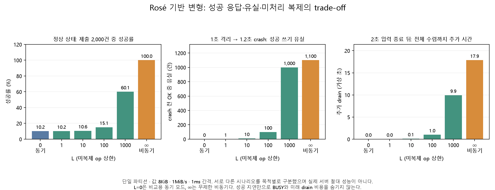
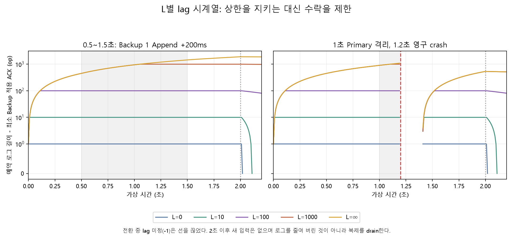

# Rosé 기반 bounded-lag 변형 결과

2026-10-29 (Asia/Seoul). **단일 파티션·op 단위 상한 변형 240조건**을 공통 Runner에서 실행했다. 논문의 다중 파티션 coordinated apply·snapshot·지역 장애 복구를 재현한 결과가 아니다. [구현과 전제](README.md)를 따른다.

- [240조건 원본 요약](runs/run-2026-10-29T01-03-29.244815600Z-bee0648a/repeat-001/results.md)
- [조건별 CSV](runs/run-2026-10-29T01-03-29.244815600Z-bee0648a/repeat-001/summary.csv) · [10ms 시계열 CSV](runs/run-2026-10-29T01-03-29.244815600Z-bee0648a/repeat-001/samples.csv)

## 확인한 결과

240조건 전부 생존 로그가 수렴했고, 유한 L의 예약 lag·성공 쓰기 유실 상한을 모두 만족했다. 각 L은 40조건, 총 48,000번의 요청을 받았다.

|L|성공 / 제출|조건 중 최대 성공 쓰기 유실|최대 예약 lag|최종 수렴|
|---|---:|---:|---:|---:|
|0 (동기 제어군)|16,117 / 48,000|0|1 (미응답 한 건)|40/40|
|1|16,138 / 48,000|1|1|40/40|
|10|16,535 / 48,000|10|10|40/40|
|100|20,231 / 48,000|100|100|40/40|
|1000|39,960 / 48,000|1000|1000|40/40|
|∞ (무제한 비동기)|46,000 / 48,000|1100|1900|40/40|

집계에는 정상·지연·분단·crash가 섞여 있으므로 실제 제품의 평균 성공률이나 처리량으로 해석하지 않는다. L=0은 비교용 동기 모드이며 Rosé 논문의 필수 설정이 아니다.

## 무엇과 무엇을 교환했나

8KiB·1MiB/s·1ms 간격 대표 조건:

|L|정상 성공 / 2,000건|격리 후 crash 전 OK|그중 유실|정상 입력 종료 뒤 추가 drain|
|---|---:|---:|---:|---:|
|0|203|100|0|0.02초|
|1|203|101|1|0.02초|
|10|212|110|10|0.11초|
|100|302|200|100|1.00초|
|1000|1,202|1,100|1,000|9.93초|
|∞|2,000|1,200|1,100|17.85초|

**L을 키우면 더 많은 쓰기를 먼저 성공시킬 수 있지만, crash에서 잃을 수 있는 성공 쓰기와 아직 남아 있는 복제 작업도 커진다.** 유한 L이 없는 제어군은 정상 입력 2,000건을 모두 즉시 성공시켰지만 실제 복제 수렴에는 입력 종료 후 17.85초가 더 필요했다.

무제한 비동기의 정상 p99가 모델상 0ns여도 미래 복제 비용이 0이라는 뜻이 아니다. 즉시 로컬 KV·CPU 비용 0인 가상 모델의 응답 시점이다. 유한 L에서는 성공 지연만 보지 않고 BUSY·TIMEOUT과 성공 수를 함께 본다. 예를 들어 L=10 정상 대표 조건은 p99 약 9.90ms지만 성공 212건, BUSY 1,788건이었다.

## crash·복구와 보장 범위

- 원래 Primary만 영구 종료한다. 실험 master가 200ms 뒤 이를 정확히 알고, 두 Backup을 freeze한 뒤 **최장 적용 prefix**를 가진 노드를 선택한다. 동률이면 NodeId 순이다.
- 느린 Backup은 peer 경로로 따라잡는다. PB의 NodeId 고정 승계와 다르며 master 합의·오판 비용은 포함하지 않는다. 감지와 선택 방식이 다른 다섯 variant의 동일 조건 속도 순위를 주장하지 않는다.
- 유실은 crash 전 OK를 받은 ID 중 최종 새 Primary prefix에 없는 수다. 남은 ID·명령·값을 확인하고 현재 Primary의 실제 KV와도 대조했다. crash 뒤 성공한 쓰기나 정상 상태 성공 쓰기가 사라지는 것은 허용하지 않았다.
- 한 명령을 적용 경계로 사용했다. 다중 파티션 common snapshot·coordinated apply와 영속 WAL trim의 이점을 증명한 결과가 아니다.
- request deadline은 500ms다. 만료 전에 이미 수락·적용한 쓰기는 나중에 복제될 수 있다. 아직 수락하지 않고 대기 중인 쓰기는 deadline에 제거하며 ACK와 같은 시각의 경계도 검증했다.
- 두 crash 시나리오의 96조건 모두 crash 후 새 쓰기의 첫 OK를 관측했다. 2초 이후에는 새 probe 없이 최대 30초 drain한다.

## 검증·재현

- 전체 Gradle build 및 **502테스트 통과**, 실패·오류 0.
- 상한 도달 대기·동기 전원 ACK·무제한 제어군·정확한 deadline 경계·최장 prefix 승격·중복 SET/DELETE 결과·stale epoch·유실/중복 ACK·분단 중 승격 금지·prefix KV를 검증했다.
- quick 30조건 두 번의 CSV가 동일했고 원본 JSON에서 CSV·시계열·보고서를 재생성할 수 있다.
- 기존 네 방식 288조건 회귀 CSV도 이전과 동일: `E3A84FEC1ED945571F2A2955A1D8C8E78C9404AD526512EE9919335DB00AB176`.
- 최종 CSV SHA256: `F7F062BB0E09A995C1E40FCE02BA995A1A0973E3DAE5DCF828871380EEC15E4B`
- 시계열 CSV SHA256: `8FA8A546F925CD269FB6E6188829B0B5430C9929E2A71EBBAC01D2F20124EF72`
- quick CSV SHA256: `3A9041B39318C55CD7035971EFA37DFC3FECAD4A39DF873A8C49871441101561`
- source hash: `35ddbb409357aa1d7256a2ed37e16dc4be69e7f1815680ef8340170fe3498184`
- backend hash: `4391971ba07eddd3e9f6e9bec8b883749d7cb28185ec5714f0f0ffe37c1f139b`

HEAD `df5716b5174f58093b7f6438520b1eecc3658ad9`의 미커밋 작업이다. Rosé 변형 추가로 기존 결과를 덮어쓰지 않았다. 실제 서버·checkpoint·pipeline·다중 파티션 확장은 멘토 질문으로 남긴다.
