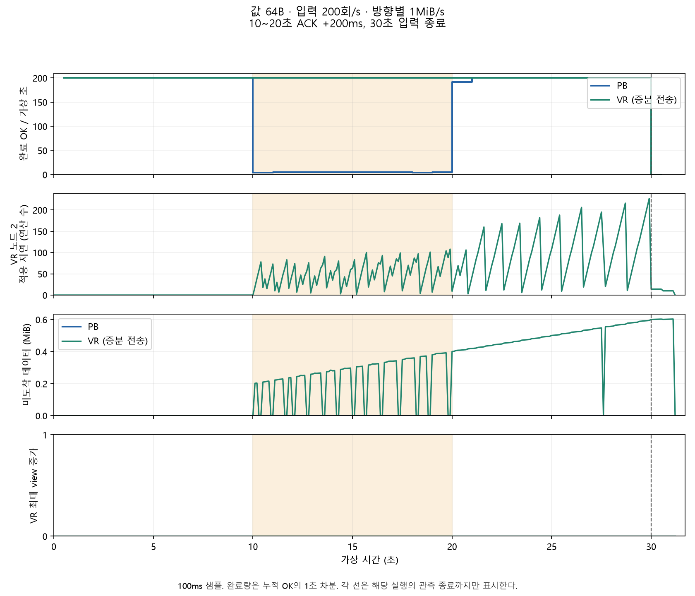
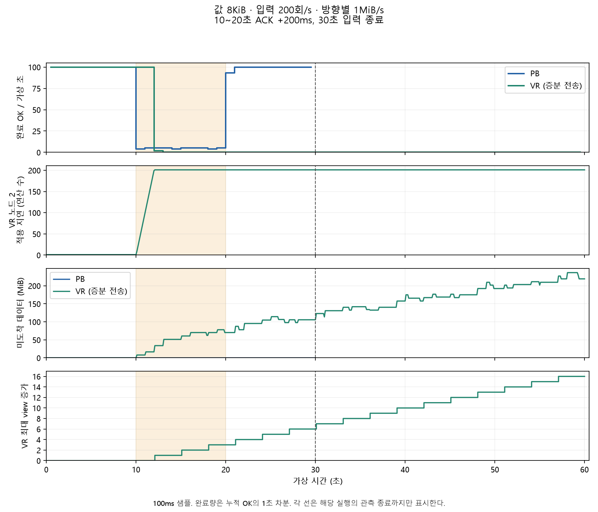

# 30초 연속 부하 결과

2026-10-28 (Asia/Seoul). 48조건에 고정 간격으로 60만 요청을 제출했다.
작은 값에서는 VR이 느린 ACK의 영향을 줄였지만, 큰 값의 느린 Backup 조건에서는 상태 전달·큐·view 변화가 누적되어 일부 조건이 관측 상한까지 수렴하지 않았다.
단일 쓰기 개선 결과를 연속 부하 전체의 안정성으로 일반화할 수 없음을 확인했다.

- [전체 조건 보고서](runs/run-2026-10-28T07-07-52.313873900Z-214c4fd3/repeat-001/results.md)
- [조건·구간·시계열 CSV](runs/run-2026-10-28T07-07-52.313873900Z-214c4fd3/repeat-001/summary.csv)
- [실험 모델·지표 정의](README.md) · [실행 설정](comparison.properties)
- [이 결과를 바탕으로 준비한 멘토 질문](mentoring-questions.md)

## 전체 결과

| 구분 | 조건 | 전체 수렴 확인 | 추가 30초 내 수렴 미확인 |
|---|---:|---:|---:|
| PB NORMAL | 12 | 12 | 0 |
| PB SLOW_RECOVER | 12 | 12 | 0 |
| VR NORMAL | 12 | 12 | 0 |
| VR SLOW_RECOVER | 12 | 7 | 5 |

48조건 모두 실행과 원본 검증을 완료했다. 수렴 미확인은 Runner 프로세스 실패가 아니다.
30초에 새 입력을 중단하고 최대 30초를 더 관측했으며, 총 43조건에서 정의한 전체 수렴을 확인했다.

| 요청 결과 (선택한 모든 조건 합) | 건수 |
|---|---:|
| 제출 | 600,000 |
| OK | 206,932 |
| BUSY | 349,667 |
| UNAVAILABLE | 43,372 |
| STALE_EPOCH | 29 |
| TIMEOUT / NOT_PRIMARY / 최종 응답 미완료 | 0 |

이 비율은 조건 조합과 입력률을 합한 값이다. 실제 운영의 성공 확률이나 최적 설정을 뜻하지 않는다.

## 1. 동시 쓰기 한 건이라는 구현 조건이 드러난다

정상 상태, 값 64B·1MiB/s에서 두 방식의 결과가 같았다.

| 제출 간격 | 제출 수 | OK | BUSY | 0~30초 실제 OK/s |
|---|---:|---:|---:|---:|
| 1ms | 30,000 | 10,000 | 20,000 | 333.333 |
| 5ms | 6,000 | 6,000 | 0 | 200.000 |
| 20ms | 1,500 | 1,500 | 0 | 50.000 |

응답을 기다려 입력률을 낮추지 않았다. 입력 간격이 RTT보다 짧으면 현재 한 건씩 처리하는 엔진이 BUSY를 반환한다.
따라서 이 처리량을 복제 알고리즘의 병렬 처리 한계로 해석하지 않는다. 공통 pipeline을 구현할지 여부는 멘토링에서 범위를 정할 주제다.

## 2. 작은 값에서는 과반수의 가용성 이점이 유지됐다

값 64B·제출 간격 5ms·1MiB/s의 10~20초 ACK 지연 구간:

| 방식 | 해당 구간 제출 | 그 요청의 최종 OK | BUSY | 성공 요청 p50 / p99 |
|---|---:|---:|---:|---:|
| PB | 2,000 | 49 | 1,951 | 202.161 / 202.161ms |
| VR | 2,000 | 2,000 | 0 | 2.188 / 2.188ms |

PB는 노드 2의 적용 ACK 전달을 기다렸다. VR은 나머지 과반수로 정상 쓰기를 계속했지만, 느린 노드의 적용 지연과 상태 전달 backlog는 따로 남았다.
PB가 실제 10~20초 안에 완료한 OK는 48건, VR은 2,000건이다. 위 표의 49건은 그 구간에 **제출한** 요청의 최종 성공 수라 완료 구간 집계와 다르다.

**그림 1.** 값 64B·입력 200회/s·1MiB/s. 음영은 ACK 지연 구간이고 점선은 입력 종료다. 완료량은 누적 OK의 1초 차분이다.
노드 2 적용 지연은 100ms 샘플이며, PB에는 같은 로그 위치가 없어 해당 선을 그리지 않았다. 각 선은 자신의 관측 종료까지만 표시한다.
이 조건에서 VR의 20초 watermark 따라잡기는 복구 후 400ms 샘플에서 관측됐고, 전체 데이터·로그 상태의 수렴은 입력 종료 후 1,200ms에 확인됐다.
watermark를 한 번 따라잡았다고 계속 발생하는 새 쓰기의 지연과 모든 재전송 큐까지 없어진 것은 아니다.

## 3. 큰 값에서는 성공 요청 지연만으로 판단할 수 없었다

값 8KiB·제출 간격 5ms·1MiB/s, 10~20초에 제출한 요청:

| 방식 | 제출 | OK | BUSY | UNAVAILABLE | STALE_EPOCH | 성공 p99 |
|---|---:|---:|---:|---:|---:|---:|
| PB | 2,000 | 48 | 1,952 | 0 | 0 | 209.913ms |
| VR | 2,000 | 202 | 202 | 1,593 | 3 | 9.939ms |

성공한 요청만 보면 VR의 p99는 짧지만, 대부분 요청이 처리되지 못했다.
20~30초에 제출한 2,000건 중 VR의 OK는 0건이었다. ACK 추가 지연을 해제한 뒤에도 이미 쌓인 상태 전달과 view 변화의 영향을 받았다.

**그림 2.** 같은 입력률·대역폭에서 값만 8KiB로 바꿨다. 실제 crash를 주입하지 않았는데 view가 증가했고 추가 관측 중에도 데이터가 남았다.
큰 상태 전달이 같은 FIFO 링크를 차지하고 재전송·view change가 이어지는 현상은 코드와 시계열에 부합한다. 각 원인의 기여를 분리한 ablation은 아직 하지 않았다.
이는 현재 구현과 정책의 한계이며 VR 일반의 성능 특성으로 주장하지 않는다.

## 4. 미수렴 5조건의 의미

모두 VR SLOW_RECOVER·값 8KiB였다.

| 제출 간격 | 링크 | 추가 관측 끝의 성공 key 복사본 누락 | 20초 watermark 따라잡기 |
|---|---:|---:|---:|
| 1ms | 1MiB/s | 201 | 상한 내 미확인 |
| 1ms | 10MiB/s | 668 | 상한 내 미확인 |
| 5ms | 1MiB/s | 201 | 상한 내 미확인 |
| 5ms | 10MiB/s | 0 | 800ms 샘플에서 확인 |
| 20ms | 1MiB/s | 101 | 상한 내 미확인 |

성공한 206,932건 각각을 실제 KV에서 검사했고, 모든 복사본에서 사라진 성공 key는 없었다.
세 복사본 기준 기대 620,796개 중 619,625개 값이 일치했고, 1,171개 복사본이 4조건에 걸쳐 아직 없었다.
이는 성공 key 전체 유실과 구분한다. 한 조건 안의 고유 key를 세 노드에서 검사한 수를 조건별로 합한 값이다.

5ms·10MiB/s 조건은 key의 존재·값은 같아졌지만, 전송 중 data와 로그·역할 상태를 포함한 전체 수렴 조건을 만족하지 못했다.
따라잡기 시점, KV 일치, 전송 큐와 로그 상태의 수렴이 서로 다른 끝점임을 보여준다.

## 검증과 재현

- 전체 Gradle build 및 Runner 배포본 생성 성공. 테스트 XML 기준 458 tests, failures/errors 0.
- 응답을 기다리지 않는 예정 제출 수, 거절된 고유 요청의 미적용, 모든 성공 key 보존, 정확한 nearest-rank, 지연된 ACK의 재정렬, snapshot 후 요청 인덱스 재구성을 검사했다.
- 예정 제출 수·응답 합·100ms 시계열 coverage·바이트 수지·복사본 집계를 원본 검증에서 대조한다.
- 원본 누락·중복·schema 변경·지표 불변식 위반은 완료 표식을 제거한다.
- quick `run-2026-10-28T07-07-47.504815500Z-6e5f3cb9`의 16조건을 두 번 실행했다. CSV SHA-256: `E1C07A69D2CC6B4B9BF8F9582938FC3751DCA29AE67DA182011A6A6E6D69F8C1`로 일치했다.
- full JSON에서 CSV·Markdown을 재생성한 뒤 두 파일 모두 기존 hash와 같았다.
- full CSV SHA-256: `AE58E31E837322B72D11D48B0E2454BBED826A5B0EF9A41329583A2DD2927DF4`.
- full 보고서 SHA-256: `53BC07E94D491F060E6E6FFB02E73F01C84F0439E51D3A6A11CEF47CD8E4583D`.
- source SHA-256: `1efe669934e4243ecc49d63ee68beebaa3806bb28e7078c85c08e13529a9d695`.
- backend SHA-256: `19de7a186734f09c142e727a8eacf11b350e54abfd1a4358e84a5dbdc0531623`.
- 기존 단일 쓰기 216조건도 다시 실행했다. [재실행 CSV](../network-optimization/runs/run-2026-10-28T07-07-56.774372900Z-06438c1a/repeat-001/summary.csv)는 기존과 동일한 `B6332A594308D28A1D3F139CF406E676C716B34DC4D17FDE8F5E05E3A46AFEE9`다.
- 기준 commit df5716b 위 미커밋 구현을 포함한다. 실제 실행 소스 식별은 source/class hash를 따른다.

그림은 [plot_results.py](plot_results.py)가 CSV에서 생성한다. 입력·스크립트·그림 hash는 [figures/sources.json](figures/sources.json)에 기록했다.
Python 의존성과 실행 환경은 이전 비용 실험의 Matplotlib·NumPy 환경을 재사용한다. JSON·manifest·로그는 run 폴더에 로컬 보관하고 CSV·보고서는 기존 Git 정책으로 보관한다.

## 멘토와 결정할 범위

동시 쓰기 폭을 늘리는 일, 느린 Backup의 지연 허용·전송 예산, checkpoint/상태 전달 범위는 아직 최종 정책으로 정하지 않았다.
연속 부하의 불안정 조건은 현재 관측 범위와 함께 보고했다.
다음 구현 범위는 [세 가지 멘토 질문](mentoring-questions.md)을 통해 정한다.
