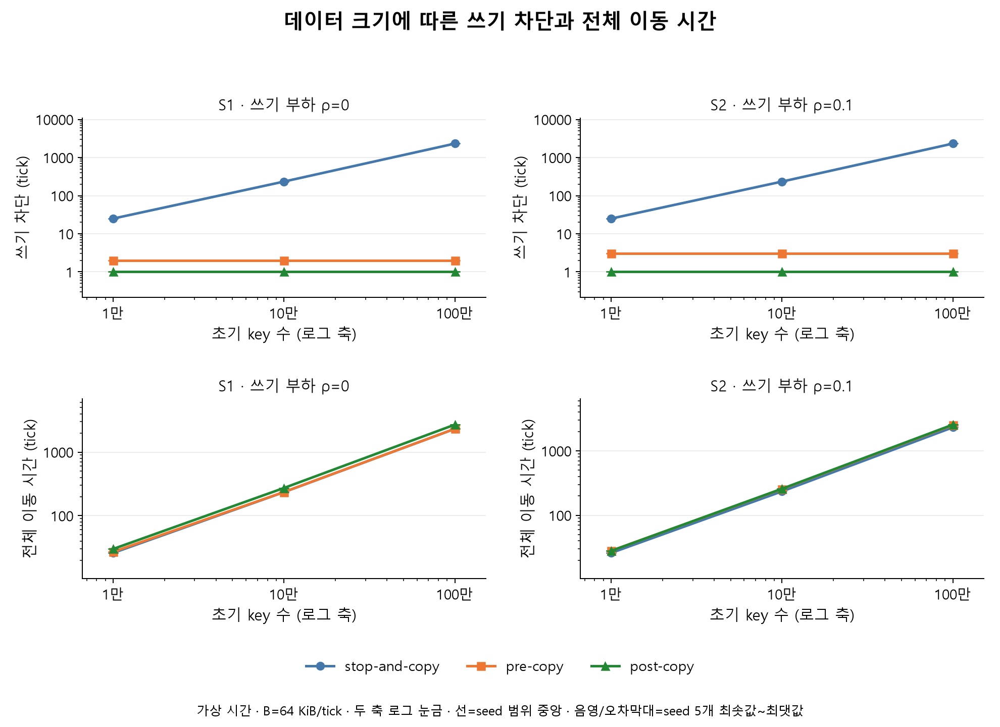
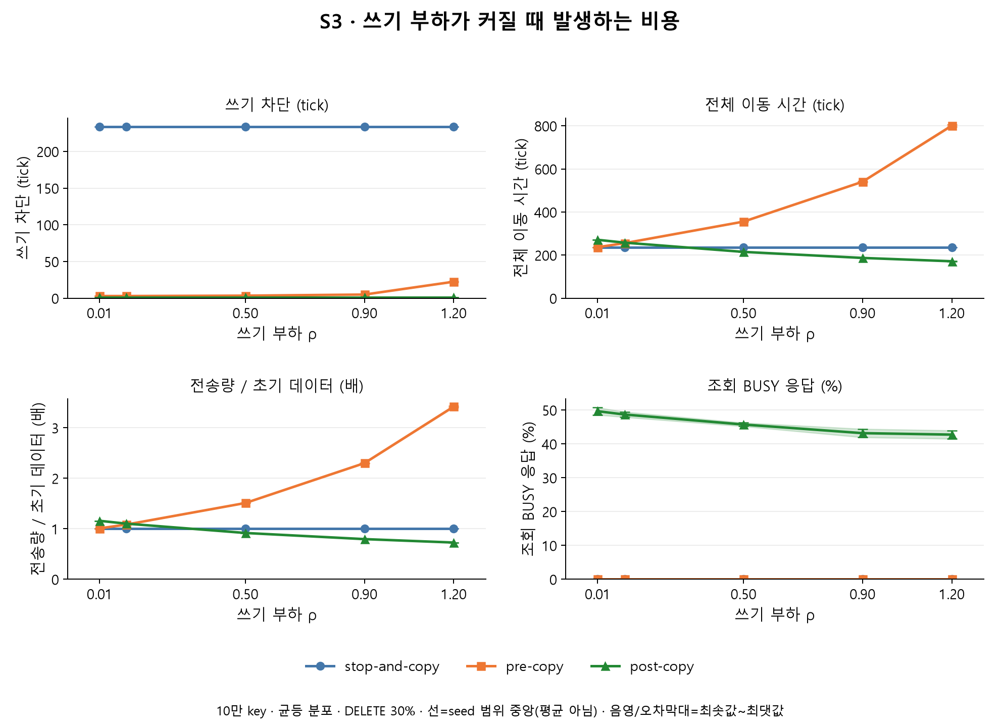
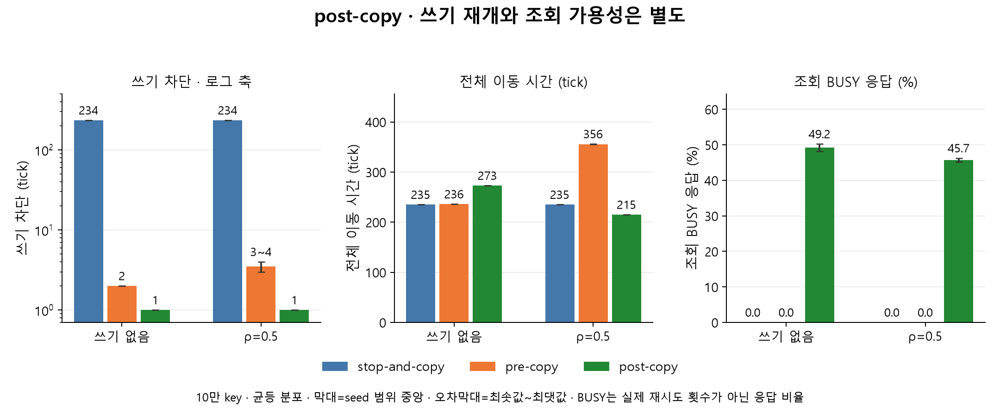
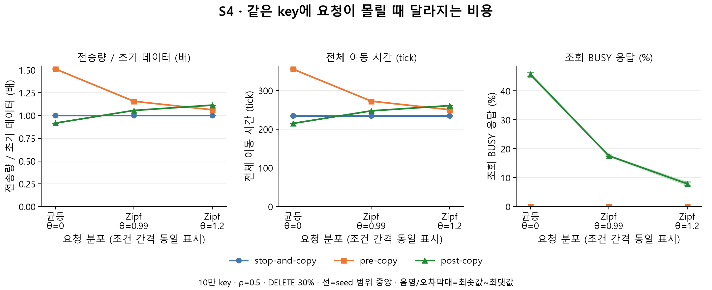
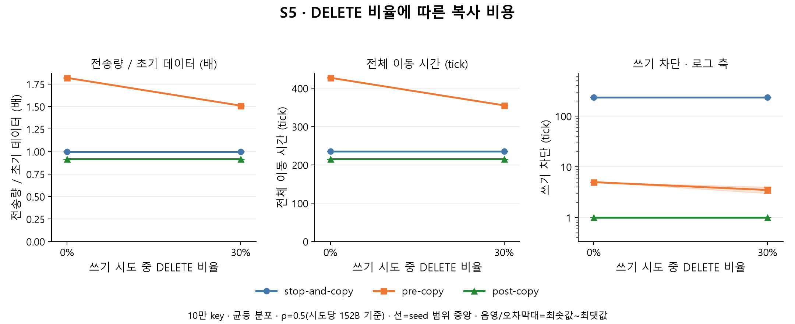

# 단일 Tablet 이동 비교 결과

2026-10-23. S1~S5 세 방식 비교의 참조 run을 아래 실행으로 선정한다.

| 범위 | 실행 | 형식 | 검증 |
|---|---|---|---|
| S1~S5 | [full 실행 보고서](runs/run-2026-10-23T06-14-41.093912600Z-30c42899/repeat-001/results.md) | b3-comparison-json-1, generator v2 | 16조건 × seed 5개 × 3방식 = 240회 완료, 정합성 위반 0, 최종 데이터 240/240 일치 |
| SC1~SC6 | [기존 Baseline](README.md) | b3-baseline-json-1 | 보관된 130회 결과. 이번 비교 수치와 혼합하지 않음 |
| S6·S3 민감도 | [계획·실행 범위](README.md) | 후속 | 취소·장애 프로토콜 테스트와 분리. 이번 비교에는 미포함 |

[조건별 CSV](runs/run-2026-10-23T06-14-41.093912600Z-30c42899/repeat-001/summary.csv) · [실행 설정](comparison.properties) · [재현 방법](README.md)

## 핵심 결과

모두 B=64 KiB/tick, key 16 bytes·value 128 bytes, 가상 시간 모델이다. 표의 범위는 seed 1~5의 최솟값~최댓값이다.

### 10만 key, 쓰기 없음

| 방식 | 쓰기 차단 tick | 전체 이동 tick | 전송량/초기 크기 | 조회 BUSY |
|---|---:|---:|---:|---:|
| stop-and-copy | 234 | 235 | 1.000445 | 0% |
| pre-copy | 2 | 236 | 1.000447 | 0% |
| post-copy | 1 | 273 | 1.164474 | 48.24~50.23% |

pre-copy는 이 조건에서 쓰기 차단을 약 99.1% 줄였다. post-copy는 더 빨리 쓰기를 재개하지만 미도착 조회가 BUSY를 반환하며, key별 응답 framing 때문에 전송량과 전체 시간이 늘었다.

### 10만 key, 균등 쓰기 rho=0.5, DELETE 30%

| 방식 | 쓰기 차단 tick | 전체 이동 tick | 전송량/초기 크기 | 조회 BUSY |
|---|---:|---:|---:|---:|
| stop-and-copy | 234 | 235 | 1.000445 | 0% |
| pre-copy | 3~4 | 355~356 | 1.509580~1.512649 | 0% |
| post-copy | 1 | 215 | 0.915928~0.917955 | 45.20~46.25% |

pre-copy는 쓰기를 유지하는 대가로 변경분을 반복 전송했다. rho=1.2에서는 전체 시간이 797~805 tick, 전송량이 3.406831~3.435388배까지 증가했다. 동일 rho=0.5에서 Zipf theta=1.2이면 전송량은 1.062144~1.063933배로 줄었다. 같은 key의 변경이 dirty generation에서 합쳐지는 효과다.

post-copy는 destination의 성공한 쓰기·삭제로 해결한 key를 source에서 다시 가져오지 않으므로 쓰기가 있을 때 전송량이 초기 크기보다 작을 수 있다. 세 방식의 tick별 **시도**는 같아도 성공 쓰기 수와 실행 종료 시점은 다르다. 따라서 이 수치를 같은 성공 쓰기 집합의 복사 성능이나 일반적인 우열로 해석하지 않는다.

조회 BUSY는 재시도가 필요한 응답 비율이며, 실제 client 재시도 횟수나 p99 latency가 아니다. 실제 네트워크, key manifest/CAS의 실제 지연, ACK/pull 요청 제어 bytes는 측정하지 않았다.

## 비교 결과 해석

아래 그래프는 위 참조 run의 [조건별 CSV](runs/run-2026-10-23T06-14-41.093912600Z-30c42899/repeat-001/summary.csv)에서 생성했다. 색과 표식은 모든 그림에서 같은 복사 방식을 뜻한다. 선·막대는 seed 범위의 중앙 (최솟값+최댓값)/2, 음영·오차막대는 seed 5개의 최솟값~최댓값이다. seed 평균·통계적 중앙값·신뢰구간을 표시한 것이 아니다. 로그 축을 쓴 패널은 축 제목과 설명에 표시했다.

### 쓰기가 없으면 pre-copy의 차단 감소 비용이 작다

**그림 1.** 위쪽은 쓰기 차단, 아래쪽은 cleanup까지 전체 이동 시간이다. 데이터 크기와 tick 축에 로그 눈금을 사용했다. 오른쪽 S2에서는 쓰기가 있어도 pre-copy 차단이 3 tick, post-copy 차단이 1 tick으로 유지되지만 전체 이동 시간은 데이터 크기에 따라 증가한다.

10만 key에서 stop-and-copy와 pre-copy의 전체 이동은 235/236 tick, 전송량은 모두 약 1.00045배다. 전체 이동 비용을 거의 늘리지 않고 쓰기 차단을 234에서 2 tick으로 줄였다. 100만 key에서도 pre-copy 차단은 2 tick이고 stop-and-copy는 2,322 tick이다. 데이터가 클수록 전체 복사 동안 쓰기를 멈추는 비용이 커지는 것을 확인했다.

### 쓰기 부하가 커지면 pre-copy는 전송 대역폭을 더 오래 사용한다

**그림 2.** 10만 key·균등 분포·DELETE 30%에서 네 지표를 같은 입력 조건으로 비교했다. stop-and-copy의 일정한 비용은 이동 중 쓰기를 거절한 결과다. post-copy의 전송량·전체 시간이 감소하는 이유는 아래 그림 3과 함께 해석해야 한다.

10만 key에서 rho=0.1/0.5/0.9/1.2의 전송량은 약 1.08/1.51/2.30/3.42배로 증가했다. rho=0.9에서는 live delta 라운드 9~10회 뒤 임계량에 도달했고, rho=1.2에서는 seed 5개 모두 라운드 상한 10회로 종료했다. 마지막 차단도 22~23 tick으로 증가했다. source 서비스를 유지할 수 있어도 복사가 저절로 짧게 끝나는 것은 아니며, 부하가 높을 때 라운드 상한·최종 freeze 정책이 필요하다. rho=1.2를 보편적인 수렴 임계값으로 확정한 결과는 아니다.

### post-copy의 1 tick은 쓰기 재개 시점이다

**그림 3.** 왼쪽 쓰기 차단 패널은 로그 축, 가운데 전체 이동 시간과 오른쪽 조회 BUSY 패널은 선형 축이다. 막대 위 숫자는 seed 범위 중앙의 반올림값이며, 원래 seed 범위는 앞의 표와 CSV를 따른다. 짧은 쓰기 차단이 조회까지 즉시 정상화됐다는 뜻은 아니다.

쓰기 없음 조건에서 post-copy는 전체 복사가 끝나는 데 273 tick이 걸리고 조회의 48.24~50.23%가 BUSY였다. 소유권을 먼저 넘겨 쓰기를 재개하는 효과와 모든 key를 즉시 읽을 수 있는지는 별도다. 이 모델은 BUSY 응답을 집계하며 실제 재시도·대기 지연을 측정하지 않는다.

쓰기 부하가 있을 때 post-copy의 전체 시간이 짧아지는 것은 destination에서 SET/DELETE를 받은 key의 baseline 복사를 생략할 수 있기 때문이다. stop-and-copy는 차단 중 같은 쓰기를 거절한다. 따라서 전체 이동 시간만으로 post-copy가 동일한 성공 작업량을 더 빠르게 처리했다고 주장할 수 없다.

### 요청 쏠림은 두 방식에 다른 이점과 비용을 만든다

**그림 4.** 가로축은 세 분포 조건을 같은 간격으로 배치했다. 숫자 theta의 연속 변화에 대한 측정이나 보간이 아니다. 같은 쓰기 부하에서 요청 쏠림이 두 프로토콜에 주는 효과를 구분해 보여준다.

rho=0.5에서 균등 분포를 Zipf theta=1.2로 바꾸면 pre-copy의 전송량은 약 1.51배에서 1.06배, 전체 시간은 355~356에서 250~251 tick으로 줄었다. 같은 key의 여러 변경이 합쳐져 distinct dirty key 수가 줄어드는 구현 구조와 일치한다.

post-copy의 조회 BUSY는 45.20~46.25%에서 7.26~8.52%로 줄었지만 전체 이동은 215에서 261 tick으로 늘었다. 자주 요청하는 key를 먼저 해결하는 것은 조회에 유리하다. 반면 쓰기가 일부 key에 반복되면 baseline 복사를 생략할 수 있는 서로 다른 key가 줄어 cold key 복사가 더 남는 것으로 해석할 수 있다. 조회 가용성과 전체 이동 시간을 함께 봐야 한다.

### DELETE와 부하 정의도 결과에 영향을 준다

**그림 5.** 쓰기 차단 패널만 로그 축이며 나머지는 선형 축이다. post-copy가 두 조건에서 같은 비용을 보이는 것은 이 모델에서 SET·DELETE 모두 해당 key의 baseline pull을 생략하게 만들고, client 통신 bytes는 migration 예산에 포함하지 않기 때문이다.

rho=0.5에서 DELETE 0%→30%이면 pre-copy 전송량은 약 1.82→1.51배, 전체 시간은 427~428→355~356 tick이었다. DELETE tombstone은 128-byte PUT value보다 작다. 이번 rho는 요청 시도마다 152 bytes로 환산한 부하이므로 같은 rho가 같은 실제 delta byte 유입을 뜻하지 않는다.

이번 전송량·예산은 migration 데이터에 대한 모델이다. 일반 client GET/SET/DELETE 통신량은 대역폭을 함께 소비하지 않는다. 실제 서버에서 세 방식의 우열을 정하려면 제어·client 통신과 재시도 비용, source 장애의 영향까지 추가 측정해야 한다.

## 재현과 입력 검증

- 그래프는 [plot_comparison.py](plot_comparison.py)로 재생성한다. 저장소 루트에서 python experiments/b3-live-migration/migration-comparison/plot_comparison.py를 실행한다. Python·Matplotlib·NumPy와 한글 폰트가 필요하며 Java 빌드·실험 재실행은 필요 없다. 입력 CSV와 이미지의 SHA-256은 [figures/sources.json](figures/sources.json)에 기록한다.
- 원본 240개는 해당 run의 repeat-001/results/*.json에 로컬 보관한다. CSV·보고서는 원본을 다시 읽어 생성하며 manifest에 산출물 hash를 기록한다.
- source hash: aa7c4176277da8f88abcfa877a0f99380eea3e979fddbd3919eb738cf3ebaa53
- backend class hash: d38b16c5b40244ae805e8cba3055add1549b8f757e5cd2a0c8a169260d08eb22
- 실행 기준 commit은 d1017bf이며 미커밋 프로토콜·비교 backend 변경을 포함한다. commit만으로 이 실행 코드를 식별하지 않고 위 source/class hash를 함께 사용한다.
- 같은 코드의 축소 반복 run-2026-10-23T06-14-27.199908300Z-b9dd3fc3는 240회 묶음을 두 번 실행해 480/480회 성공했다. 두 summary.csv의 SHA-256이 F7225E69E37AA4FDCCAEADF3E10EEF51DD666E23A8F6228AC3E0D43BE668DC8A로 일치한다.
- 전체 빌드·테스트 325개 통과. 비교 회귀 검증은 동일 요청 재생, finite Zipf 쏠림, 균등 쓰기 key 다양성, 기존 TickRunner와 Baseline 시간/bytes 일치, 불변 스냅샷, 원본 재생성·누락/변조 검출을 포함한다.
- generator v1의 tick seed 중복으로 요청 다양성이 부족했던 실행(run-2026-10-23T06-05-20.218593800Z-89259ab0)은 제외했다. 원본·진단용 요약은 로컬 보존하며 위 참조 run과 섞지 않는다. 그 이전 스냅샷 생성 병목으로 중단한 실행도 결과에서 제외했다.

S3 임계/라운드 민감도, S6 중단 비교, E/M scaling과 실제 KV/peer 실험은 남아 있다. 이번 v1 비교 원본의 phaseEvents는 단계/라운드 경계이며 계획된 v2 dirty 라운드 상세 원본을 대체하지 않는다.
