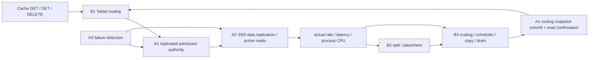

# OpenKache A1+A2+A3+B1+B2+B3 동시 통합

[전체 방법론 누락 감사](ec2/METHOD_AUDIT.md) · [현재 검증](ec2/AUDIT_VALIDATION.md)

## 실행 구조

기본 구성은 A1과 A2를 **동시에** 실행한다. 각 replica JVM이 A1 authority와 A2 data engine을 별도 포트·저장 디렉터리에서 실행한다. 기존 `protocol` 단일 선택은 과거 독립 엔진 대조군 전용이다. 새 구성은 `a1.method`와 `a2.method`를 각각 지정하며 둘을 `protocol`과 섞으면 거절한다.

A1은 요청 fingerprint를 자신의 기존 복제 엔진으로 commit하고 읽어 확인한다. 확인된 요청만 A2로 전송한다. A1에는 캐시 value를 중복 저장하지 않는다. A1의 장애 복구가 성공해야 새 요청 승인이 재개된다. A2는 실제 value·tombstone, 쓰기 순서·Fast ACK, 읽기·view recovery를 담당한다. A1과 A2는 서로의 leader/view를 임의로 덮어쓰지 않는다.

이는 A1의 기존 **데이터 복제** 실험과 같은 배치가 아니다. A1 알고리즘을 **제어/승인 복제**에 적용하고 A2를 데이터 계층으로 조립한 통합 캐시다. 이 구조의 추가 승인 RPC 비용을 측정에 포함한다. 두 엔진의 원 논문을 하나의 새 consensus로 재현했다는 주장은 하지 않는다.

## 모듈과 독립 선택 축

| 역할 | 후보 | 실제 연결 |
|---|---|---|
| A1 승인·소유권 기록의 복제/승계 | PB, PB_FENCED, RAFT, VR, CHAIN, CRAQ, ROSE | `JointBackend` → `A1Replica`의 기존 native 엔진 |
| A2 SSD 데이터 복제·읽기 | O00, V01~V07, V06 ADAPTIVE/ROUND_ROBIN | `JointBackend` → `IoniaProfile`의 기존 node/client |
| A3 두 계층 장애 감지 | 기존3대조군 + Lab F0~F7c 및 제품 프로필, 총17개 선택 | 원본 Lab 판단 기계 + 계층별 실제 UDP/TCP runtime, native quorum/view-change |
| B1 분배 | RANGE, SLOT, RING, RING_ALLOC, TAG, RESIZABLE, ORDER | 같은 key hash로 라우팅·dirty·manifest·수신 검증 |
| B2 | split 3개+NONE, placement 7개+NONE | 실제 요청 관찰 → split/placement → B3 공유 계획 |
| B3 | scaler 8개+fixed, scheduler 9개, STOP/PRE/POST, drain 2개, 고정 LPT 배치 대조군 | 실제 A2 source/destination RPC·target 읽기 확인·drain |

목록은 `IntegrationConfig --catalog`로 확인한다. A1×A2는 7×8=56개다. 실행기 기본 matrix는 두 축을 별도 열로 유지한다.

## 상태와 공개 순서

- 모든 foreground 요청과 B3의 내부 데이터 RPC는 A1 승인 후 A2로 간다. 승인 lock은 데이터 RPC 동안 잡지 않으므로 A2의 동시 처리·배치는 가능하다. A1 승인 실패는 데이터 미전송이므로 BUSY로 재시도할 수 있다. A2 기록 후의 불확정 BUSY는 TIMEOUT으로 유지한다.
- B1 초기 표와 split·resize·소유권 변경은 group 0의 A1 authority에 B1 전체 snapshot을 기록하고 확인한 뒤 local routing에 공개한다. 모든 메타데이터 변경자는 단일 gateway controller다. 이것은 다중 writer CAS 서비스가 아니다.
- B3 Stop/Pre는 대상 A2 적용·read barrier 후 A1 메타데이터 확인 → local publication 순서다. Post는 A1을 거친 선소유권 전환 후 pull/foreground를 처리한다.
- A1 메타데이터 공개가 모호하게 실패하면 `routingUncertain=true`, SAFE_HOLD 상태로 **전체 요청을 중단**한다. A1에 새 표가 기록됐을 가능성을 두고 이전 local 표로 계속 성공 응답하지 않는다.
- 시작 readiness는 양쪽 계층과 초기 A1 routing 기록을 모두 검사한다. status의 `components`는 A1/A2 이름, `authorityAdmissions`, `authorityDenied`, `dataCalls`, `routingPublications`를 보여 준다.
- 그룹당 세 JVM 안에 양쪽 엔진이 공존한다. CPU/RSS는 두 계층을 합친 실제 JVM 비용이다. A1/A2의 별도 진단 포트와 이벤트도 수집한다.

## 구현 한계와 실험 해석

- 단일 gateway/controller·dedup ledger·key catalog는 run-local이다. routing snapshot을 A1에 복제하지만 gateway 자동 재기동·재구성을 구현한 것은 아니다. A1 native 엔진의 메모리 로그·fsync=false KV 등 기존 보장 범위를 유지한다.
- group 0 A1은 전역 routing authority이므로 논리 data-group 축소 뒤에도 준비된 replica에서 계속 실행한다. 물리 서버를 끄는 autoscaler가 아니다. 이 control-plane 자원 비용을 포함한다.
- A1 PB는 제어 계층에서 SET/GET만 사용한다. 따라서 **A1 PB + A2의 DELETE**는 지원한다. 과거 PB 단독 엔진의 DELETE 제한을 이 조합에 적용하지 않는다. plain PB는 crash-only이며 pause/partition 대조군에는 PB_FENCED를 쓴다.
- Chain/CRAQ/Rosé의 master 복구는 실행기가 소유 프로세스의 영구 종료를 확인한 경우만 사용한다. arbitrary partition survivor 제외는 지원하지 않는다. Rosé의 lag/loss와 PB의 fencing 등 native 제한이 통합으로 강화되지는 않는다.
- B1 ring의 임의 placement/개별 split, SLOT/RESIZABLE의 개별 split은 거절한다. B2 독립 Merge 정책은 없다. RESIZABLE 자체 merge는 유지한다.
- P-Store에는 실제 관찰 history가 필요하다. calibration 부재 시 reference model임을 기록한다. 선택만 하고 판단이 실행되지 않은 정책은 coverage pass가 아니다.
- scheduler 예산은 logical protocol bytes이며 실제 RPC wire shaping은 아니다. 준비된 2~8개 그룹을 active 집합에 넣고 뺀다. EC2 생성·종료·요금 절감은 별도다.

[실행](ec2/README.md), [실험 설계](ec2/EXPERIMENT_PLAN.md), [전체 감사 후 검증](ec2/AUDIT_VALIDATION.md)을 따른다. 과거 `VALIDATION.md`의 단일 엔진 16회는 새 동시 구성의 증거로 재사용하지 않는다.
