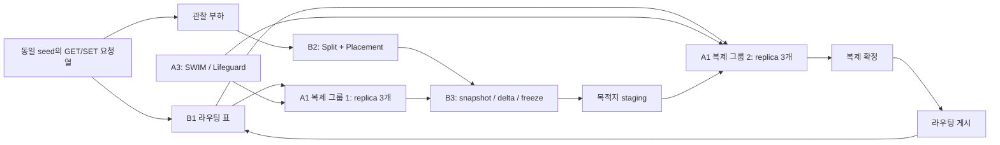

> 이 문서는 A2 병합 전 가상 fixture의 범위·기록이다. 최신 A2 포함 실제 TCP 통합 준비는 [EC2 실행 안내](ec2/README.md)를 따른다. 아래 과거 결과를 새 실제 서버 검증 결과로 사용하지 않는다.

# 통합 상태의 방법론 교체 실험

목적은 개별 연구의 순위를 합치는 것이 아니라, **한 요청 경로와 공통 자원을 공유하는 상태에서 조합을 비교**하는 것이다. 현재는 기존 알고리즘을 연결한 **통합 실험용 가상 클러스터**다. 실제 서버와 A2까지 모두 연결한 제품 시스템은 아직 아니다.

## 조립 구조



- B1의 owner는 복제 그룹의 논리 ID다. 데이터는 2개 그룹 × 3개 replica에 저장한다.
- A1은 실제 `CrashOnlyPrimaryBackupEngine` 또는 `RaftEngine`을 실행한다. A3의 실제 membership 이벤트를 A1에 전달한다. PB 내부 고정 timeout은 끄고, Raft는 외부 FD 모드와 기존 watchdog을 사용한다.
- A3의 감지 범위는 그룹 안의 3개 replica다. 전체 클러스터 membership 합의를 구현한 것은 아니다.
- B2는 관찰한 부하로 실제 `SplitPolicy`·`PlacementPolicy`를 호출한다. 동일한 공통 조건에서 1초에 한 번 판단한다. 한 실행에서 계획을 한 번 만들고, 계획의 이동들을 직렬로 완료한다.
- B3는 실제 stop-and-copy/pre-copy 프로토콜을 실행한다. 검증된 staging 값을 목적지 복제 엔진으로 SET·확정한 뒤 B1 표를 게시한다. 확정 전 staging은 client에 노출하지 않는다.
- 로컬 KV는 fixture의 메모리 map과 직렬 서비스 큐다. 지연은 가상 시간이며 CPU/SSD 실측값이 아니다. 복제·FD·이동은 같은 physical node의 송신 byte 예산을 사용한다.
- source의 이전 값은 실행이 끝날 때까지 보관하고 라우팅으로 접근을 막는다. source log/스냅샷 회수와 저장 공간 반환은 비교하지 않는다.

## 현재 교체 가능한 축

| 계층 | 연결한 방법 | 아직 연결하지 않은 범위 |
|---|---|---|
| A1 복제 | PB, Raft | VR, Chain/CRAQ, Rosé의 이 harness용 제어 어댑터 |
| A2 복제 대안 | 없음 | 이 체크아웃의 IONIA Engine/Client/Log 주요 동작이 미구현 |
| A3 감지 | core SWIM, core SWIM+Lifeguard | 독립 FD Lab의 Phi, ring, 제품 inspired detector 등 |
| B1 분배 | HashRange(노드당 4 tablet), FixedSlot(총 8 slot) | ring, tag, resizable, key-order 어댑터 |
| B2 분할 | NONE, Midpoint, Heat, EStore | 공통 지속 trigger, merge |
| B2 배치 | Greedy, Hysteresis, CostAware | 그 외 구현된 placement 어댑터 |
| B3 이동 | Stop-and-copy, Pre-copy | Post-copy의 요청별 pull 어댑터 |
| B3 증감·스케줄링 | 고정 2그룹, 직렬 실행 | 독립 node-count 판단, 병렬 scheduler, drain/remove |

A1과 A2는 같은 복제 계층을 위한 대안이다. 여섯 개의 독립 스위치로 곱하지 않는다. A2를 연결하기 전에는 A1↔A2의 통합 성능 결론을 낼 수 없다. PB는 crash-only 가정을 사용하므로 분단 안전성까지 Raft와 같다고 해석하지 않는다.

FixedSlot+split은 명시적으로 거부한다. 지원 조합은 `2 replication × 2 detector × (4 RANGE split + 1 SLOT split) × 3 placement × 2 copy = 120`개다. 기존 구현의 존재와 이 harness에 연결된 상태는 구분한다.

## 실행

JDK 21과 `rg`가 있는 저장소 루트에서:

```bash
# 120조합 × 4시나리오 × 3 seed = 1,440회 + 독립 seed 재검증
experiments/system-integration/run.sh \
  experiments/system-integration/pilot.properties \
  experiments/system-integration/results/my-pilot

# 30 seed 전체 비교 + 독립 30 seed의 선택 조합/단일 변경 이웃 검증
experiments/system-integration/run.sh \
  experiments/system-integration/full.properties \
  experiments/system-integration/results/my-full

# 처리 시간 가정만 4ms → 1ms로 바꾼 민감도
experiments/system-integration/run.sh \
  experiments/system-integration/fast-node.properties \
  experiments/system-integration/results/my-fast-node
```

`run.sh`는 core production 전체와 필요한 fixture를 임시 디렉터리에 `javac --release 21 -Xlint:all -Werror`로 컴파일한다. 외부 라이브러리·Gradle·네트워크가 필요 없고 종료하면 임시 class를 지운다. 알고리즘은 새로 모사하지 않고 저장소의 실제 클래스를 사용한다.

Gradle 환경에서는 다음 진입점도 사용할 수 있다. build/check에서 실험을 자동으로 실행하지 않는다.

```bash
./gradlew :cache-core:systemIntegration  # 지원 조합 목록
./gradlew :cache-core:systemIntegration \
  -Pintegration.args='experiments/system-integration/pilot.properties experiments/system-integration/results/my-gradle-pilot'
./gradlew :cache-core:test --tests '*IntegratedClusterTest'
```

출력 디렉터리는 새 경로여야 한다. 기존 증거는 덮어쓰지 않는다. `variants`를 config에 넣으면 지원 ID의 부분집합을 실행할 수 있으며 알 수 없는 ID/key, 중복 seed, 겹치는 탐색·검증 seed는 거부한다.

## 조건과 측정의 의미

- 96개 key를 미리 복제해 채우고, 6초간 3ms마다 요청 1개를 발행한다. warm-up은 측정에서 제외한다.
- 읽기 65%/쓰기 35%, 값 약 256B다. 모든 조합은 같은 seed에서 같은 요청열을 사용하며 `tape_hash`를 검증한다. detector 난수는 요청열 난수와 독립이다.
- uniform, 85% hotspot, hotspot+1.3초의 실제 리더 crash, hotspot+0.6~1.1초의 peer 지연 25ms 추가를 비교한다.
- 동일 key의 미완료 요청이 있으면 새 요청은 BUSY로 센다. source drain/freeze 중에는 해당 tablet의 GET/SET 모두를 잠시 거절하는 보수적인 adapter를 사용한다. 이는 원 프로토콜 자체의 필수 읽기 차단 조건이 아니다.
- 노드별 KV 처리 시간은 pilot/full에서 4ms, fast-node에서 1ms다. 실제 CPU 비용이 아닌 공통 용량 가정이다. 송신은 physical node별 1024 byte/ms, 기본 전파 지연 1ms다. client 전송과 migration ACK byte는 모형에서 제외한다.
- migration budget과 batch 검증은 실제 프로토콜을 사용한다. source snapshot 앞과 pre-copy 라운드 경계에서 수락된 요청을 배출해 일관된 final delta를 보장한다. 목적지 순차 SET 복제 비용도 freeze에 포함된다.
- `goodput_virtual_rps`는 6초 안에 성공한 요청/6이다. p99는 성공 요청의 가상 지연이다. 실패·종료 시 pending을 별도 공개하므로 성공 요청 p99만으로 판단하지 않는다.
- `recovery_virtual_ms`는 crash부터 **그룹 1의 첫 성공 SET**까지다. detector 순수 감지 시간, Raft 선출 시간과 동일하지 않으며 미관측은 빈 값이다.
- 마지막 OK 쓰기보다 오래된 값/없는 값을 유실·stale로 센다. TIMEOUT 이후 적용될 수 있는 더 최신 발행 값은 허용한다. 읽기 응답과 마지막 소유 그룹의 값은 검사하지만 전체 history의 선형화 가능성을 증명하지는 않는다.
- `safe`는 검사한 유실·stale·false DEAD가 0이고 계획한 이동이 완료됐다는 뜻이다. crash 후보 선정에는 쓰기 재개 관측도 필요하다. 모든 장애 모델에 대한 안전성 보장이 아니다.

## 최선 조합과 이유를 찾는 절차

1. 호환되는 전체 조합을 같은 seed·요청열·자원에서 실행한다. 프로세스 실행 순서는 seed별로 섞는다.
2. 안전성·이동 완료 조건을 통과한 조합 중 시나리오별 평균 goodput이 큰 후보를 선택한다. 동률 ID 선택은 순위 증거가 아니다.
3. 다른 옵션을 고정한 짝비교로 각 방법론 변경의 goodput·p99·이동 byte·freeze 차이를 구한다. seed별 차이의 Student-t 95% CI를 함께 남긴다.
4. 선택에 쓰지 않은 seed에서 선택 조합과 단일 옵션 변경 이웃을 다시 실행한다. 이웃이 더 좋아지면 선정이 불안정하다고 보고한다.
5. 노드 처리 시간 가정을 바꿔 결론이 유지되는지 본다. 한 가정·한 시나리오의 승자를 전체 시스템의 승자로 확정하지 않는다.

이 탐색은 다중 비교 보정을 하지 않은 연구 screening이다. 최종 결정에는 허용 p99·복구시간·유실 조건과 운영 자원 예산을 정하고, 그 조건을 통과한 조합의 Pareto 비교 및 실서버 재검증이 필요하다.

## 결과 파일

| 파일 | 내용 |
|---|---|
| `config.properties` / `manifest.json` | 실행 설정, Git/dirty, JDK, core source/config/diff SHA-256 |
| `screening.json` / `confirmation.json` | 실행별 지표와 membership/crash/freeze/publish 완료 이벤트 원본 |
| `summary.csv` / `confirmation.csv` | 실행별 전체 측정값 |
| `aggregate.csv` / `confirmation-aggregate.csv` | 반복 평균, seed 수, safe 수, CI |
| `conditional-effects.csv` / `confirmation-effects.csv` | 다른 축을 고정한 방법론 변경의 짝비교 |
| `results.md` / `COMPLETE` | 시나리오별 선정·검증 결과 / 전 과정 완료 표시 |

원본 JSON은 기존 experiments ignore 규칙을 따른다. CSV·Markdown·설정은 검토 가능한 요약이다. `python3 experiments/system-integration/verify_results.py <결과 디렉터리>`로 JSON/CSV·요청 집계·짝비교·source/config hash를 독립 대조할 수 있다. 현재 실행 결과와 해석은 [analysis.md](analysis.md)를 따른다.

## 여섯 모듈 전체 실서버 실험으로 이어갈 작업

1. A2 완성 구현의 위치/브랜치를 확인하고 동일한 복제 그룹 계약으로 연결한다. 현재 골격을 성공 구현으로 대체해 세지 않는다.
2. 이 harness에서 빠진 기존 A1/A3/B1/B2/B3 방법론별 adapter를 연결하고 각 지원/거부 조건을 시험한다. 특히 post-copy는 요청별 pull·source 실패 의미가 다르다.
3. B3의 증감 판단·스케줄러를 연결한다. 고정 노드 실험과 증감 실험을 분리해 배치 정책과 증감 판단의 기여가 섞이지 않게 한다.
4. 기존 PB 실서버와 B1 실서버의 분리된 진입점을 공통 composition root로 묶는다. ownership epoch와 복제 term은 다른 값으로 유지하고, routing 게시에 quorum/fencing·복제 그룹 bootstrap·source 회수를 포함한다.
5. 동일 배포본/장비/워크로드로 TCP+SSD 정상·과부하·이동 중 crash·지연 변동·분단을 측정한다. 가상 수치와 실제 수치는 같은 통계에 섞지 않는다.

현재 사용자 요청은 통합 실험이며, 과거 독립 B3 연구의 통합 제외 범위를 바꾸지 않고 새 실험 경로에 조립했다. 기존 알고리즘·독립 실행 경로·사용자의 미커밋 파일은 수정하지 않았다.
