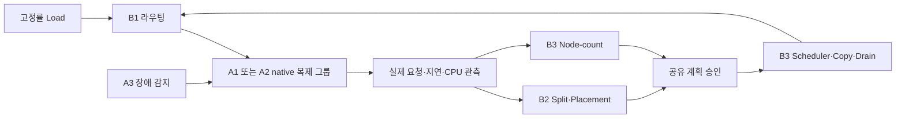

> 과거 A1 **또는** A2 엔진 실험용 문서. 현재 동시 통합 경로는 README.md를 따른다.

# A1~B3 공통 통합 실행체

A의 실제 TCP 복제 그룹과 B의 분배·부하 균형·증감·스케줄링·세 복사·drain을 같은 실행체에서 선택한다. 기존 연구용 엔진·정책을 사용하며, 새 consensus hybrid를 만들어 원래 방법으로 표시하지 않는다. **구현/기능 검증과 EC2 성능 실험은 별도다. EC2에 접속하거나 실험하지 않았다.** [실험 계획](EXPERIMENT_PLAN.md), [검증 기록](VALIDATION.md), [전체 범위/호환성](../FULL_SYSTEM_SCOPE.md)을 따른다.



## 선택 가능한 구현

| 축 | 설정/후보 |
|---|---|
| 복제 `--protocol` | A1: PB/PB_FENCED/RAFT/VR/CHAIN/CRAQ/ROSE. A2: O00/V01~V07. 합계15개 |
| A1 세부 | `--vr-mode FULL_LOG/INCREMENTAL/INCREMENTAL_CATCHUP`, `--rose-limit -1/0/1/...` (−1은 무제한 비동기). CRAQ는 clean/dirty 읽기 변형 |
| A3 `--fd` | FIXED_TIMEOUT/SWIM/SWIM_LIFEGUARD. VR도 외부 FD를 연결하며 내부 timer는10배 watchdog |
| B1 `--distribution` | RANGE/SLOT/RING/RING_ALLOC/TAG/RESIZABLE/ORDER. Ring RANDOM/BALANCED를 구분 |
| B2 `--split` | NONE/MIDPOINT/HEAT/ESTORE |
| B2 `--placement` | NONE/GREEDY/HYSTERESIS/COST/ESTORE/P2C/SLICER/RENDEZVOUS |
| B3 `--scaler` | fixed/scads/elastman/estore/accordion/pstore/tiramola/pax/aws-warmup |
| B3 `--scheduler` | fifo/mongodb/tidb-token/tidb-feedback/iter-gwin/single-mcs/slamig/vmbuddies/fpta |
| B3 `--copy` | STOP/PRE/POST |
| B3 `--drain` | preflight-all/incremental-drain |

`IntegrationConfig --catalog`가 Java runtime의 목록을 출력한다. Python `plan --help`의 선택 목록과 함께 사용한다. A1/A2 구현은 쓰기 확정·로그·leader/view 전환을 소유하는 **동일 복제 슬롯의 대안**이다. A1 이름과 A2 이름을 동시에 설정해서 두 consensus가 합성되었다고 보고하지 않는다. A3/B1/B2/B3는 어느 엔진을 선택하든 같은 실행 경로에 연결된다.

## 실제 동작과 호환성

- **반복 제어:** `AUTO`는 측정 시작 후 `--control-ms` 간격으로 실제 요청·지연을 관찰하고 B3 수 판단→B2 split/placement→공유 계획 승인→scheduler/copy→drain/remove→다음 관찰을 반복한다. 이동 중에는 새 계획을 겹쳐 게시하지 않지만 부하 이력을 계속 관찰한다. cooldown을 적용한다. load는 측정 종료 후 자동 제어를 정지시키고 진행 중 작업을 수집한다.
- **증감:** 준비된 복제 그룹2~8개, 그룹당 native replica3개. 기본3그룹 중2개가 처음 서비스에 참여하고1개는 예비다. target count가 여러 단계 바뀌면 기존 B1 규칙을 한 그룹씩 적용한다. 신규 quorum readiness를 확인하고, 제거 대상의 Tablet/작업/metadata가 모두0일 때만 active 집합에서 뺀다. `SCALE_CYCLE`은 부하 중 그룹 수를 늘렸다 줄이는 기능 시나리오다.
- **준비된 그룹:** replica JVM은 전부 기동한 예비 그룹이다. 증감은 **서비스 그룹의 참여/제거**다. EC2 인스턴스 생성·중지·종료 또는 사용료 절감이 아니다. idle 예비 JVM의 자원도 수집한다. 실제 프로비저닝 지연이 필요한 실험은 외부 allocator adapter가 필요하다.
- **B1/B2:** TAG/ORDER의 key 변환을 dirty 추적·receiver·Post manifest 검증까지 전달한다. Ring은 membership 변경에 따른 이동만 허용한다. SLOT/RING/RESIZABLE에는 개별 split을 조합하지 않는다. RESIZABLE의 전체 double/half는 기존 B1 규칙대로 실행한다. B2의 별도 Merge 정책은 원래 미구현이므로 새로운 방법인 것처럼 추가하지 않았다.
- **스케줄러:** 기존9개 알고리즘과 `MigrationScheduler`가 실제 작업 시작·동시 상한·endpoint/cluster 예산을 제어한다. controller는 하나이고 native RPC를 동기 호출하므로 snapshot/bootstrap I/O가 tick을 늘릴 수 있다. 지원 batch는 최대60 Tablet이다. `protocolModelBytes`/tick 예산은 protocol 데이터 모델이며 실제 TCP wire byte나 물리 링크 rate limiter가 아니다. 추가 GET/SET/검증/cleanup 비용은 실제 요청·자원에 포함된다.
- **Stop/Pre:** source freeze·요청 배출, snapshot/delta/tombstone·checksum/epoch 확인, 목적지 native SET 뒤 인증 GET barrier를 마친 뒤에만 B1 표를 게시한다. A2 Fast ACK를 KV 적용 완료로 간주하지 않는다.
- **Post:** manifest와 source fence를 확보한 뒤 먼저 소유권을 게시한다. 미도착 GET은 BUSY/priority pull, SET/DELETE는 목적지 native 복제와 Post 상태에 반영한다. pull이 도착할 때도 목적지 SET/인증 GET을 수행한다. 지연 pull이 최신 쓰기·tombstone을 덮지 못한다. 완료된 값과 tombstone을 실제 목적지에서 확인한 뒤 cleanup한다. source 장애 후에는 소유권을 되돌리지 않고 실패 상태·source 의존성을 보존한다. 원천이 복구되고 불확정 쓰기가 없는 경우 peer opcode105(RESUME, body u64 job id)로 재개할 수 있다.
- **cleanup:** DELETE를 지원하는 엔진은 이전 source의 해당 범위를 복제 DELETE한다. append 파일/log의 과거 bytes는 run 끝까지 남는다. PB는 SET-only이므로 source copy를 보존하며 재방문 시 이전 key가 incoming manifest에 모두 존재할 때만 덮어쓴다. 없는 key를 제거해야 하면 HELD다. PB에 DELETE를 다른 명령으로 몰래 대체하지 않는다.
- **불확정 결과:** timeout/IO 또는 A2 쓰기 BUSY 등이 모호하면 range 이동을 HELD로 보류한다. bootstrap 실패는 목적지를 quarantine한다. 게시 후 실패한 Post source와 guard는 보존한다. SAFE_HOLD·미해결 작업을 성공으로 집계하지 않는다. dedup ledger는 run-local이고 축출한 오래된 ID는 재실행하지 않는다.
- **A1 crash master:** Chain/CRAQ/Rosé는 정확한 영구 crash를 아는 master가 필요하다. 실행 도구가 **자신이 시작한 JVM**을 SIGKILL하고 종료를 확인한 뒤 opcode104로 통보한다. gateway는 선택된 A3의 DEAD 증거(또는 fixed 대기)를 확인한 뒤 기존 FREEZE→REPAIR→prefix/apply/ACK barrier→OPEN을 수행한다. backup을 먼저, head/primary를 마지막에 연다. FD만으로 영구 crash를 가정하지 않는다. 각 그룹1회 crash를 지원한다. partition이나 임의 live-node 제외용 fencing이 아니다. PB_FENCED는 기존 lease/quorum 구현을 사용한다.

## 빌드와 로컬 기능 실행

```bash
./gradlew build :cache-server:integrationZip --offline --console=plain
unzip cache-server/build/distributions/openkache-integration.zip -d /absolute/new-bundle
B=/absolute/new-bundle

# 3×3 replica + gateway + load = 독립 JVM11개, 실제 TCP/UDP와 파일 KV
python3 "$B/tools/integration.py" plan --output /absolute/new-plan \
  --groups 3 --initial-groups 2 --protocol O00 --fd SWIM_LIFEGUARD \
  --distribution TAG --key-mode TAGGED --split HEAT --placement GREEDY \
  --copy POST --scheduler tidb-feedback --drain incremental-drain \
  --scenario SCALE_CYCLE --keys 64 --requests 500 --rate 50
python3 "$B/tools/integration.py" local --bundle "$B" --plan /absolute/new-plan --output /absolute/new-result
python3 "$B/tools/integration.py" verify --result /absolute/new-result/runtime/load-result

# 실제 CPU에 따른 반복 제어. --scaler가 모든 node-count 방법의 선택 지점이다.
python3 "$B/tools/integration.py" plan --output /absolute/new-auto-plan \
  --protocol O00 --scenario AUTO --scaler estore --control-ms 1000 \
  --split HEAT --placement HYSTERESIS --scheduler vmbuddies --copy PRE \
  --keys 1000 --requests 12000 --rate 100
```

파일 KV는 모든 엔진에서 같은 append-file adapter이며 `fsync=false`, OS page cache를 사용할 수 있다. A2 ACK는 replica RAM quorum이다. SSD fsync 완료나 원 논문의 storage 성능 재현을 주장하지 않는다. 로컬 실행은 한 물리 호스트를 공유하므로 EC2 성능 순위가 아니다.

## 학습·계측 입력

`--key-mode DEFAULT/TAGGED/ORDERED`: 기존 key/실제 hash tag/앞8바이트 순서 공간을 덮는 key다. 비교 cohort는 같은 key mode를 사용한다. source·routing·oracle·요청 tape가 같은 실제 key를 사용한다.

Node-count의 reads/writes·completed·p99는 실제 관찰 창에서 얻는다. CPU는 replica의 실제 process CPU 누계를 차분하고 CPU 수로 정규화한 그룹 평균이다. 첫 표본·누락은0으로 대체하지 않는다. CPU 정책은 표본이 준비될 때까지 OBSERVING이다.

성능 경계를 요구하는 정책에는 `--calibration /path/file.csv`를 넣을 수 있다. 열은 `nodes,reads,writes,p99_seconds,completed_per_second`; 같은 native protocol·값 크기·host 조건에서 수집한 calibration을 사용하고 입력 hash를 보존한다. SLO 양쪽 표본이 필요하며 TIRAMOLA에는 모든 후보 node count의 reward 표본이 필요하다. 파일이 없으면 기존 연구의 **reference queue calibration**을 사용하고 `modelOrigin`에 명시한다. 이것을 실측 calibration으로 설명하지 않는다.

`--history /path/rates.txt`는 한 줄당 과거 관찰 rate다. P-Store는 `2×period+5+horizon`보다 많은 과거 관찰이 필요하다. 없으면 TRAINING을 유지하고, `coverageValid=false`로 **선택된 scaler가 실행되지 않았음**을 표시한다. 가짜 과거 부하를 채우지 않는다. `--override scaling.period=...`, `scaling.forecast.horizon=...` 등 명시 설정으로 trace의 주기를 맞춘다.

## EC2 실행

기존 전용 Linux/JDK21/Python3 호스트의 private 주소를 `topology.example.json`에 넣는다. 예제는9 replica+gateway+load의11호스트다. controller에서도 endpoint에 접근할 수 있어야 한다. native TCP27101, A1 peer TCP27102, FD UDP(A2 27102/A1 27103), replica HTTP27105, gateway TCP27300, SSH를 전용 실험망에서 연결한다.

```bash
python3 "$B/tools/integration.py" plan --topology /absolute/topology.json --output /absolute/new-ec2-plan \
  --protocol V07 --scenario AUTO --scaler elastman --calibration /absolute/calibration.csv \
  --placement COST --split HEAT --copy POST --scheduler slamig --drain preflight-all \
  --keys 1000 --requests 12000 --warmup 2000 --rate 200 --value-bytes 1024
# 기본은 dry-run: SSH/AWS 호출 없음
python3 "$B/tools/integration.py" ec2 --bundle "$B" --plan /absolute/new-ec2-plan --output /absolute/new-ec2-result
# 실제 실행을 명시한 경우에만 기존 호스트로 업로드·기동·수집·소유 JVM 종료
python3 "$B/tools/integration.py" ec2 --execute --bundle "$B" --plan /absolute/new-ec2-plan \
  --output /absolute/new-ec2-result --identity /absolute/key.pem --known-hosts /absolute/known_hosts --timeout 1800
```

각 역할은 새 run 경로, JAR/tool/input hash, JDK21/Linux, 정확한 PID·시작 ticks·main/config 경로를 확인한다. 자신의 JVM만 중단하고 원격 원본을 자동 삭제하지 않는다. FD 모드는 startup grace 이후 모든 replica의 실제 UDP probe를 확인하고 부하를 시작한다. auxiliary calibration/history도 같은 hash로 업로드한다. SSH/SCP와 실제 EC2 환경은 첫 원격 pilot에서 검증해야 한다.

`CRASH_MOVE`/`CRASH_SCALE`는 실제 진행 중 작업을 확인한 뒤 source 그룹의 관찰된 leader를 종료한다. Post는 게시 후 PULLING 상태도 source 의존 구간으로 인정한다. `--fault-index 0/1/2`로 Chain head/middle/tail 등을 명시할 수 있다. `PAUSE_LEADER/PAUSE_OBSERVER`는 실제 probe 이후1초 SIGSTOP/SIGCONT다. plain PB의 pause는 거절한다. network-only/SSD-only stall injector는 없다.

## 전체 조합과 판정

```bash
python3 "$B/tools/integration.py" matrix --stage smoke --output smoke.csv
python3 "$B/tools/integration.py" matrix --stage coverage --output coverage.csv
python3 "$B/tools/integration.py" matrix --stage exhaustive --count-only
# 큰 전수 목록이 정말 필요할 때 CSV만 생성한다. 실행은 시작하지 않는다.
python3 "$B/tools/integration.py" matrix --stage exhaustive --output all.csv --allow-large
```

coverage는 **모든 호환 전략 쌍**을 덮는 기능 입력이며 전수 Cartesian 실측이 아니다. exhaustive 기본값은 전략 조합2,493,180개 ×2 workload×3 seed =14,959,080행이다. 유효한 어떤 조합도 `plan`으로 직접 생성할 수 있다. CSV는 `plan` 옵션에 전달할 실행 목록이며 전체 CSV 자동 기동 명령은 없다.

`correctnessValid / migrationValid / coverageValid / uncertainKeys / gatewayUncertainKeys`와 실패·미발행·repair 결과를 함께 본다. COMPLETE는 수집 표시다. 성공/MISS p99와 발행 terminal p99를 구분하며 예정 시각→완료는 load JVM 한 clock에서 계산한다. `/proc` CPU/RSS/I/O·GC·FD·routing/migration/scheduler/drain 이벤트와 raw CSV를 보존한다. 서로 다른 JVM nanoTime을 차감하지 않는다. A1 peer byte와 A2 stream byte의 계측 범위가 다르므로 총 network 비용 비교에는 동일 OS 계측이 필요하다.

중앙 gateway metadata/ledger의 HA·재시작, native replica 프로세스 재가입·전원 손실 내구성은 별도 범위다. 원래 엔진의 보장도 구분한다. Rosé L>0의 허용 손실을 strong-quorum 엔진과 같은 보장으로 보고하지 않는다. API 연결·검증 결과가 모든 조합의 안전성/성능 우승을 증명하지 않는다.
