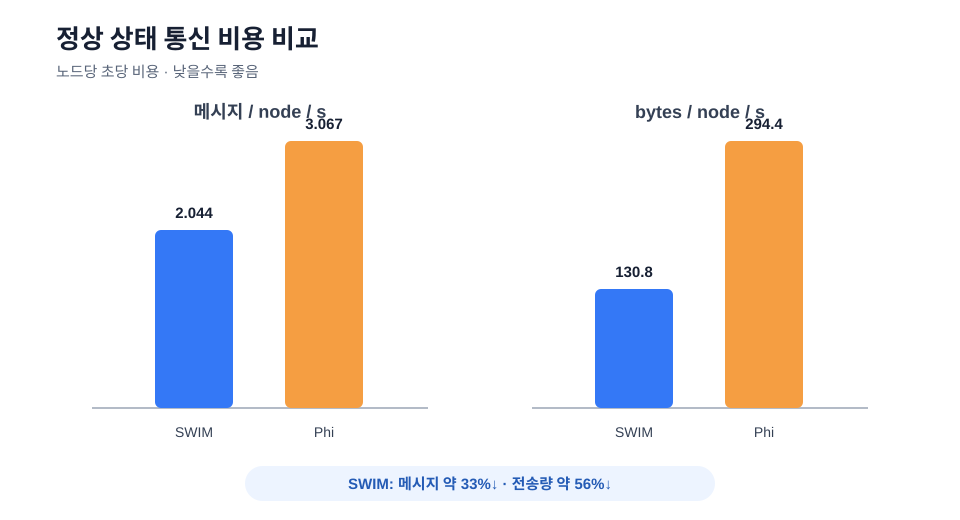
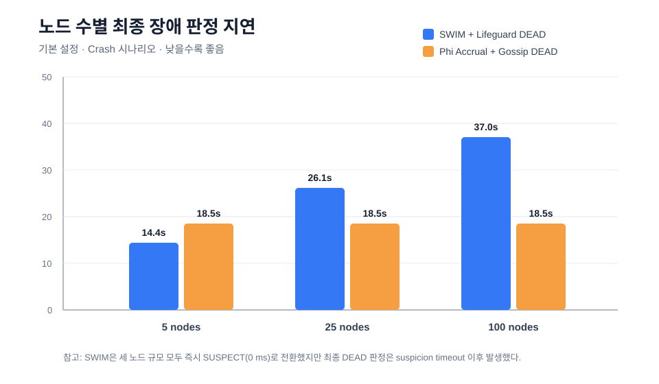
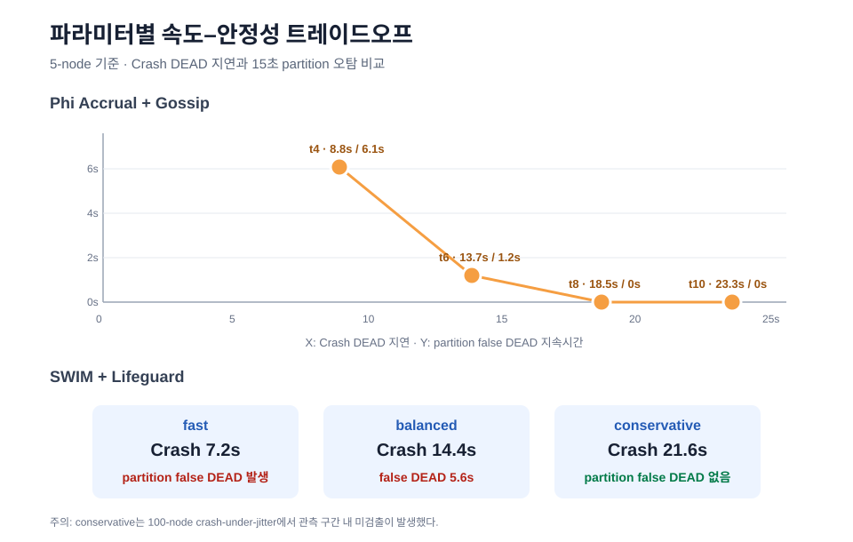

# OpenKache Failure Detector 비교 실험 보고서

> **결론 요약:** 이번 시뮬레이션에서는 SWIM + Lifeguard가 통신 비용과 빠른 SUSPECT 전환에서 우세했고, Phi Accrual + Gossip은 노드 수가 커져도 일정한 최종 DEAD 판정 지연과 일시적 네트워크 장애 안정성에서 강점을 보였다. 현재 결과만으로 단일 승자를 확정하지 않고, 두 후보의 유력 파라미터를 실제 UDP 환경에서 재검증하는 것이 타당하다.

- 작성일: 2026-10-26
- 총 실행 수: **11,160 runs**
- 비교 구현체: **2종**
- 실험 범위: **12개 시나리오 × 5/25/100 nodes**

## 1. 실험 개요

### 1.1 목적

OpenKache에 적용할 Failure Detector를 경험이나 인상으로 선택하지 않고, 동일한 조건에서 **SWIM + Lifeguard**와 **Phi Accrual + Gossip**을 반복 비교해 정량적으로 선정하기 위한 실험이다.

평가의 핵심 질문은 다음과 같다.

- 실제 장애를 얼마나 빨리 감지하는가?
- 정상 노드나 일시적으로 느린 노드를 장애로 잘못 판정하는가?
- 노드 수가 증가해도 통신 비용과 감지 품질이 유지되는가?
- 빠른 감지와 오탐 억제 사이의 파라미터 트레이드오프는 무엇인가?

### 1.2 구현 범위

- Java 17 기반 독립 프로젝트 `failure-detector-lab` 안에 모든 코드를 격리했다.
- SWIM + Lifeguard는 direct/indirect probe, suspicion timeout, local health 보정을 구현했다.
- Phi Accrual + Gossip은 heartbeat 도착 간격 통계, phi threshold, gossip 기반 전파 및 통신 비용 모델을 구현했다.
- Failure Detector의 관측 결과와 실제 failover 정책을 분리해 SUSPECT와 DEAD를 별도 지표로 측정했다.

### 1.3 실험 규모

| 구분 | 상세 실험 | 파라미터 스윕 |
|---|---:|---:|
| 목적 | 기본 설정의 시나리오별 동작 비교 | 속도–오탐 트레이드오프 탐색 |
| 시나리오 | 12종 | 12종 |
| 노드 수 | 5 / 25 / 100 | 5 / 25 / 100 |
| 반복 수 | 조건당 50회 | 조건당 30회 |
| 프로필 | SWIM 1종 + Phi 1종 | SWIM 3종 + Phi 4종 |
| 실행 수 | 3,600 | 7,560 |
| **합계** | **11,160 runs** | 테스트 및 self-test 통과 |

## 2. 실험 내용

### 2.1 시나리오

| 범주 | 시나리오 | 검증 목적 |
|---|---|---|
| 정상 기준선 | normal | 오탐과 정상 상태 통신 비용 측정 |
| 실제 장애 | crash, crash-under-jitter | 감지 지연과 미검출 여부 측정 |
| 패킷 손실 | packet-loss, packet-loss-burst | 일시적 손실에서 SUSPECT/DEAD 오탐 구분 |
| 지연 변화 | latency, latency-gradual, latency-bursty, latency-regime | 지연 분포가 계속 변할 때 적응성 확인 |
| 프로세스 정지 | observer-pause, target-pause | 감지자 CPU stall과 대상 노드 stall 분리 |
| 네트워크 단절 | partition | 15초 일시 단절을 영구 장애로 오판하는지 확인 |

### 2.2 측정 지표

- **False SUSPECT events / duration:** 일시적인 의심이 얼마나 자주, 오래 발생했는지
- **False DEAD events / duration:** 실제 failover로 이어질 수 있는 치명적 오탐
- **SUSPECT latency / DEAD latency:** 최초 의심과 최종 장애 판정까지 걸린 시간
- **False negative:** 관측 구간 내 실제 장애를 판정하지 못한 횟수
- **Protocol messages / bytes:** 노드당 초당 메시지 수와 바이트 수
- **Scale sensitivity:** 5, 25, 100 노드에서 지표가 어떻게 변하는지

### 2.3 통제 조건

각 실험에서는 노드 수, 실행 시간, 장애 시작 시점, 손실률, 지연 분포, pause 시간과 반복 횟수를 동일하게 고정했다. 정확도는 동일한 observer–target 관측 쌍에서 측정하고, 통신 비용은 전체 클러스터 모델로 환산했다.

## 3. 실험 결과

### 3.1 한눈에 보는 결과

| 평가 축 | SWIM + Lifeguard | Phi Accrual + Gossip | 우세 |
|---|---|---|---|
| 정상 상태 통신량 | 2.044 msg/s, 130.844 B/s | 3.067 msg/s, 294.400 B/s | **SWIM** |
| 최초 장애 의심 | Crash에서 0 ms SUSPECT | 최종 threshold까지 통계 축적 | **SWIM** |
| 최종 DEAD 지연 | 노드 수에 따라 14.4–37.0s | 세 규모 모두 18.5s | 규모에 따라 다름 |
| 동적 지연 false DEAD | 0 | 0 | 동률 |
| 15초 partition 안정성 | 5-node balanced에서 false DEAD | t8에서 false DEAD 없음 | **Phi t8** |

### 3.2 정상 상태 통신 비용



SWIM은 정상 상태에서 Phi보다 **메시지 수가 약 33% 적고**, **전송 바이트가 약 56% 적었다**. 이번 구현의 gossip fanout과 heartbeat payload 조건에서는 SWIM의 통신 효율이 명확했다.

### 3.3 실제 Crash 감지



| 노드 수 | SWIM SUSPECT | SWIM DEAD | Phi DEAD |
|---:|---:|---:|---:|
| 5 | 0 ms | 14.4s | 18.5s |
| 25 | 0 ms | 26.1s | 18.5s |
| 100 | 0 ms | 37.0s | 18.5s |

SWIM은 장애를 즉시 SUSPECT로 표시했지만, 최종 DEAD 판정은 클러스터 크기에 따라 늘어나는 suspicion timeout의 영향을 받았다. 반대로 Phi t8은 이번 모델에서 노드 수와 무관하게 18.5초를 유지했다.

### 3.4 일시적 장애와 오탐

| 조건 | SWIM + Lifeguard | Phi t8 + Gossip | 해석 |
|---|---|---|---|
| 지연 gradual / bursty / regime | false DEAD 0 | false DEAD 0 | 두 방식 모두 동적 지연을 견딤 |
| 45% burst packet loss | run당 평균 3.92회 임시 SUSPECT, false DEAD 0 | 상태 전이 없음, false DEAD 0 | SUSPECT와 DEAD를 분리해 봐야 함 |
| 15초 partition, 5 nodes | balanced: false DEAD 1회, 5.6초 | t8: false DEAD 0 | 기본값에서는 Phi가 보수적 |
| 15초 partition, 25 / 100 nodes | false DEAD 0 | false DEAD 0 | SWIM suspicion timeout 증가 효과 |

임시 SUSPECT가 곧 실패한 Detector를 의미하지는 않는다. failover가 DEAD에서만 실행된다면, SWIM의 burst loss SUSPECT는 조기 경고로 사용할 수 있다. 반대로 SUSPECT만으로 즉시 승격한다면 오탐 위험이 커진다.

### 3.5 파라미터 스윕



| 구현 / 프로필 | 5-node Crash DEAD | 15초 partition false DEAD | 비고 |
|---|---:|---:|---|
| Phi t4 | 8.8s | 6.1s | 빠르지만 공격적 |
| Phi t6 | 13.7s | 1.2s | 중간 절충안 |
| Phi t8 | 18.5s | 0s | 안정성 중심 후보 |
| Phi t10 | 23.3s | 0s | t8보다 느리며 추가 안정성 이득 없음 |
| SWIM fast | 7.2s | 발생 | 빠르지만 partition 취약 |
| SWIM balanced | 14.4s | 5.6s | 기본 절충안 |
| SWIM conservative | 21.6s | 0s | 100-node crash-under-jitter에서 관측 구간 내 미검출 |

### 3.6 잠정 판단

현 단계에서는 최종 한 개를 바로 채택하지 않는다. 다음 실제 네트워크 실험 후보를 **SWIM fast/balanced + 다수 관측 기반 failover gate**와 **Phi t6/t8 + gossip 비용 최적화**로 압축한다.

- 통신량과 즉각적인 장애 의심이 가장 중요하면 SWIM + Lifeguard가 유리하다.
- 일시적 네트워크 단절의 false DEAD 억제와 일정한 최종 판정 시간이 중요하면 Phi t8이 유리하다.
- OpenKache의 자동 failover에는 단일 detector 결과를 바로 사용하지 않고 Detector와 승격 정책을 분리하는 편이 안전하다.
- SSD 기반 캐시 특성상 heartbeat가 살아 있어도 GET/SET 또는 disk I/O가 멈출 수 있으므로 service/disk health 신호가 추가로 필요하다.

## 4. 회고

### 4.1 잘된 점

- 코드를 `failure-detector-lab`에 격리해 develop 병합 시 충돌 가능성을 낮췄다.
- SUSPECT와 DEAD를 분리해 잠깐 의심한 것과 실제 failover 오탐을 구별했다.
- 기본값 비교와 파라미터 스윕을 함께 수행해 속도–안정성의 Pareto 후보를 확인했다.
- 5, 25, 100 노드를 비교해 SWIM suspicion timeout의 규모 의존성을 발견했다.
- 그래프와 aggregate 결과를 자동 생성하도록 확장해 재현성을 확보했다.

### 4.2 새롭게 확인한 점

- 동적 지연 시나리오에서 두 구현 모두 false DEAD가 0이므로 SWIM도 지연 변화를 충분히 커버했다.
- Phi의 차별점은 단순 지연 변화 대응이 아니라 연속적인 의심 점수와 노드 수에 덜 민감한 판정 시간에 있었다.
- Detector 선택만큼 SUSPECT를 라우팅 우회에 사용할지, DEAD만 failover에 사용할지에 대한 정책 분리가 중요했다.

### 4.3 한계

- discrete-time 시뮬레이션이며 실제 UDP, 커널 스케줄링, GC pause를 직접 재현하지 않았다.
- 정확도는 대표 observer–target 쌍을 중심으로 측정했고, 통신 비용은 전체 클러스터 모델로 환산했다.
- gossip fanout, piggyback payload, packet size를 단순화했다.
- partition 노드를 ground truth상 살아 있다고 정의했으므로 false DEAD는 fail-stop 관점의 평가다.
- SSD stall, Data Service hang, 실제 GET/SET 복구 시간과 데이터 정합성은 아직 측정하지 않았다.

### 4.4 다음 실험

- [ ] 동일 파라미터로 실제 UDP 기반 5 / 25 / 100 노드 실험
- [ ] Linux tc/netem으로 delay, jitter, loss, duplication, partition 주입
- [ ] CPU saturation, stop-the-world GC, process freeze를 실제 프로세스에 주입
- [ ] SWIM fast/balanced에 다수 관측·epoch 기반 failover gate 결합
- [ ] Phi t6/t8의 heartbeat 주기와 gossip fanout을 조정해 통신량 재측정
- [ ] SSD I/O stall과 GET/SET health probe 추가
- [ ] Detection latency 외 실제 요청 복구 시간, 오류율, 데이터 손실 여부 측정

### 4.5 재현 방법

```bash
./gradlew -p failure-detector-lab test selfTest
./gradlew -p failure-detector-lab detailedExperiment
./gradlew -p failure-detector-lab parameterSweep
```

생성 결과는 `failure-detector-lab/results-detailed`와 `failure-detector-lab/results-sweep` 아래의 aggregate CSV 및 SVG 차트에서 확인할 수 있다.
